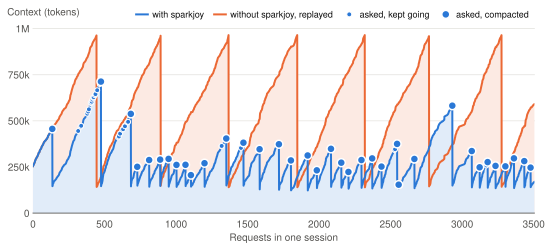
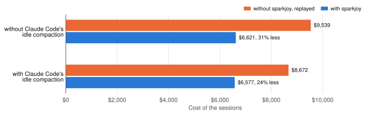
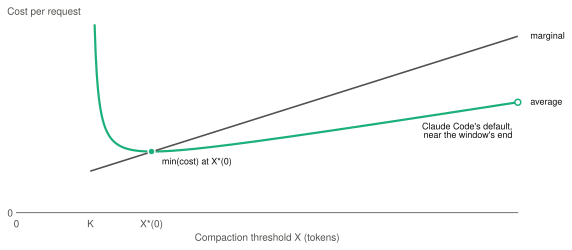
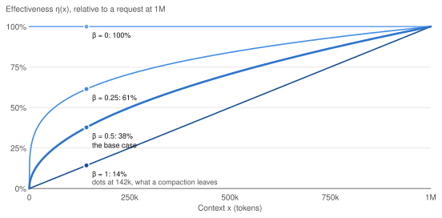

<h1>
  <picture>
    <source media="(prefers-color-scheme: dark)" srcset="assets/logo-dark.svg">
    
  </picture>
</h1>

[![maintained with tend](https://img.shields.io/badge/maintained_with-tend-bba580?logo=)](https://github.com/max-sixty/tend)

> To truly cherish the things that are important to you, you must first discard
> those that have outlived their purpose.
>
> — Marie Kondo, _The Life-Changing Magic of Tidying Up_

A small Claude Code plugin that lets Claude decide when to compact. It [cuts the
total cost of long sessions by 20% to 35%](#cost-saving), depending on your usage patterns and configs.

It does this by sending the cached context and [a small prompt](#how-it-decides) at the end of each turn asking whether to compact, and compacting if the model chooses to compact. Because almost all the context is cached,
it's [very cheap](#faq).

Then, on your return, the session is compacted and ready for the next prompt.

In comparison, Claude Code requires waiting for the compaction after running
`/compact` yourself; and `/autocompact` compacts at a set size, whether or not
the existing context is valuable:

|                | When it compacts                                                    |
| -------------- | ------------------------------------------------------------------- |
| `/compact`     | you type it                                                         |
| Claude Code    | at ~965k                                                            |
| Claude Code    | when idle, just before the one-hour cache expires, from 200k[^idle] |
| `/autocompact` | at a set size, even mid-turn                                        |
| **sparkjoy**   | at a turn end, on the model's decision (min 250k)                   |
| **sparkjoy**   | just before the cache expires, on the model's decision (min 175k)   |

A comparison of context lengths of a real session, with sparkjoy vs. modeled without:

<picture>
  <source media="(prefers-color-scheme: dark)" srcset="assets/session-dark.svg">
  
</picture>

Every request reads the whole context, so the area under each line is the number of tokens read during the session. Each dot marks a time the plugin asked the session's
model whether to compact. The larger dots mark the times the session compacted.

## Install

At the prompt of Claude Code:

```
/plugin install sparkjoy --marketplace max-sixty/sparkjoy
```

Or in a terminal:

```
claude plugin install sparkjoy --marketplace max-sixty/sparkjoy
```

To see its verdicts before it compacts anything, run
`/sparkjoy classify`, then `/sparkjoy on` to let it compact
([Settings](#settings)).

## What it does

- **It asks the session's model whether to compact now**, and compacts if
  the model says to. It asks when a turn ends, and in an idle session just
  before the prompt cache expires: after 55 minutes on the one-hour cache, or 4
  minutes on the 5 minute one. The compaction then finishes before you return.
- **It prints each verdict** in the transcript, as a dim line with its reason.
  In the session above, it kept the context while a move was half done:

  ```
  sparkjoy: Kept at 362k tokens: The README move is half done: unpushed files, a helper still running, and a page rebuild that hasn't been run yet
  ```

  Once the move was on main, it compacted the session:

  ```
  sparkjoy: Compacting at 404k tokens: Move is finished and pushed; file paths, commands and conventions fit in a summary, and files can be re-read
  ```

- **`/sparkjoy report`** opens a page on your sessions of the last 14 days,
  with every verdict and what the compactions saved. It fits the [cost
  model](#cost-model) to those sessions, and sparkjoy uses the fit from then on.
  It reads your transcripts on your machine and sends nothing. It needs
  [uv](https://docs.astral.sh/uv/).

<details>
<summary>Sample report</summary>

<picture>
  <source media="(prefers-color-scheme: dark)" srcset="assets/report-dark.png">
  
</picture>

</details>

- **`/sparkjoy bug`** drafts a bug report from the session's transcript, with
  sparkjoy's settings and what you say went wrong, and files it here once you
  agree. When one of sparkjoy's lines reports a bug, such as a question that
  failed, the next line suggests running `/sparkjoy bug`.

## Surprising facts about compactions

The [cost model](#cost-model) has a lot of detail about compactions. In doing this work, some points that surprised me:

- Compacting while the cache is warm is cheap. Even at Claude Code's default of 965k, a cache-warm compaction costs \$1.12.
- Missing the cache is expensive. After the cache lapses, the same compaction
  costs \$8.38.
- The compaction's produced summary is small, about 5k tokens, so the compaction
  request's output contributes only \$0.10 of the \$1.12.
- Most of a compaction's cost, \$0.82, is the cache write of the subsequent request after compaction, mostly files, skills, instructions and
  memory read again.
- Because the cache write contributes most of the cost, other forms of context reduction, such as dropping old tool results in
  place of compacting, aren't necessarily cheaper. (Once about 130k tokens
  follow the first result dropped, the cache write costs as much as a
  compaction.)
- Getting compacting right is really important for costs, particularly for long
  sessions, and using the full context is arguably very worthwhile to get that
  right: in my sessions the \$47 cost of the requests compares to a \$2,905 overall saving.
- This shape of costs is particularly prominent since the recent changes in Opus & Fable cache-read costs; where Fable 5.2 and Opus 5.5 cut their cache-read costs by 80% & 60% respectively.

## Cost saving

What my sessions of
18 to 22 November cost[^sessions], with sparkjoy and in a replay without it:

<!-- Generated from docs/cost-model.md's Results by docs/embed.py; edit that file. -->

<picture>
  <source media="(prefers-color-scheme: dark)" srcset="assets/savings-dark.svg">
  
</picture>

The replay prices the same requests without sparkjoy's compactions or its
questions, so Claude Code compacts on its own near 965k, and where its idle
compaction runs[^idle], also an idle context from 200k. If a request gets less
done with a smaller context, sparkjoy saves less per unit of work than it saves
in cost, as modeled below in [Cost and context](docs/cost-model.md#cost-and-context).

Resampling my sessions puts the saving between 22% and 32%, whether or not
Claude Code's idle compaction runs.

<!-- End of what sparkjoy saves. -->

`/sparkjoy report` replays your own sessions the same way. In mine, the context
each request carried, as sparkjoy ran and in a replay without it:

<picture>
  <source media="(prefers-color-scheme: dark)" srcset="assets/context-dark.svg">
  
</picture>

## How it decides

sparkjoy asks the session's own model whether now is a good time to compact, at
each turn end from 250k and again just before an idle session's prompt cache
lapses. It asks at the end of a turn because that's the most likely point where the prior details in the context are likely to no longer be needed.

To ask, it forks the conversation for one
request. The fork reads the whole conversation, which is already in the prompt
cache. The model answers in about a hundred tokens, a verdict and a one-line
reason. The fork goes from Claude Code to the session's own model, so the
conversation goes only where the session already sends it.

The question asks whether the next turns are likely to need the details which a summary would drop (such
as failed attempts or a design still taking shape), and lists the cost of
compacting and the cost of keeping the context at its current size.

### The prompt

<details>
<summary>At the end of a turn, for a 500k context, with default params</summary>

<!-- Generated from question() in hooks/register.ts, at a turn end, by docs/embed.py; edit that function. -->

````
Decide whether to compact this session now. This request comes from the sparkjoy plugin, not from the user, and a program reads your answer.

Your turn just ended.

Nearly every long transcript is mostly finished work, so that alone is no reason to compact. Base the decision on whether the next turns will need detail a summary drops: exact output, what was tried and failed, what the user objected to and why, the state of a design or fix still taking shape. Work that iterates with the user on something just shown, or takes up a half-done fix or design, needs that detail; after a compaction it re-reads and re-runs what it can and loses the rest. Work that only reports a result, or starts something new, needs no more than a summary.

What a compaction costs:
- It takes about a minute, and the request that writes its summary outputs about 6k tokens, thinking included.
- Afterwards the context holds about 142k tokens, counting the files the next requests read again. Those requests make a cache write of all of it but the 30k of system prompt and tools, which stay cached.
- A cache write costs as much as 40 cached reads, and an output token as much as 100.
- At 500k a compaction pays for itself after about 13 more requests that need nothing it dropped.

What keeping costs, more the larger the context:
- Every later request reads all 500k tokens, against about 142k after a compaction.
- Keeping only puts the compaction off to a later turn end.
- A turn runs a median of 9 requests and a mean of 38, so keeping 500k through one more turn costs as much as about 0.7 compactions for a median turn and 3 for a mean one.

What lost detail costs:
- It's very noisy and hard to judge, but as some indication, past sessions had about 6 more wasted requests than usual after a compaction: failed tool calls, repeated lookups and corrections.
- That count misses detail lost without such a failure, such as a design's rejected options or what the user likes.

Weigh what keeping costs against what losing the detail would cost the next turns. The larger the context, the more detail a compaction can drop and still pay.

The user added these instructions for this decision:
$CUSTOM_INSTRUCTIONS

Answer with nothing but one JSON object that matches this schema, filling its fields in the order listed:

```json
{
  "type": "object",
  "properties": {
    "next": {"type": "string", "description": "what most likely comes next, in a few words"},
    "needs_detail": {"type": "boolean", "description": "whether the next turns will need detail a summary drops"},
    "compact": {"type": "boolean", "description": "whether to compact now"},
    "reason": {"type": "string", "description": "one short line saying why"}
  },
  "required": ["next", "needs_detail", "compact", "reason"],
  "additionalProperties": false
}
```
````

<!-- End of the generated question. -->

</details>

<details>
<summary>In a session idle for 55 minutes, for a 500k context</summary>

<!-- Generated from question() in hooks/register.ts, in an idle session, by docs/embed.py; edit that function. -->

````
Decide whether to compact this session now, before its prompt cache lapses. This request comes from the sparkjoy plugin, not from the user, and a program reads your answer.

Your turn ended 55 minutes ago, and nothing has happened since.

Nearly every long transcript is mostly finished work, so that alone is no reason to compact. Base the decision on whether the next turns will need detail a summary drops: exact output, what was tried and failed, what the user objected to and why, the state of a design or fix still taking shape. Work that iterates with the user on something just shown, or takes up a half-done fix or design, needs that detail; after a compaction it re-reads and re-runs what it can and loses the rest. Work that only reports a result, or starts something new, needs no more than a summary.

What a compaction costs:
- It takes about a minute, and the request that writes its summary outputs about 6k tokens, thinking included.
- Afterwards the context holds about 142k tokens, counting the files the next requests read again. Those requests make a cache write of all of it but the 30k of system prompt and tools, which stay cached.
- A cache write costs as much as 40 cached reads, and an output token as much as 100.

What keeping costs now:
- The prompt cache holding the conversation lapses within a few minutes.
- The first request after that makes a cache write of all but 30k of its 500k tokens, against about 112k after a compaction.

So compact unless the next turn continues work that needs the transcript's detail.

What lost detail costs:
- It's very noisy and hard to judge, but as some indication, past sessions had about 6 more wasted requests than usual after a compaction: failed tool calls, repeated lookups and corrections.
- That count misses detail lost without such a failure, such as a design's rejected options or what the user likes.

Weigh what keeping costs against what losing the detail would cost the next turns. The larger the context, the more detail a compaction can drop and still pay.

The user added these instructions for this decision:
$CUSTOM_INSTRUCTIONS

Answer with nothing but one JSON object that matches this schema, filling its fields in the order listed:

```json
{
  "type": "object",
  "properties": {
    "next": {"type": "string", "description": "what most likely comes next, in a few words"},
    "needs_detail": {"type": "boolean", "description": "whether the next turns will need detail a summary drops"},
    "compact": {"type": "boolean", "description": "whether to compact now"},
    "reason": {"type": "string", "description": "one short line saying why"}
  },
  "required": ["next", "needs_detail", "compact", "reason"],
  "additionalProperties": false
}
```
````

<!-- End of the generated question. -->

</details>

Parameters are fitted to your own sessions by running `/sparkjoy report`.

<!-- The Evals block waits until the mid-task verdicts' swing between batches is explained. Remove this line and the closing one to restore it.
### Evals

<details>
<summary>The question's verdicts at 16 turn ends from my sessions</summary>

Each turn end's label is chosen from what the session did next, and each run
asks the question above, on 19 and 20 November 2026[^evals]:

| turn ends                                                                                  | context   | label   | runs that matched it |
| ------------------------------------------------------------------------------------------ | --------- | ------- | -------------------- |
| five that finished a piece of work                                                         | 479k–742k | compact | 10 of 10             |
| one idle for 55 minutes after everything landed                                            | 290k      | compact | 2 of 2               |
| four in the middle of a task                                                               | 519k–681k | keep    | 80 of 160            |
| two that stop to ask before going on, where the next turn needed detail the ask leaves out | 490k–599k | keep    | 16 of 16             |
| two that stop to ask, where the ask holds all the next turn needed                         | 403k–479k | compact | 8 of 16              |
| two natural breaks, but small                                                              | 210k–296k | keep    | 0 of 4               |

At the two small natural breaks the [cost model](#cost-model) also says to
compact. At the mid-task turn ends, the same question and transcripts kept the
context in 6 of 16 runs on the evening of 19 November, in none of 16 on the
morning of 20 November, and in 23 of 32, 24 of 32 and 27 of 64 in three batches
that afternoon, so two versions of the question compare only when run in the
same batch. Some labels are uncertain, since each records what the session did
next rather than what it needed ([Where this leaves
them](evals/README.md#where-this-leaves-them)).

The hook reads only `compact` and `reason`, yet the question asks for `next` and
`needs_detail` first, because without them the model almost never keeps the
context. At the mid-task turn ends, in the batches that ran both, versions of
the question with the two fields kept it in 16 of 64 runs, and versions that ask
only for `compact` and `reason` in 3 of 96 (p = 0.03, an exact test within
batches). In one of those batches neither kept. Among the versions without them,
one asks first for a `reason` that says what most likely comes next and whether
it needs detail a summary drops, and another tells the model to consider those
two things before it answers. The two fields cost about 20 output tokens a
question.

</details>

[^evals]:
    The [evals](evals/README.md) put the question to the model at turn
    ends from my sessions.
-->

## Settings

```
/sparkjoy on         ask, and compact when the model says to (the default)
/sparkjoy classify   ask and show each verdict, but compact nothing
/sparkjoy off        ask nothing
/sparkjoy            show the mode, and the floors it asks from
```

| setting        | default                     | what it sets                                                         |
| -------------- | --------------------------- | -------------------------------------------------------------------- |
| `mode`         | `on`                        | `on`, `classify` or `off`, as the commands above set it              |
| `floor`        | the report's fit, else 250k | the context, in tokens, from which sparkjoy asks at a turn end       |
| `idle_floor`   | the report's fit, else 175k | the context from which it asks in an idle session                    |
| `instructions` | none                        | your own guidance, added to its question ([The prompt](#the-prompt)) |

`/config` lists them under sparkjoy. In `~/.claude/settings.json`, they look
like this:

```json
{
  "pluginConfigs": {
    "sparkjoy@sparkjoy": {
      "options": {
        "mode": "classify",
        "floor": 300000,
        "idle_floor": 200000,
        "instructions": "Keep the context while a pull request awaits review."
      }
    }
  }
}
```

## Limits

- It acts only in sessions with a 1M-token context window, the size its defaults
  are fitted to, and only in interactive ones, not in `-p` runs or SDK hosts.
- Its default floors, 250k at a turn end and 175k in an idle session, are
  fitted to my sessions ([Floors](docs/cost-model.md#floors)). My sessions hold
  about 139k after a compaction, much of it my own instructions and skills, and
  sessions that hold less would do better with lower floors. `/sparkjoy report`
  fits the floors to your own sessions, and you can set them yourself
  ([Settings](#settings)).
- The report fits every figure the question states except the count of wasted
  requests after a compaction, which takes months of sessions to measure.
- It leaves Claude Code's own compaction on, so Claude Code still compacts when
  a turn fills the window. Where Claude Code's idle compaction runs[^idle], it
  also compacts an idle context of 200k or more itself, before sparkjoy would
  ask.
- I run sparkjoy without `/autocompact`. If you set it, keep it above sparkjoy's
  turn-end floor: at or below the floor, Claude Code compacts mid-turn before
  the context reaches the floor at any turn end, so sparkjoy never asks at a
  turn end.

## FAQ

<details>
<summary>Isn't it expensive to ask with the whole context at every turn end?</summary>

Because the context is cached, it's really cheap to send another request with
the existing context and a short prompt added on. On Opus 5.5, reading a full
context window of 1M tokens from the cache costs \$0.20, or \$0.05 at
sparkjoy's 250k floor. In my sessions of 18 to 22 November, the questions came
to less than 1% of what the sessions cost.

When a question reads less than nine tenths of its input from the cache,
sparkjoy prints a line saying so, and when the turn before it had just written
to the cache, the line reports a bug. `/sparkjoy report` counts the questions
that missed the cache.

</details>

<details>
<summary>What if I didn't want the compaction?</summary>

Press Esc twice, pick the last prompt before the compaction, and choose Restore
conversation. This rewinds one turn too far, dropping Claude's reply to that
prompt, because Claude Code has no rewind point at the compaction itself. Follow
[anthropics/claude-code#112303](https://github.com/anthropics/claude-code/issues/112303),
which asks for one.

To have the model keep the context in cases like yours, describe them in
sparkjoy's [`instructions`](#settings).

</details>

<details>
<summary>How does sparkjoy differ from other compaction plugins?</summary>

Two other plugins also compact before the window fills, and never in the middle
of a turn:

- [Compactly](https://github.com/swapnildahiphale/compactly) asks Sonnet, at
  each prompt you send from 150k, whether the work has reached a natural break,
  and if so compacts before sending the prompt. After a turn that commits,
  pushes or opens a pull request, it also compacts if no prompt comes within 55
  minutes.
- [claude-smart-compact](https://github.com/mdseyam-as/claude-smart-compact)
  compacts at every turn end from 180k unless you send a message first. Haiku
  says whether the task is done, and its answer sets how long the plugin waits,
  60 seconds or up to 8 minutes. From 350k it compacts as soon as the turn ends.

Both decide from under 8,000 characters of the transcript, and neither gives its
model the cost of keeping or compacting. sparkjoy asks the session's own model,
which reads the whole transcript, and gives it both costs at the context's
current size.

</details>

<details>
<summary>How do I keep sparkjoy up to date?</summary>

Claude Code leaves auto-update off for plugins installed from GitHub. Ask
Claude to turn it on for sparkjoy, or open `/plugin`, select sparkjoy in the
Marketplaces tab, and turn it on there. Until then, sparkjoy checks GitHub once
a day, and when a newer version has been out for a day or more, says so in the
transcript with the command that updates it. It doesn't check where Claude
Code's updates or nonessential traffic are turned off.

</details>

# Cost model

sparkjoy's default floors come from a model of the cost of keeping a context
and the cost of compacting it, fitted to my sessions.

<!-- Generated from docs/cost-model.md by docs/embed.py; edit that file. -->
<details>
<summary>The cost model</summary>

To understand what makes a good compaction policy, we can model how a policy
affects what a session costs and how much context its requests have. The model
finds when a session should compact, and what sparkjoy saves against Claude
Code's default.

## The models

As with any model, there's a trade-off between simplicity and completeness. A
simple model gives a formula that shows which parameters matter, and a fuller
one follows real sessions more closely. There are a few models, each in a
section below, and each adds something the one before it leaves out:

- **[Cost alone](docs/cost-model.md#cost-alone).** It assumes a request gets as much done at any
  context, so only tokens count, and that the context grows by the same number
  of tokens with each request. The most efficient threshold, where a request
  costs least on average, then has a closed form.
- **[Cost and context](docs/cost-model.md#cost-and-context).** It assumes a request gets more done
  with a larger context, in proportion to a power β of the context's size, with
  one β for all work. The most efficient threshold is then the one where the
  cost per unit of work done is lowest.
- **[Idle sessions](docs/cost-model.md#idle-sessions).** It adds sessions that go idle. An idle
  session is worth compacting just before its prompt cache lapses, at a smaller
  context than a session in use.
- **[Mid-turn or at a turn end](docs/cost-model.md#mid-turn-or-at-a-turn-end).** It assumes a
  compaction also wastes D requests on the detail it drops, more in the middle
  of a turn than at its end. Asking only at turn ends avoids the larger D, but
  during a long turn the context can grow past the most efficient threshold.
- **[A classifier](docs/cost-model.md#a-classifier).** It assumes β and D vary with the work
  ahead. A classifier that tells work with a high β or D from work with a low
  one, as sparkjoy's question aims to, lets the session compact each kind of
  work where it costs least.
- **[A replay of my sessions](docs/cost-model.md#a-replay-of-my-sessions).** It keeps every logged
  request and moves only the compactions, so it includes what the other models
  leave out: uneven growth, long turns, cache lapses and sessions that end.

## Results for my sessions

What my sessions of 18 to 22 November cost on Opus 5.5[^sessions], with sparkjoy
and in a replay without it:

<!-- What sparkjoy saves -->

<picture>
  <source media="(prefers-color-scheme: dark)" srcset="assets/savings-dark.svg">
  
</picture>

The replay prices the same requests without sparkjoy's compactions or its
questions, so Claude Code compacts on its own near 965k, and where its idle
compaction runs[^idle], also an idle context from 200k. If a request gets less
done with a smaller context, sparkjoy saves less per unit of work than it saves
in cost, as modeled below in [Cost and context](docs/cost-model.md#cost-and-context).

Resampling my sessions puts the saving between 22% and 32%, whether or not
Claude Code's idle compaction runs.

<!-- End of what sparkjoy saves. -->

That range joins two 90% intervals: 29–32% without Claude Code's idle
compaction and 22–26% with it. A single session's saving varies more: of the
quarter of sessions that cost the most, eight in ten saved 22% to 43%, or 17%
to 39% where Claude Code's idle compaction runs.

<!-- TODO: Work through the cost model to give sparkjoy's saving per unit of work beside its saving in cost.
If a request at 250k gets half as much done as one at 1M (β = 0.5), sparkjoy as it ran saves 11.3% per unit
of work without Claude Code's idle compaction and 6.5% with it, against 30.6% and 24.2% in cost; model/docs.py
doesn't compute these yet. -->

## Costs

The models before the replay price a session as cycles, each a run of requests
and the compaction that ends it. This section gives what a request and a
compaction cost, in symbols and then in my sessions' figures.

<details>
<summary>The model's symbols</summary>

**Variables**

| symbol | what it is                                                                                  |
| ------ | ------------------------------------------------------------------------------------------- |
| x      | Context of a request, in tokens. Over each cycle between compactions, it grows from K to X. |
| X      | Context at which the session compacts, in tokens.                                           |

**Functions of the variables**

| symbol | what it is                                                                                                                                                                                                              |
| ------ | ----------------------------------------------------------------------------------------------------------------------------------------------------------------------------------------------------------------------- |
| c(x)   | Cost of a request with context x, in cached reads: $`c(x) = h\,x + c_0`$.                                                                                                                                               |
| F(X)   | Cost of a compaction at context X, in cached reads: $`F(X) = F_0 + X`$, since the compaction request reads the whole context.                                                                                           |
| η(x)   | Effectiveness of a request with context x, how much it gets done, relative to a request with the full 1M window: $`\eta(x) = (x / 1\text{M})^\beta`$.                                                                   |
| J(X)   | Cost per unit of effectiveness when the session compacts at X, in cached reads, a cost-effectiveness ratio. It is the cost of a cycle's requests and its compaction, divided by the sum of its requests' effectiveness. |

**Parameters**

| symbol | what it is                                                                                                                                                                                                         |
| ------ | ------------------------------------------------------------------------------------------------------------------------------------------------------------------------------------------------------------------ |
| K      | Context after a compaction, in tokens. It is the first request's context (the system prompt and tools, instructions, the summary, and recent messages and files), plus the files the next few requests read again. |
| g      | Growth of the context per request, in tokens, from tool results, files read and the model's own output.                                                                                                            |
| P      | Size of the system prompt and tools, in tokens. Claude Code keeps this part of K in a cache shared across sessions, so it stays cached through a compaction.                                                       |
| ℓ      | Share of requests that find the cache lapsed, and so make a cache write of the whole context. The cache lapses when it expires or is invalidated.                                                                  |
| N      | Output of the compaction request, in tokens: the summary's text plus its thinking.                                                                                                                                 |
| w      | Price of one token's cache write, in cached reads.                                                                                                                                                                 |
| o      | Price of one output token, in cached reads.                                                                                                                                                                        |
| β      | Growth of a request's effectiveness with its context: each doubling of the context makes a request $`2^\beta`$ times as effective.                                                                                 |
| D      | Requests a compaction wastes on the detail it dropped, such as failed tool calls, repeated lookups and corrections. Each costs as much as a request at K, so the compaction costs $`F(X) + D\,c(K)`$ in all.       |
| h      | Cost per request of one token in the context, in cached reads. It is one read, plus the chance that the cache has lapsed times the extra cost of the token's cache write: $`h = 1 + \ell\,(w - 1)`$.               |
| c₀     | Fixed cost of a request, the part that doesn't grow with its context, in cached reads. It is the request's output, its uncached input, and the cache write of its g new tokens.                                    |
| F₀     | Fixed cost of a compaction, in cached reads. It is the compaction request's output, plus the extra cost of the cache write of the K − P tokens outside the shared cache: $`F_0 = oN + (w - 1)(K - P)`$.            |

**Result**

| symbol | what it is                                                                                                                                                                                   |
| ------ | -------------------------------------------------------------------------------------------------------------------------------------------------------------------------------------------- |
| X\*(β) | Most efficient threshold, the value of X that makes J lowest at a given β, in tokens. X\*(0) is the most efficient threshold when only cost counts. Where the β is clear, it is written X\*. |

</details>

The models take each cycle to start at K, right after a compaction, and to grow
by g tokens with each request until the session compacts at X. A request with
context x costs

$`\displaystyle c(x) = h\,x + c_0, \qquad h = 1 + \ell\,(w - 1)`$

Each token in the context costs one cached read. In the share ℓ of requests
that find the cache lapsed, the token is a cache write instead, at w cached
reads, w − 1 more than the read. So h is what one token in the context costs a
request on average.
c₀ is the part that doesn't grow with the context: the request's output, its
uncached input, and the cache write of its g new tokens.

A compaction at X reads the whole context and outputs N tokens of summary and
thinking, at o cached reads each. The requests after it make a cache write of
the K tokens of context after it, all but the P tokens of system prompt and tools,
which Claude Code keeps in a cache shared across sessions:

$`\displaystyle F(X) = F_0 + X, \qquad F_0 = o\,N + (w - 1)(K - P)`$

[Parameter values](docs/cost-model.md#parameter-values) gives my sessions' value for each
parameter and where it comes from.

<picture>
  <source media="(prefers-color-scheme: dark)" srcset="assets/model-cycles-dark.svg">
  
</picture>

### What a request and a compaction cost

<picture>
  <source media="(prefers-color-scheme: dark)" srcset="assets/model-inputs-dark.svg">
  
</picture>

A compaction costs about \$1 whatever the context it compacts[^parts], since
most of it is the cache write of the context after it, and nearly all of that
context is loaded again.

Once the prompt cache lapses, the compaction first writes the context to the
cache again, so a compaction at 500k costs \$4.66 rather than \$1.02. sparkjoy
asks an idle session whether to compact before its cache lapses
([Idle sessions](docs/cost-model.md#idle-sessions)):

<picture>
  <source media="(prefers-color-scheme: dark)" srcset="assets/model-lapse-dark.svg">
  
</picture>

The larger the context, the sooner a compaction pays for itself. After a
compaction at 700k, each later request reads 561k fewer tokens, and the
compaction pays for itself within 8 requests; at 400k within 17, and at 200k
within 67:

<picture>
  <source media="(prefers-color-scheme: dark)" srcset="assets/model-payback-dark.svg">
  
</picture>

## Cost alone

Every request reads the whole context, so a session that compacts late pays to
read a large context on every request, and one that compacts early pays for more
compactions. A request's average cost over a cycle, its share of the compaction
included, is lowest where it equals the marginal cost, the cost of one more
request before compacting, as in Harris's economic order quantity. That
threshold, X\*(0), has a closed form:

$`\displaystyle X^*(0) = K + \sqrt{\frac{2g\,(F_0 + K)}{h}}`$

<picture>
  <source media="(prefers-color-scheme: dark)" srcset="assets/model-average-dark.svg">
  
</picture>

For my sessions, X\*(0) is 253k, with a 90% interval of 248–257k:

$`\displaystyle X^*(0) = 139\text{k} + \sqrt{\frac{2 \cdot 1627 \cdot (4.62\text{M} +
139\text{k})}{1.19}} = 139\text{k} + 114\text{k} = 253\text{k}`$

Compacting there, a request costs \$0.086 on average, its share of the
compaction included, against \$0.159 under Claude Code's default.

## Cost and context

A request's effectiveness η(x) is how much it gets done with context x. If a
request gets more done with a larger context, compacting costs more than tokens,
since the requests after a compaction work with less context. The most efficient
threshold then minimizes J, a cycle's cost per unit of its effectiveness:

$`\displaystyle J(X) = \frac{g\,F(X) + \int_K^X c(x)\,dx}{\int_K^X \eta(x)\,dx}`$

J is lowest at X\*(β), where one more request costs as much per unit of what it
gets done as the cycle's average. That request's cost is c(X) plus the g tokens
it adds to the compaction's read:

$`\displaystyle \frac{c(X^*) + g}{\eta(X^*)} = J(X^*)`$

The model takes η to be a power of the context, relative to a request with the
full 1M window, so each doubling of the context multiplies it by $`2^\beta`$:

$`\displaystyle \eta(x) = \left(\frac{x}{1\text{M}}\right)^\beta`$

β sets how much the work gets from a larger context. Work that builds on its
history, such as a design that takes shape over many turns, has a larger β than
work that needs only a summary of what came before.

At β = 0, where a request gets as much done at any context, J is the average
cost under [Cost alone](docs/cost-model.md#cost-alone), and the condition above gives its closed
form, X\*(0). That is an extreme simplification: it says a request at 150k gets
as much done as one at 1M. No session measures β, so this document's figures
take a base case of β = 0.5, where a request at 250k gets half as much done as
one at 1M, and [Sensitivity](docs/cost-model.md#sensitivity) shows how the most efficient
threshold moves with β.

<picture>
  <source media="(prefers-color-scheme: dark)" srcset="assets/model-effectiveness-dark.svg">
  
</picture>

η depends only on the context's size, so a request right after a compaction, at
K, counts as getting as much done as one at K before any compaction. At β above
0, the requests after a summary that keeps everything the work needs get more
done than requests at K before any compaction, so compacting pays more than the
model says. A summary that drops detail the next turns need costs more, in a
mistake, a correction from the user or a step run again, which [Mid-turn or at a
turn end](docs/cost-model.md#mid-turn-or-at-a-turn-end) adds as D wasted requests.

### Cost at each threshold

<picture>
  <source media="(prefers-color-scheme: dark)" srcset="assets/model-cost-dark.svg">
  
</picture>

At β = 0.5, the most efficient threshold X\*(0.5) is 363k, with a 90% interval
of 356–370k. Compacting there costs 15.3% less per unit of work than Claude
Code's default, and compacting anywhere from 299k to 454k comes within a point
of that.

### Sensitivity

<picture>
  <source media="(prefers-color-scheme: dark)" srcset="assets/model-sensitivity-dark.svg">
  
</picture>

Across their 90% intervals, the measured parameters move the most efficient
threshold by 9k at most. β moves it much further. At β = 0.25 it is 287k, and at
β = 1 no threshold below Claude Code's default costs less per unit of work than
the default.

That interval covers only my sessions, and K differs more between users, since
most of it beyond the shared system prompt is the user's own instructions and
skills. A published session with few of them
([anthropics/claude-code#87602](https://github.com/anthropics/claude-code/issues/87602))
would have a K of roughly 60–70k on a 1M window, which puts the most efficient
threshold near 250k. So `/sparkjoy report` fits K and the floors to each user's
sessions.

## Idle sessions

Once the cache lapses, an idle session's next request makes a cache write of the
whole context, compacted or not. If the session keeps its context, that request
costs P + w(x − P). Compacting first, while the cache still holds the context,
costs x + oN for the compaction request and then P + w(K − P). Counting only the
next request, which understates the saving, compacting first is cheaper when

$`\displaystyle x > \frac{o\,N + w\,K}{w - 1}`$

For my sessions, compacting first pays from about 155k, or from 166k on the
five-minute cache, where a cache write costs 25 cached reads.

## Mid-turn or at a turn end

Claude Code compacts after whichever request fills the window, and
`/autocompact` after whichever request reaches its threshold, so most of their
compactions fall in the middle of a turn. sparkjoy asks only at turn ends, on
the assumption that in the middle of a turn the work ahead nearly always needs
the context's detail. During a long turn, the context can then grow far past the
most efficient threshold before the turn ends. `/autocompact` set above
sparkjoy's floor would compact during those long turns as a backstop, but in the
middle of a turn.

The model assumes a compaction wastes D requests on the detail it dropped, such
as failed tool calls, repeated lookups and corrections, each priced as a request
at K. D is largest while the work ahead continues what the context holds, as in
the middle of a turn, smaller at a turn end in the middle of a task, and close
to 0 once a piece of work is finished. Here each compaction in the middle of a
turn wastes ΔD more requests than one at a turn end.

β and D put a compaction's cost on different requests. Through β, every request
until the next compaction gets less done, and the more a compaction shrinks the
context, the less each gets done. The D wasted requests come right after a
compaction, whatever the context. So D can differ between two moments in one
piece of work, such as the middle of a turn and the turn end a few requests
later, while β is the same at both.

The table below [replays](docs/cost-model.md#a-replay-of-my-sessions) my sessions at the base
case, β = 0.5, with each policy at its most efficient thresholds and also
compacting idle sessions from 175k. Its savings are against Claude Code's
default without its idle compaction.

| policy                                          | thresholds          | saves, at ΔD = 0 | compactions mid-turn | costs as much as compacting after any request once ΔD reaches |
| ----------------------------------------------- | ------------------- | ---------------- | -------------------- | ------------------------------------------------------------- |
| after any request                               | 390k                | 14.2%            | 312                  |                                                               |
| only at turn ends                               | 290k                | 12.4%            | 0                    | 8                                                             |
| at turn ends, with a backstop after any request | 350k, backstop 400k | 14.5%            | 194                  | never: it costs less at any ΔD                                |

No session of mine measures ΔD: only 1 of their 478 compactions came in the
middle of a turn, too few to measure what one costs.

## A classifier

The sections above take β and D to be the same for all work, so one threshold
suits all of it. Here they vary with the work. The model assumes some work leans
on its history more than other work, a difference in β, and that a compaction at
a turn end in the middle of a task drops more of what the next turns need than
one at a turn end that finishes a piece of work, a difference in D.

A classifier that tells these kinds of work apart can compact each where it
costs least. sparkjoy is such a classifier. At each turn end past its 250k
floor, it asks a model to read the context and say whether to keep it or compact
it. Each question is a request that reads the context, and every saving below
counts what the questions cost. With no information, a classifier can do no
better than one threshold for all the work, so each table below gives that case
too.

The model takes as inputs how widely β and D differ across work, and how often
the classifier is right. No session of mine measures them yet, so the sections
below give what a classifier saves across a range of each ([What the model needs
measured](docs/cost-model.md#what-the-model-needs-measured)).

### Work that differs in β

β sets how much the requests between two compactions get done. So the classifier
sorts the work between compactions into two groups, by whether it judges that a
larger context lets the requests get much more done or only a little more, and
the session compacts each group's work at that group's own most efficient
threshold. With $`s_k`$ the share of the work of kind k, $`q_k`$ the share of it
the classifier says to compact, and $`J_k`$ the cost per unit of work of kind k
at its own β, from [Cost and context](docs/cost-model.md#cost-and-context), the classifier's cost
per unit of work is

$`\displaystyle J_\text{classifier} = \min_{X_1} \sum_k q_k\,s_k\,J_k(X_1) + \min_{X_0} \sum_k (1 - q_k)\,s_k\,J_k(X_0)`$

against $`J_\text{default} = \sum_k s_k\,J_k(965\text{k})`$ under Claude Code's
default, which the most efficient single threshold, $`J_\text{single} = \min_X
\sum_k s_k\,J_k(X)`$, never exceeds. Below, the classifier is right the same
share of the time in each group. The chart measures its accuracy by its
information: the mutual information between its verdict and which β the work
has, as a share of a perfect classifier's. A classifier right 9 times in 10 has
about half a perfect classifier's information, and one right 99 times in 100 has
about 90%.

<picture>
  <source media="(prefers-color-scheme: dark)" srcset="assets/model-voi-dark.svg">
  
</picture>

Each line of the chart shows a mix of work with mean β 0.5, the base case, in
which one share of the work is at the β shown and the rest at β = 0. The table
adds the base case where work differs, which also has mean β 0.5. In it, three
quarters of the work is at β = 0.25, work that gets only a little more done with
a larger context, and a quarter is at β = 1.25, work that gets much more done
with one.

| mix                                                                   | most efficient single threshold | it saves | a perfect classifier saves | right 9 times in 10, a classifier saves | a classifier saves more than the single threshold once right |
| --------------------------------------------------------------------- | ------------------------------- | -------- | -------------------------- | --------------------------------------- | ------------------------------------------------------------ |
| 50% at β = 1                                                          | 638k                            | 3.0%     | 15.1%                      | 10.6%                                   | 66% of the time                                              |
| 25% at β = 2                                                          | Claude Code's default           | 0        | 22.9%                      | 8.9%                                    | 73%                                                          |
| 10% at β = 5, work that stalls without its history                    | Claude Code's default           | 0        | 26.3%                      | 0.1%                                    | 90%                                                          |
| 75% at β = 0.25 and 25% at β = 1.25, the base case where work differs | 617k                            | 3.9%     | 19.1%                      | 14.1%                                   | 64%                                                          |

The [replay](docs/cost-model.md#a-replay-of-my-sessions) asks the classifier at turn ends, as
sparkjoy does, on the base case where work differs. Each session's turns come in
stretches of one kind of work, 5 turns long on average unless a row says
otherwise. At each turn end the classifier names the next turn's kind, and the
session compacts if its context has passed that kind's threshold. Each row that
compacts where the judgment says uses the pair of thresholds that costs least
for that row. An idle session compacts from 175k, or from the higher threshold
when the classifier expects β = 1.25 work next. No compaction loses detail the
work needs.

| against Claude Code's default                                                     | thresholds for β = 0.25 and β = 1.25 work | without Claude Code's idle compaction | with it |
| --------------------------------------------------------------------------------- | ----------------------------------------- | ------------------------------------- | ------- |
| compacting at every turn end past sparkjoy's floors                               | 250k for both                             | 0.0%                                  | −4.7%   |
| compacting where its judgment says, right 9 times in 10                           | 280k and 900k                             | 9.7%                                  | 4.9%    |
| compacting where its judgment says, right every time                              | 260k and 900k                             | 12.0%                                 | 7.2%    |
| compacting where its judgment says, right 9 times in 10, in stretches of 20 turns | 260k and 930k                             | 10.7%                                 | 5.6%    |

### Turn ends that differ in lost detail

D depends on whether the work right after a compaction continues what the
context holds, so here the classifier picks the turn end to compact at, rather
than sorting the work into groups. A share m of turn ends fall in the middle of
a task, where a compaction wastes D requests, each priced as a request at K,
\$0.059. The rest finish a piece of work, where a compaction wastes none.
Without a classifier, a compaction falls at a turn end of either kind and wastes
mD on average. A classifier right at a share $`a`$ of the turn ends of each kind
compacts only at turn ends it calls finished, so each of its compactions wastes

$`\displaystyle \bar D(a) = D\,\frac{m\,(1-a)}{m\,(1-a) + (1-m)\,a}`$

and the session compacts at the threshold where J, with that cost added to each
compaction, is lowest. Waiting for a turn end the classifier calls finished
moves each compaction later. A lower floor makes up for the average wait. The
wait also varies around that average, but J changes little near its lowest
point, so the variation costs little, and the model leaves the wait out.

The table below takes the base case, with half of turn ends in the middle of a
task. Its savings are against Claude Code's default, whose compactions fall
mid-turn and each waste D.

| D, at a turn end in the middle of a task | most efficient single threshold | it saves | a perfect classifier saves | right 9 times in 10, a classifier saves | a classifier saves more than the single threshold once right |
| ---------------------------------------- | ------------------------------- | -------- | -------------------------- | --------------------------------------- | ------------------------------------------------------------ |
| 12 wasted requests, \$0.70               | 397k                            | 13.9%    | 14.8%                      | 14.4%                                   | 79% of the time                                              |
| 24, \$1.41                               | 427k                            | 12.8%    | 15.6%                      | 14.6%                                   | 67%                                                          |
| 48, \$2.81                               | 478k                            | 11.3%    | 17.0%                      | 15.3%                                   | 61%                                                          |
| 96, \$5.62                               | 560k                            | 9.6%     | 19.7%                      | 16.5%                                   | 58%                                                          |

At D = 12, a compaction wastes 6 requests on average, as many as my sessions'
compactions did ([Parameter values](docs/cost-model.md#parameter-values)). A perfect classifier's
compactions lose none of that detail. So the more a compaction loses, the more a
classifier saves over the single threshold, since at each turn end it judges
right the session avoids all D wasted requests, while the session pays for a
question at every turn end it asks at.

Unlike this classifier, sparkjoy's question also states what keeping the context
costs, so the session's model can compact at a turn end in the middle of a task
once keeping costs more than the detail a compaction would drop.

### What the model needs measured

| what the model takes as input                         | in the measured sessions                                                                                                                                                                                  |
| ----------------------------------------------------- | --------------------------------------------------------------------------------------------------------------------------------------------------------------------------------------------------------- |
| how widely β varies across work                       | Not measured. Continuing the same work once from a compaction and once from the whole context, and comparing each pair, would measure it.                                                                 |
| the share of turn ends in the middle of a task, and D | My sessions' compactions cost about 6 wasted requests on average, but nothing separates turn ends in the middle of a task from those that finish a piece of work. The same pairs would measure D at each. |
| how often the classifier is right                     | Not measured. Grading sparkjoy's verdicts by what happened next, such as whether the turns after a compaction re-read files it dropped, would measure it.                                                 |

## A replay of my sessions

The replay runs my sessions again under each compaction policy. It keeps every
logged request and moves only the compactions.

<picture>
  <source media="(prefers-color-scheme: dark)" srcset="assets/model-threshold-dark.svg">
  
</picture>

The table below takes the base case and compacts no idle sessions. Its savings
are against Claude Code's default without its idle compaction.

| model                                          | most efficient threshold | saves |
| ---------------------------------------------- | ------------------------ | ----- |
| Cost and context, compacting after any request | 363k                     | 15.3% |
| the replay, compacting only at turn ends       | 280k                     | 11.8% |

The replay's threshold is lower, since during a long turn the context can grow
far past the threshold before the turn ends and the session can compact. It
saves less, since real sessions often end before their context fills the window.
Both assume a compaction loses no detail the work needs, and the replay compacts
at every turn end past the threshold with no question asked; sparkjoy instead
asks at each of them, and its answer decides where to compact.

### Floors

| policy, at the base case                                                         | saved without Claude Code's idle compaction | with it |
| -------------------------------------------------------------------------------- | ------------------------------------------- | ------- |
| turn ends from 250k and idle sessions from 175k, sparkjoy's default floors       | 11.5%                                       | 6.3%    |
| turn ends from 250k and idle sessions from 150k, the floors fitted by cost alone | 11.5%                                       | 6.3%    |
| turn ends from 300k and idle sessions from 150k, the most efficient pair         | 11.9%                                       | 6.7%    |

Compacting idle sessions gets much of the saving of a lower turn-end threshold:
with idle sessions from 150k, every turn-end floor from 250k to 450k comes
within a point of the most efficient pair. Each pair of floors pays for a
question at every turn end and idle session past it.

A floor is where sparkjoy starts asking, and its question decides at which turn
ends above the floor to compact. So sparkjoy puts its floors at the most
efficient thresholds that cost alone gives, since a β above 0 only raises them.
Its default floors, 250k and 175k, come from fitting cost alone to earlier
sessions of mine, and in these sessions they save as much as the pair fitted to
these sessions by cost alone, 250k and 150k.

On the five-minute cache, where the cache lapses after half of turn ends,
compacting at turn ends from 250k saves 18.8%, and also asking after 4 minutes
idle from 175k saves 20.3%.

## Parameter values

<details>
<summary>My sessions' value for each parameter, and its source</summary>

| parameter                                       | value                      | source                                                                                                                                                                                                                                                                                                                                      |
| ----------------------------------------------- | -------------------------- | ------------------------------------------------------------------------------------------------------------------------------------------------------------------------------------------------------------------------------------------------------------------------------------------------------------------------------------------- |
| K, context after a compaction                   | 139k                       | measured[^sessions], 90% interval 135–142k: the first request after a compaction holds 128k, and the next few requests read 11k of files again                                                                                                                                                                                              |
| g, growth of the context per request            | 1,627                      | measured, 1,585–1,667: the mean over the sessions' requests except the first few after a compaction, since K counts the files those read again                                                                                                                                                                                              |
| P, system prompt and tools                      | 33.5k                      | measured, 33.3–33.5k                                                                                                                                                                                                                                                                                                                        |
| ℓ, share of requests that find the cache lapsed | 0.48%                      | measured, 0.44–0.52%: the one-hour cache expires after an hour idle                                                                                                                                                                                                                                                                         |
| N, output of the compaction request             | 5.1k                       | measured, 5.0–5.3k: the summary's text is a median 3.3k tokens, and requests with about 3.3k tokens of visible output produce 1.56 times that in all, thinking included                                                                                                                                                                     |
| w, price of a token's cache write               | 40 cached reads            | list price, for the one-hour cache; a write to the five-minute cache costs 25                                                                                                                                                                                                                                                               |
| o, price of an output token                     | 100 cached reads           | list price                                                                                                                                                                                                                                                                                                                                  |
| β, growth of effectiveness with the context     | 0.5                        | assumed, since no session measures it: a request at 250k gets half as much done as one at 1M                                                                                                                                                                                                                                                |
| D, requests a compaction wastes                 | about 6                    | measured, very noisily, over two months of my sessions to 15 November, since it needs many: after a compaction, nearly always at a turn end or in an idle session, they had about 6 more wasted requests than usual, such as failed tool calls, repeated lookups and corrections. sparkjoy's question gives the session's model this figure |
| h, cost per request of a token in the context   | 1.19                       | derived                                                                                                                                                                                                                                                                                                                                     |
| c₀, fixed cost of a request                     | 128k cached reads, \$0.026 | derived                                                                                                                                                                                                                                                                                                                                     |
| F₀, fixed cost of a compaction                  | 4.62M cached reads, \$0.92 | derived                                                                                                                                                                                                                                                                                                                                     |

</details>

## Prices by model

<details>
<summary>Each model's prices, its fixed cost of a compaction, and its most efficient threshold</summary>

| model                 | a cached read, per 1M tokens | a cache write, in cached reads | an output token, in cached reads | a compaction's fixed cost | most efficient threshold, X\*(0.5) |
| --------------------- | ---------------------------- | ------------------------------ | -------------------------------- | ------------------------- | ---------------------------------- |
| Opus 5.5              | \$0.20                       | 40                             | 100                              | \$0.92                    | 363k                               |
| Sonnet 5.5            | \$0.10                       | 40                             | 100                              | \$0.46                    | 363k                               |
| Fable 5.2             | \$0.20                       | 80                             | 200                              | \$1.87                    | 485k                               |
| Haiku 5.5, above 100k | \$0.05                       | 20                             | 50                               | \$0.11                    | 286k                               |

Prices for the one-hour cache. Every other section's figures are for Opus 5.5.

</details>

## Fitting it to your sessions

`/sparkjoy report` fits the model to your sessions of the last 14 days, and its
Thresholds section gives the pair of floors that minimizes their cost. From then
on, sparkjoy asks once the context reaches those floors, unless you set floors
of your own, and its question states the parameters the report measured in
place of mine. The fit needs some compactions in those sessions, to measure K
and N.

## Questions about the model

<details>
<summary>Has anyone modelled this before?</summary>

The closest cost model, [Cheng's](https://doi.org/10.5281/zenodo.21236704) from
July 2026, treats when to restart a prompt-cached session as an economic order
quantity and as ski rental, and prices the rebuild at the cache-write rate. It
and the closest cost rule,
[Nadir's](https://getnadir.com/blog/mask-dont-summarize-agent-context-cache-cost/),
assume a request gets as much done at any context. The closest studies, from
August to October 2026, sweep the threshold on benchmarks ([Satish et
al.](https://arxiv.org/abs/2609.32961), [Nguyen et
al.](https://arxiv.org/abs/2609.26779)) or measure what a compaction drops
([Salle et al.](https://arxiv.org/abs/2610.31778),
[Liu](https://arxiv.org/abs/2608.16370)). Salle et al. also find accuracy
similar across thresholds from 160k to 380k. None lets a request's effectiveness
depend on its context or limits compaction to turn ends.

</details>

<details>
<summary>Why a power law?</summary>

It has one parameter with a plain meaning: each doubling of the context makes a
request $`2^\beta`$ times as effective, wherever it starts. J depends on η only
from about 150k to 965k, a range of under three doublings. Over that range a
saturating form, levelling off once the context holds what the work needs, could
serve as well. The two differ on one question: does doubling an agent's context
from 400k to 800k improve its next steps about as much as doubling it from 100k
to 200k? Under the power law, both doublings improve them by the same factor.
Under a saturating form, the later doubling improves them less. A logarithm, η =
ln(x / 45k), gives a request at 150k the same effectiveness, relative to one at
1M, as β = 0.5 does, and puts the most efficient threshold at 389k, saving 17.4%
against Claude Code's default, where the power law puts it at 363k, saving
15.3%.

</details>

<details>
<summary>What would put the most efficient threshold near 700k?</summary>

A request at 700k costs about \$0.19, against about \$0.06 at 150k, so a
compaction there pays for its \$1.06 within 8 requests, fewer than a median
turn's 11. The most efficient threshold reaches 700k only if the requests after
a compaction get much less done, and even then compacting at 700k barely beats
Claude Code's default:

| what puts the most efficient threshold at 700k                           | effectiveness right after a compaction, against 1M | effectiveness per dollar against Claude Code's default |
| ------------------------------------------------------------------------ | -------------------------------------------------- | ------------------------------------------------------ |
| β = 0.76, with no detail lost                                            | 22%                                                | +0.9%                                                  |
| β = 0.5, and each compaction loses \$6.00 of detail, 102 requests' worth | 37%                                                | +2.8%                                                  |

</details>

[^sessions]:
    My 163 sessions of 18 to 22 November 2026, all on the one-hour cache.
    Every figure here comes from them except D's, and the measured parameters
    have 90% intervals from resampling sessions.
    [`model/docs.py`](model/docs.py) writes them all to
    [`docs/figures.json`](docs/figures.json), and `model/calibrate.py` adds
    D's. Every cost is at Opus 5.5's
    list prices for the one-hour cache, unless a figure names the five-minute
    cache. The formulas count costs in cached reads, the price of reading one
    token from the prompt cache, \$0.20 per million tokens on Opus 5.5
    ([Prices by model](docs/cost-model.md#prices-by-model) gives other models'). Replayed as
    sparkjoy ran, the sessions cost within 3% of what their transcripts log.
    On a subscription, the same tokens count against usage limits rather than
    a bill.

[^idle]:
    Claude Code's idle compaction compacts a conversation of 200k tokens or more
    just before its one-hour prompt cache expires. It runs only in an
    interactive session in a terminal, in VS Code's chat panel or in the
    desktop app's Code tab, and only while
    [`idleCompaction`](https://code.claude.com/docs/en/settings-reference#idlecompaction)
    is on, as it is by default. It doesn't run in a session started with
    `claude --bg` or from agent view (`claude agents`)
    ([#103866](https://github.com/anthropics/claude-code/issues/103866)). 144 of
    my 163 sessions ran in agent view.

[^parts]:
    Every part except the read of the context is measured from the 67,388
    requests of my sessions. The cache write after a compaction is split by
    the characters each source put into the first request after each of the
    478 compactions and into the requests after it, at characters per token
    fitted to their logged usage (`model/context.py`).

</details>
<!-- End of the generated copy. -->
