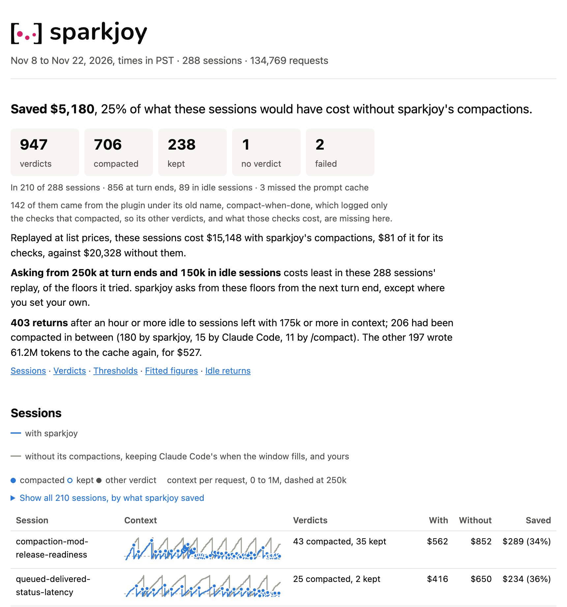
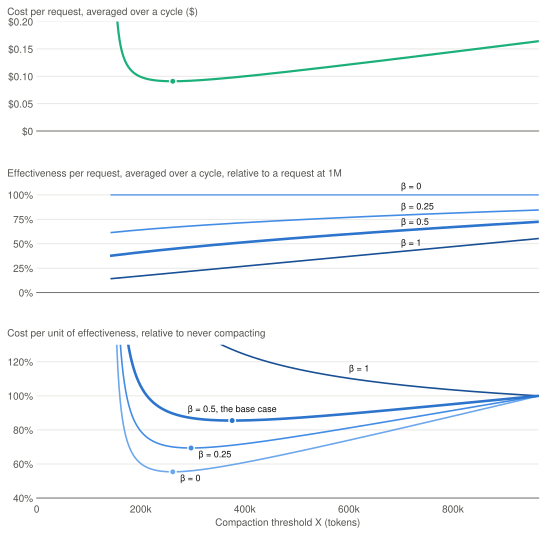
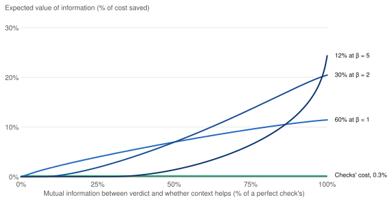

# sparkjoy

A Claude Code plugin that compacts the conversation when a piece of work is
finished, rather than when the context window fills. At the end of each turn
it puts Marie Kondo's question to the session's own model: does this
transcript spark joy? That is, does the work ahead still need it, or can it go?

<picture>
  <source media="(prefers-color-scheme: dark)" srcset="assets/session-dark.svg">
  
</picture>

One session with the plugin, and the same session replayed without it. Every
request reads the whole context, so the area under each line counts the tokens
the session read. At each dot the plugin asked the session's model whether to
compact, and at the larger dots the session compacted. In the replay, this
session cost 30% less with the plugin than without it.

## Install

At the prompt of a Claude Code session:

```
/plugin install sparkjoy --marketplace max-sixty/sparkjoy
```

## What it does

- **When a turn ends**, it asks the session's own model whether to compact now,
  and compacts if the model says to ([How it decides](#how-it-decides)).
- **After 55 minutes idle**, it asks again before the one-hour prompt cache
  lapses.
- **Each verdict shows in the transcript** as a dim line with its reason, such
  as these two from the session above:

  ```
  sparkjoy: Kept at 362k tokens: The README move is half done: unpushed files, a helper still running, and a page rebuild that hasn't been run yet
  sparkjoy: Compacting at 404k tokens: Move is finished and pushed; file paths, commands and conventions fit in a summary, and files can be re-read
  ```

- **`/sparkjoy:report`** opens a page on your sessions of the last 14 days,
  with every verdict and what the compactions saved. It fits the [cost
  model](#cost-model) to those sessions, and sparkjoy uses the fit from then on.
  It needs [uv](https://docs.astral.sh/uv/).

<details>
<summary>Sample report</summary>

<picture>
  <source media="(prefers-color-scheme: dark)" srcset="assets/report-dark.png">
  
</picture>

</details>

## What it saves

My 87 Claude Code sessions from 7 to 15 November 2026, 36,251
requests, replayed with and without the plugin[^replay]:

<picture>
  <source media="(prefers-color-scheme: dark)" srcset="assets/cost-dark.svg">
  
</picture>

<picture>
  <source media="(prefers-color-scheme: dark)" srcset="assets/context-dark.svg">
  
</picture>

|                                 | without sparkjoy | with sparkjoy |
| ------------------------------- | ---------------- | ------------- |
| cost, at Opus 5.5 list prices   | $5,214           | $4,013 (−23%) |
| mean context per request        | 462k             | 337k          |
| requests at 600k tokens or more | 28%              | 6%            |

Of the 59 sessions that reached 400k, half saved between 12% and 31%, and one
cost 19% more.

Each question is one request, which reads the conversation from the cache and
outputs about a hundred tokens. The 198 questions, at turn ends of 400k or more,
cost $22 in all, and 122 led to a compaction.

A compaction costs about $1 on Opus 5.5, mostly the cache write of the 142k
tokens left after it. Every later request then reads less:

| compacting at | each later request reads | pays for itself after | context grows back in |
| ------------- | ------------------------ | --------------------- | --------------------- |
| 200k          | 58k less                 | 74 requests           | 34 requests           |
| 400k          | 258k less                | 17 requests           | 151 requests          |
| 700k          | 558k less                | 9 requests            | 327 requests          |

## How it decides

sparkjoy asks only when a turn ends, because a piece of work most likely
finishes with a turn. It asks again if the session then sits idle.

The question goes to the session's own model, which reads the whole transcript
from the prompt cache. It asks whether the next turns will need detail a summary
drops, such as exact output, failed attempts or a design still taking shape. It
also tells the model that nearly every long transcript is mostly finished work,
so that alone is no reason to compact.

The question gives both costs for the context's size: what a compaction costs
and how many requests it takes to pay for itself, and what keeping the context
through another turn costs. The model answers with its verdict and a one-line
reason. In the [evals](evals/README.md), the model compacts at every turn end
that finishes a piece of work, as the [cost model](#cost-model) recommends past
about 250k. At the four turn ends in the middle of a task, from 519k to 681k, it
compacts in 5 of 8 runs.

### The prompt

<details>
<summary>At the end of a turn, for a 500k context</summary>

```
The goal of this request is to decide whether to compact this session now. It comes from the sparkjoy plugin, not from the user, and a program reads your answer. Use no tools.

Your turn just ended with this reply, which the user is reading now:

<reply>
…the reply…

</reply>

Nearly every long transcript is mostly finished work, so that alone is no reason to compact. What decides it is whether the next turns will need detail a summary drops: exact output, what was tried and failed, what the user objected to and why, the state of a design or fix still taking shape. Work that iterates with the user on something just shown, or takes up a half-done fix or design, needs that detail; after a compaction it re-reads and re-runs what it can and loses the rest. Work that only reports a result, or starts something new, needs no more than a summary.

What a compaction costs:
- It takes about a minute, and the request that writes its summary outputs about 6k tokens, thinking included.
- Afterwards the context holds about 142k tokens, counting the files the next requests read again. Those requests make a cache write of all of it but the 30k of system prompt and tools, which stay cached.
- A cache write costs as much as 40 cached reads, and an output token as much as 100.
- At 500k a compaction pays for itself after about 13 more requests that need nothing it dropped.

What keeping costs, more the larger the context:
- Every later request reads all 500k tokens, against about 142k after a compaction.
- Keeping only puts the compaction off to a later turn end.
- A turn runs a median of 9 requests and a mean of 38, so keeping 500k through one more turn costs as much as about 0.7 compactions for a median turn and 3 for a mean one.

What lost detail costs:
- It's very noisy and hard to judge, but as some indication, past sessions had about 6 more wasted requests than usual after a compaction: failed tool calls, repeated lookups and corrections.
- That count misses detail lost without such a failure, such as a design's rejected options or what the user likes.

Weigh what keeping costs against what losing the detail would cost the next turns. The larger the context, the more detail a compaction can drop and still pay.

Answer with one JSON object and nothing else, filling its fields in order:
{"next": "what most likely comes next, in a few words", "needs_detail": true or false, "compact": true or false, "reason": "one short line saying why"}
```

</details>

<details>
<summary>In a session idle for 55 minutes, for a 500k context</summary>

```
The goal of this request is to decide whether to compact this session now, before its prompt cache lapses. It comes from the sparkjoy plugin, not from the user, and a program reads your answer. Use no tools.

Your turn ended 55 minutes ago with this reply to the user, and nothing has happened since:

<reply>
…the reply…

</reply>

Nearly every long transcript is mostly finished work, so that alone is no reason to compact. What decides it is whether the next turns will need detail a summary drops: exact output, what was tried and failed, what the user objected to and why, the state of a design or fix still taking shape. Work that iterates with the user on something just shown, or takes up a half-done fix or design, needs that detail; after a compaction it re-reads and re-runs what it can and loses the rest. Work that only reports a result, or starts something new, needs no more than a summary.

What a compaction costs:
- It takes about a minute, and the request that writes its summary outputs about 6k tokens, thinking included.
- Afterwards the context holds about 142k tokens, counting the files the next requests read again. Those requests make a cache write of all of it but the 30k of system prompt and tools, which stay cached.
- A cache write costs as much as 40 cached reads, and an output token as much as 100.

What keeping costs now:
- The prompt cache holding the conversation lapses in a few minutes.
- The first request after that makes a cache write of all but 30k of its 500k tokens, against about 112k after a compaction.

So compact unless the next turn continues work that needs the transcript's detail.

What lost detail costs:
- It's very noisy and hard to judge, but as some indication, past sessions had about 6 more wasted requests than usual after a compaction: failed tool calls, repeated lookups and corrections.
- That count misses detail lost without such a failure, such as a design's rejected options or what the user likes.

Weigh what keeping costs against what losing the detail would cost the next turns. The larger the context, the more detail a compaction can drop and still pay.

Answer with one JSON object and nothing else, filling its fields in order:
{"next": "what most likely comes next, in a few words", "needs_detail": true or false, "compact": true or false, "reason": "one short line saying why"}
```

</details>

## Limits

- It asks only once the context reaches 250k at a turn end, or 175k in an idle
  session. These floors cost least in a replay of my sessions ([Cost
  model](#cost-model)) if every question leads to a compaction. My sessions hold
  about 142k after a compaction, much of it my own instructions and skills, and
  sessions that hold less would cost least with lower floors.
  `/sparkjoy:report` fits the floors to your own sessions.
- The report fits every figure the question states except the count of wasted
  requests after a compaction, which takes months of sessions to measure.
- It leaves Claude Code's own compaction on, so Claude Code still compacts when
  a turn fills the window. In a session you have open, Claude Code also
  compacts an idle context of 200k or more without asking, a minute or more
  before sparkjoy would ask. So sparkjoy's idle question comes mainly in
  background sessions, below 200k, or with
  [`idleCompaction`](https://code.claude.com/docs/en/settings-reference#idlecompaction)
  set to `false`.
- It acts only in sessions with a 1M-token context window, the size its floors
  and figures come from.

[^replay]: The replay keeps every logged request fixed and moves only the
    compactions: "with sparkjoy" keeps the plugin's, and "without sparkjoy"
    removes them and lets Claude Code compact at its own threshold, near 965k.
    Both price each request at Opus 5.5 list prices with the session's own cache
    lifetime, and "with sparkjoy" comes within 2% of the cost the transcripts log
    ($4,013 against $3,943).

# Cost model

sparkjoy's default floors come from a model of what keeping a context and
compacting it cost, fitted to my sessions.

<!-- Generated from docs/cost-model.md by docs/embed.py; edit that file. -->
<details>
<summary>The cost model</summary>

This is an analytical model of when compacting costs least. It treats a
session's context as growing by the same number of tokens with each request and
dropping back to the same size at each compaction, which gives the best
compaction point in closed form. [The model](docs/cost-model.md#the-model) states it in symbols.
[Fitted to my sessions](docs/cost-model.md#fitted-to-my-sessions) gives it values measured from
my sessions on Opus 5.5 with the one-hour cache, and tests that simplification
against a replay of the same sessions.

It answers two questions:

- **One compaction threshold.** If every compaction comes at the same context
  size, whatever the work, which size costs least? For my sessions, the cost
  is lowest at about 260k[^x]. That figure counts token costs alone, leaving out
  how much each request gets done and the detail a compaction loses, and it
  assumes a session can compact after any request. A replay of the sessions that compacts only
  at turn ends gives sparkjoy's default floors, the context sizes from which it
  asks whether to compact: 250k at turn ends and 175k in an idle session.
- **[Value of information](docs/cost-model.md#value-of-information).** A classifier, such as
  sparkjoy's question, says at each turn end whether to compact before or after
  that threshold, depending on how much the work ahead needs the context's
  detail. The model finds what a classifier could save over the best single
  threshold, and how often it must be right to pay for itself.

Costs are in dollars, at Opus 5.5's prices for the one-hour cache. The formulas
count them in cached reads: reading one token from the prompt cache costs one
cached read, \$0.20 per million tokens on Opus 5.5. [Prices by
model](docs/cost-model.md#prices-by-model) gives other models' prices.

## The model

### Request and compaction costs

In each cycle between compactions, the context starts at K, right after a
compaction, and grows by g tokens with each request until the session compacts
at X. A request with context x costs

$`\displaystyle c(x) = h\,x + c_0, \qquad h = 1 + \ell\,(w - 1)`$

Each token in the context costs one cached read. In the share ℓ of requests
that find the cache lapsed, the token is a cache write instead, at w cached
reads, w − 1 more than the read.
c₀ is the part that doesn't grow with the context: the request's output, its
uncached input, and the cache write of its g new tokens.

A compaction at X reads the whole context and outputs N tokens of summary and
thinking, at o cached reads each. The requests after it make a cache write of
the K tokens left after it, all but the P tokens of system prompt and tools, which
Claude Code keeps in a cache shared across sessions:

$`\displaystyle F(X) = F_0 + X, \qquad F_0 = o\,N + (w - 1)(K - P)`$

<picture>
  <source media="(prefers-color-scheme: dark)" srcset="assets/model-cycles-dark.svg">
  
</picture>

The context and each request's cost over many requests, compacting early, at
X\*, late, and never, which leaves it to Claude Code near the window's end.

<details>
<summary>The model's symbols</summary>

**Variables**

| symbol | what it is |
|----|----|
| x | Context of a request, in tokens. Over each cycle between compactions, it grows from K to X. |
| X | Context at which the session compacts, in tokens. The model chooses it. |

**Functions of the variables**

| symbol | what it is |
|----|----|
| c(x) | Cost of a request with context x, in cached reads: $`c(x) = h\,x + c_0`$. |
| F(X) | Cost of a compaction at context X, in cached reads: $`F(X) = F_0 + X`$, since the compaction request reads the whole context. |
| η(x) | Effectiveness of a request with context x, how much it gets done, relative to a request with the full 1M window: $`\eta(x) = (x / 1\text{M})^\beta`$. |
| J(X) | Cost per unit of effectiveness when the session compacts at X, in cached reads, a cost-effectiveness ratio. It is the cost of a cycle's requests and its compaction, divided by the sum of its requests' effectiveness. |

**Parameters**

| symbol | what it is |
|----|----|
| K | Context after a compaction, in tokens. It is the first request's context (the system prompt and tools, instructions, the summary, and recent messages and files), plus the files the next few requests read again. |
| g | Growth of the context per request, in tokens, from tool results, files read and the model's own output. |
| P | Size of the system prompt and tools, in tokens. Claude Code keeps this part of K in a cache shared across sessions, so it stays cached through a compaction. |
| ℓ | Share of requests that find the cache lapsed, and so make a cache write of the whole context. The cache lapses when it expires or is invalidated. |
| N | Output of the compaction request, in tokens: the summary's text plus its thinking. |
| w | Price of one token's cache write, in cached reads. |
| o | Price of one output token, in cached reads. |
| β | Growth of a request's effectiveness with its context: each doubling of the context makes a request $`2^\beta`$ times as effective. |
| h | Cost per request of one token in the context, in cached reads. It is one read, plus the chance that the cache has lapsed times the extra cost of the token's cache write: $`h = 1 + \ell\,(w - 1)`$. |
| c₀ | Fixed cost of a request, the part that doesn't grow with its context, in cached reads. It is the request's output, its uncached input, and the cache write of its g new tokens. |
| F₀ | Fixed cost of a compaction, in cached reads. It is the compaction request's output, plus the extra cost of the cache write of the K − P tokens outside the shared cache: $`F_0 = oN + (w - 1)(K - P)`$. |

**Result**

| symbol | what it is |
|----|----|
| X\* | Value of X that makes J lowest, in tokens. |

</details>

### Best compaction point

A request's cost, averaged over a cycle with its share of the compaction
included, is lowest where the marginal cost crosses the average. The marginal
cost is the cost of one more request before compacting. While it is below the
average, waiting one more request to compact lowers the average, as in Harris's
economic order quantity. Counting cost alone, the best point has a closed form:

$`\displaystyle X^* = K + \sqrt{\frac{2g\,(F_0 + K)}{h}}`$

<picture>
  <source media="(prefers-color-scheme: dark)" srcset="assets/model-average-dark.svg">
  
</picture>

The average and marginal costs of a request against the compaction point X.

### Context size and effectiveness

<picture>
  <source media="(prefers-color-scheme: dark)" srcset="assets/model-effectiveness-dark.svg">
  
</picture>

A request's effectiveness η(x), how much it gets done, against its context x,
relative to a request with the full 1M window. Each doubling of the context
multiplies it by $`2^\beta`$, so at β = 0 a request gets as much done at any
context.

η depends only on the context's size, so a request right after a compaction, at
K, counts as getting as much done as one at K before any compaction. At β above
0, the requests after a compaction get less done than the ones before it, since
their context is smaller. The best point minimizes J, a cycle's cost per unit of
its effectiveness, which at β = 0 is the average cost under [Best compaction
point](docs/cost-model.md#best-compaction-point):

$`\displaystyle J(X) = \frac{g\,F(X) + \int_K^X c(x)\,dx}{\int_K^X \eta(x)\,dx}`$

### Compacting before the cache lapses

Once the cache lapses, an idle session's next request makes a cache write of the
whole context, compacted or not. If the session keeps its context, that request costs P + w(x − P).
Compacting first, while the cache still holds the context, costs x + oN for the
compaction request and then P + w(K − P). Counting only the next request, which
understates the saving, compacting first is cheaper when

$`\displaystyle x > \frac{o\,N + w\,K}{w - 1}`$

### Value of information

A single threshold compacts all work at the same context size. A classifier
that tells kinds of work apart lets each kind compact at its own best point.
sparkjoy's question is a classifier: at each turn end, it says whether to keep
the context or compact it. The expected value of a classifier's information is
the cost it saves against the best single threshold, as a share of the whole
cost, output included. For a classifier that is always right, this is the
expected value of perfect information.

The model covers two ways in which work differs:

- **In β.** The classifier sorts the work into two groups, by whether it judges
  that the context helps the work. Each group compacts at its own best point. The classifier is right the same share of the
  time in each group. Its information is the mutual information between its
  verdict and whether the context helps the work, as a share of a perfect
  classifier's. A classifier right 9 times in 10 has about half a perfect
  classifier's information, and one right 99 times in 100 has about 90%.
- **In lost detail.** Each turn end is either mid-task, where a compaction loses
  detail, or finished, where it loses none. The classifier is right at some
  share of turn ends. Above a floor, the session compacts at each turn end the
  classifier calls finished. Above a higher ceiling, it compacts at every turn
  end. The floor and ceiling are set where the cost is lowest.

## Fitted to my sessions

Measured parameters come from my sessions of 7 to 15 November, with 90% intervals
from resampling sessions.

### Parameter values

| parameter | value | source |
|----|----|----|
| K, context after a compaction | 142k | measured, 90% interval 137–147k: the first request after a compaction holds 122k, and the next few requests read 20k of files again |
| g, growth of the context per request | 1,706 | measured, 1,615–1,805: the mean over the sessions' requests except the first few after a compaction, since K counts the files those read again |
| P, system prompt and tools | 30.4k | measured, 30.4–31.0k |
| ℓ, share of requests that find the cache lapsed | 0.56% | measured, 0.51–0.63%: the one-hour cache expires after an hour idle |
| N, output of the compaction request | 5.6k | measured, 5.2–5.9k: the summary's text is a median 3.5k tokens, and requests with about 3.5k tokens of visible output produce 1.61 times that in all, thinking included |
| w, price of a token's cache write | 40 cached reads | list price, for the one-hour cache; a write to the five-minute cache costs 25 |
| o, price of an output token | 100 cached reads | list price |
| β, growth of effectiveness with the context | 0 | assumed |
| h, cost per request of a token in the context | 1.22 | derived |
| c₀, fixed cost of a request | 134k cached reads, \$0.027 | derived |
| F₀, fixed cost of a compaction | 4.93M cached reads, \$0.99 | derived |
| X\*, best compaction point | 261k | derived |

### Trade-off

The four compaction points of the chart under [Request and compaction
costs](docs/cost-model.md#request-and-compaction-costs), with the values above:

| compact at | requests a cycle | mean cost per request | against never compacting |
|----|----|----|----|
| 175k | 19 | \$0.119 | 73% |
| 260k | 69 | \$0.091 | 55% |
| 400k | 151 | \$0.100 | 61% |
| never, leaving it to Claude Code at 965k | 482 | \$0.164 | 100% |

### What a request and a compaction cost

<picture>
  <source media="(prefers-color-scheme: dark)" srcset="assets/model-inputs-dark.svg">
  
</picture>

A request's cost c(x) (top) and a compaction's F(x) (bottom) by part, against
the context x. Every part except the read of the context is measured from
36,249 requests. A compaction costs about \$1 at any context, and \$0.87 of
that is the cache write of the context it leaves.

<details>
<summary>Cost by kind of token</summary>

<picture>
  <source media="(prefers-color-scheme: dark)" srcset="assets/model-bill-dark.svg">
  
</picture>

Each of the sessions' 36,000 requests is priced from its logged usage at Opus
5.5. A compaction's own request isn't logged, so its cost comes from the model.
Output is a small share because each request reads its whole context again. On
average, a request's 746 output tokens cost as much as 75k cached reads, and its
context holds 335k tokens.

| kind of token | share of the cost | share of the cost from compactions |
|----|----|----|
| output, thinking included | 14% | 0.4%, the summary |
| cache writes | 25% | 2.4%, the cache write of the compacted context on the request after each compaction |
| cache reads | 61% | 0.35%, the compaction request's read of the context |
| uncached input | 0.01%, too thin to draw | |
| all | 100% | 3.2% |

</details>

### Average cost

Counting cost alone, compacting at the cheapest point, about 260k, saves 45% per
request against Claude Code's default of compacting at 965k, and compacting at
400k saves 39%. With the values above, the closed form under [Best compaction point](docs/cost-model.md#best-compaction-point) gives

$`\displaystyle X^* = 142\text{k} + \sqrt{\frac{2 \cdot 1706 \cdot (4.93\text{M} + 142\text{k})}{1.22}} = 142\text{k} + 119\text{k} = 262\text{k}`$

### Best point for each β

<picture>
  <source media="(prefers-color-scheme: dark)" srcset="assets/model-cost-dark.svg">
  
</picture>

J against the compaction point, as a share of J when never compacting.

| β | effectiveness at 150k, against 1M | best point | saved there, against never compacting |
|----|----|----|----|
| 0 | 100% | about 260k | 45% |
| 0.3 | 55% | 310k | 28% |
| 0.6 | 30% | 440k | 8% |
| 1 | 15% | 965k, where Claude Code compacts | none |

### Sensitivity

<picture>
  <source media="(prefers-color-scheme: dark)" srcset="assets/model-sensitivity-dark.svg">
  
</picture>

How far the point of lowest cost, about 260k, moves when a parameter measured in
the sessions is halved or doubled, and across its 90% interval. K moves it
most, but only from 254k to 269k across its interval, and each other parameter
moves it by less than 10k across its own.

That interval covers only my sessions, and K differs more between users, since
most of it beyond the shared system prompt is the user's own instructions and
skills. A published session with few of them
([anthropics/claude-code#87602](https://github.com/anthropics/claude-code/issues/87602))
would have a K of roughly 60–70k on a 1M window, which puts the best point near
140k. So `/sparkjoy:report` fits K and the floors to each user's sessions.

The best point reaches 400k only at β = 0.55, where a request at 200k gets 68%
as much done as one at 400k, or if each compaction loses about \$3.70 of detail,
the cost of some 64 wasted requests.

<details>
<summary>Does the model's simplification matter?</summary>

<picture>
  <source media="(prefers-color-scheme: dark)" srcset="assets/model-threshold-dark.svg">
  
</picture>

The best point against β, with 90% bands, in the model, which compacts after
any request, and in a replay of the sessions, which compacts only at turn ends.

The replay keeps every logged request and moves only the compactions. When the
replay may compact after any request, its best point is 260k, against the model's 261k,
so uneven growth, cache lapses and sessions ending move it little. Its best
turn-end threshold is lower, since turns run a median of 9 requests but a mean
of 38, and one long turn can carry the context far past the best point before
the next turn end.

| β | best point | best turn-end threshold | saved there | saved from 250k, sparkjoy's default floor | saved from 400k |
|----|----|----|----|----|----|
| 0   | 261k | 200k | 30.0% | 29.8% | 25.0% |
| 0.3 | 307k | 250k | 20.1% | 20.1% | 17.2% |
| 0.6 | 444k | 290k | 8.5%  | 8.3%  | 7.9%  |

These savings are below the model's 45% because real sessions without
compaction end before their context reaches 965k. Each saving assumes a
classifier that always says to compact. sparkjoy's question instead decides at
which turn ends past the floor to compact.

</details>

### Idle sessions

| policy | saved |
|----|----|
| turn ends from 400k | 25.0% |
| turn ends from 400k and idle sessions from 200k | 28.4% |
| turn ends from 200k, the best without idle compaction | 30.0% |
| turn ends from 250k and idle sessions from 175k, sparkjoy's default floors | 30.7% |

Savings in the replay, counting only cost. Compacting idle sessions gets much of
the saving of a lower turn-end threshold, since 18% of turn ends are followed by
an hour's gap. Every pair of floors from 200k–250k at turn ends and 150k–175k
idle comes within 0.3 points of the default. Counting only the next request,
compacting before the cache lapses pays from about 160k ([Compacting before the
cache lapses](docs/cost-model.md#compacting-before-the-cache-lapses)).

### What a classifier saves

#### Work that differs in β

<picture>
  <source media="(prefers-color-scheme: dark)" srcset="assets/model-voi-dark.svg">
  
</picture>

What a classifier saves, against its accuracy. Each line is a mix of work with
mean β 0.6, with one share at the β shown and the rest at β = 0. The band along
0 is the cost of running the classifier, about 0.3%.

| mix | best single threshold | a perfect classifier saves | right 9 times in 10, a classifier saves | a classifier pays once right |
|----|----|----|----|----|
| all at β = 0.6 | 440k | 0 | 0 | |
| 60% at β = 1 | 790k | 11% | 7% | 57% of the time |
| 30% at β = 2 | never compacting | 20% | 7% | 71% |
| 12% at β = 5, work that stalls without its history | never compacting | 24% | 1% | 87% |

<details>
<summary>Where a classifier compacts</summary>

<picture>
  <source media="(prefers-color-scheme: dark)" srcset="assets/model-voi-point-dark.svg">
  
</picture>

The compaction point of the work a classifier says to compact, against its
accuracy. The work it says to keep compacts at 965k at all but the lowest
accuracies. At β = 5, a unit of work compacted at 261k costs 208 times as much
as when the session never compacts, so compacting any of that mix pays only once
a classifier has 29% of a perfect classifier's information.

</details>

| work mixed with β = 0, in any share | the most a perfect classifier saves |
|----|----|
| at β = 1 | 15% |
| at β = 2 | 31% |
| at β = 5 | 40% |
| at any β | 45%, what β = 0 work saves at its best point against never compacting |

At a given mean β, a perfect classifier saves most when a small share of the
work has β around 5 to 10. With 2% of the work at β = 30 it saves 17%. A unit
of that work's effectiveness costs 77 times one at β = 0 even when the session
never compacts, and no classifier lowers that part of the cost.

#### Turn ends that differ in lost detail

A replay of the sessions marks 30% of turn ends mid-task and the rest finished,
and gives its classifier a floor and a ceiling as under [Value of
information](docs/cost-model.md#value-of-information).

| with \$0.35 lost per compaction, as measured, about 6 wasted requests | share of the cost under the best threshold without a classifier |
|----|----|
| what a perfect classifier saves | 0.7% |
| what a classifier saves that is right as often as sparkjoy's question on the evals, at every finished turn end and 3 in 8 of the mid-task ones | under 0.1% |
| what running the classifier costs | 0.3% |
| what the lost detail costs in all, the most any classifier can save | 2% |

On the evals, sparkjoy's question compacted at every finished turn end, and
kept the context in 3 of 8 runs at the four mid-task turn ends. Whether the live
plugin's verdicts match the evals' is still open ([Against the live
plugin](evals/README.md#against-the-live-plugin)). The lost detail costs
only 2% in all because real sessions end, so they compact less often than in the
steady state.

The replay's classifier doesn't see the context's size, so it needs the ceiling.
sparkjoy's question states what keeping the context costs, so the model can
compact at a mid-task turn end once keeping costs more than the detail a
compaction would lose. On the evals, its verdicts follow context size only
noisily.

#### Where a classifier pays

| telling work apart pays when | in the measured sessions |
|----|----|
| work's β varies widely, and the classifier is right most of the time | Neither is measured. Grading sparkjoy's verdicts by what happened next, such as whether the turns after a compaction re-read files it dropped, would measure its accuracy. |
| each compaction loses several times the \$0.35 of detail measured so far | Hard to judge ([What does the model assume a compaction loses?](docs/cost-model.md#questions-about-the-model)). |

### Prices by model

| model | a cached read, per 1M tokens | a cache write, in cached reads | an output token, in cached reads | a compaction's fixed cost | best point |
|----|----|----|----|----|----|
| Opus 5.5 | \$0.20 | 40 | 100 | \$0.99 | about 260k |
| Sonnet 5.5 | \$0.10 | 40 | 100 | \$0.49 | about 260k |
| Fable 5.2 | \$0.20 | 80 | 200 | \$1.99 | about 300k |
| Haiku 5.5, above 100k | \$0.05 | 20 | 50 | \$0.12 | about 230k |

Prices for the one-hour cache. Every other section's figures are for Opus 5.5.

## Fitting it to your sessions

`/sparkjoy:report` fits the model to your sessions of the last 14 days, and its
Thresholds section gives the pair of floors that costs least for them. From then
on, sparkjoy asks once the context reaches those floors, and its question states
the parameters the report measured in place of mine. The fit needs some
compactions in those sessions, to measure K and N.

## Questions about the model

<details>
<summary>What would put the best point near 700k?</summary>

A request at 700k costs about \$0.20, against about \$0.06 at 150k, so a
compaction there pays for its \$1.13 within 9 requests, the length of a
median turn. The best point reaches 700k only if the requests after a
compaction get much less done, and even then compacting at 700k barely beats
never compacting:

| what puts the best point at 700k | effectiveness right after a compaction | effectiveness per dollar against never compacting |
|----|----|----|
| β = 0.75 (best point 690k) | 23% of 1M's | +1.1% |
| β = 0, and each compaction loses \$21 of detail, 365 requests' worth | 100% | +5.3% |

</details>

<details>
<summary>What does the model assume a compaction loses?</summary>

The model makes a request's effectiveness depend only on its context's size. A
request right after a compaction, whose 142k tokens hold a summary of the work
so far, counts as getting as much done as a request at 142k before the session's
first compaction.

At β above 0, a summary can do better than that. If it keeps everything the
work needs, the requests after the compaction get as much done as with the whole
transcript. The model counts them as getting less, so compacting pays more than
the model says. A summary that drops detail the next turns need costs more, in a
mistake, a correction from the user or a step run again. The model adds that cost as D per compaction, and the best point
of 260k is for D = 0.

It's very noisy and hard to judge, but as some indication, my sessions had
about 6 more wasted requests than usual after manual `/compact`s
and Claude Code's own compactions. A wasted request is a failed tool call, a
repeated lookup or a correction. That makes D about \$0.35, with a 90%
interval from −\$0.14 to +\$1.12. The count misses losses that waste no request,
such as a design's rejected options or what the user likes.

| D per compaction | best point, β = 0 | best point, β = 0.6 | a perfect classifier saves, β = 0 |
|----|----|----|----|
| 0, a summary that keeps everything needed | 260k | 440k | 0 |
| \$0.35, as measured | 280k | 480k | 0.7% |
| \$1.12, the top of its interval | 315k | 550k | 3.2% |
| \$3.72, about 64 wasted requests | 400k | 720k | 12% |

</details>

<details>
<summary>Why a power law?</summary>

It has one parameter with a plain meaning: each doubling of the context makes a
request $`2^\beta`$ times as effective, wherever it starts. The cost uses only the
curve from about 150k to 965k, under three doublings. Over that range a
saturating form, levelling off once the context holds what the work needs,
could serve as well. The two differ on one question: does doubling an agent's
context from 400k to 800k improve its next steps about as much as doubling it
from 100k to 200k? Under the power law, both doublings improve them by the same
factor. Under a saturating form, the later doubling improves them less.

</details>

<details>
<summary>Does the power law give context diminishing returns?</summary>

Yes, with β below 1: a token at 400k adds less than one at 100k, half as much at
β = 0.5 and 29% as much at β = 0.1. Every token is worth the same only at β = 1.

</details>

<details>
<summary>Has anyone modelled this before?</summary>

The closest published studies, from August to October 2026, sweep the
threshold on benchmarks ([Satish et al.](https://arxiv.org/abs/2609.32961),
[CliffCompaction](https://arxiv.org/abs/2609.26779)) or measure what a
compaction drops ([Salle et al.](https://arxiv.org/abs/2610.31778),
[Liu](https://arxiv.org/abs/2608.16370)). The closest cost rule,
[Nadir's](https://getnadir.com/blog/mask-dont-summarize-agent-context-cache-cost/),
leaves out quality. None lets a request's effectiveness depend on its context,
prices the cache write, or limits compaction to turn ends.

</details>

[^x]: X\*, the best compaction point: 262k from the closed form under [Best
compaction point](docs/cost-model.md#best-compaction-point), and 253–271k, its 90% interval from
resampling sessions.

</details>
<!-- End of the generated copy. -->
