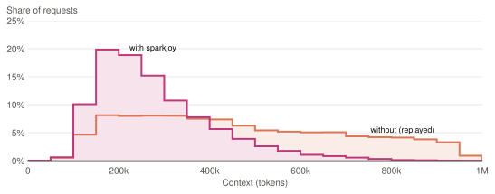
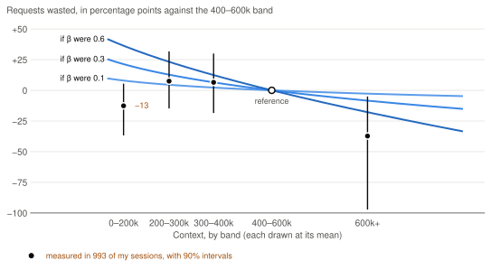

# sparkjoy

A Claude Code plugin that compacts the conversation when a piece of work is
finished, rather than when the context window fills. At the end of each turn
it puts Marie Kondo's question to the session's own model: does this
transcript spark joy? That is, does the work ahead still need it, or can it go?

<picture>
  <source media="(prefers-color-scheme: dark)" srcset="assets/session-dark.svg">
  
</picture>

One of my sessions, replayed without the plugin for comparison. Every request
re-reads the whole context, so the area under each line is what the session
paid to read. At each dot the plugin asked the session's model whether to
compact, and at the six filled ones it did, when a piece of work had ended:

> Long transcript of finished exploration, reverted attempts and diffs;
> remaining work is CI follow-up and the final closeout, which a summary
> covers. *(728k)*

> The hierarchy PR is open and handed over. The follow-up work needs only the
> summary, not the transcript's diffs and logs. *(680k)*

At the hollow dots the session went on without a compaction; the plugin that
week didn't record why. Where the line climbs with no dot, a long turn is still
running or the context is under 400k, the plugin's floor that week
([Limits](#limits)). This session cost 25% less with the plugin, and all my
sessions 23% less.

## Install

At the prompt of a Claude Code session:

```
/plugin install sparkjoy --marketplace max-sixty/sparkjoy
```

Answer `y` to add the marketplace, and choose the user scope to have it in
every session. It is tested daily on the latest and stable Claude Code
releases; `claude plugin disable sparkjoy` turns it off.

## What it does

A turn is everything Claude does between your message and its reply, often
dozens of requests.

- **After each turn**, the plugin asks the session's own model, which reads the
  conversation from the prompt cache, whether to compact now
  ([the prompt](#the-prompt)). On yes it compacts, which takes about a minute
  while you read the reply. If Claude Code restarts the session before the
  compaction finishes, as it does to each background session after an update,
  the plugin compacts when the session starts again.
- **When a session sits idle for 55 minutes**, it asks again, adding that the
  prompt cache is about to lapse and the next message would make a cache write
  of the whole context. Claude Code's own
  [idle compaction](https://code.claude.com/docs/en/prompt-caching#compacting-the-conversation)
  skips background sessions (`claude --bg`): in mine it fired in none of 358
  idle gaps of 55 minutes or more. This needs a Claude subscription, where the
  cache lasts an hour, and a computer that stays awake: a session the
  computer slept through is left alone, its cache already gone.
- **Each decision shows as a dim line in the transcript**, which the model never
  reads, with its reason:

  ```
  sparkjoy: Compacting at 401k tokens: Long transcript of finished experiments, diffs and query output; …
  ```

- **`/sparkjoy:report`** writes a page about your own sessions of the last 14
  days and opens it: every verdict, what the compactions saved, and the
  thresholds the [cost model](#cost-model) fits to them. From then on the
  question states the figures it fitted in place of mine. It needs
  [uv](https://docs.astral.sh/uv/).

Claude Code's own compaction near the end of the window still runs, and
`claude -p` and the Agent SDK are left alone.

The top of my report:

<picture>
  <source media="(prefers-color-scheme: dark)" srcset="assets/report-dark.png">
  
</picture>

## What it saves

I replayed all 87 of my Claude Code sessions from 7 to 15 November 2026, 36,251
requests, with and without the plugin:

<picture>
  <source media="(prefers-color-scheme: dark)" srcset="assets/cost-dark.svg">
  
</picture>

<picture>
  <source media="(prefers-color-scheme: dark)" srcset="assets/context-dark.svg">
  
</picture>

|                                 | without | with          |
| ------------------------------- | ------- | ------------- |
| cost, at Opus 5.5 list prices   | $5,214  | $4,013 (−23%) |
| mean context per request        | 462k    | 337k          |
| requests at 600k tokens or more | 28%     | 6%            |

Of the 59 sessions that reached 400k, half saved between 12% and 31%, and one
cost 19% more. On a subscription the same tokens count against your usage
limits instead.

A check is one request, which reads the conversation from the cache and writes
about a hundred tokens. The 198 checks, at turn ends of 400k or more, cost $22
in all, and 122 of them compacted.

A compaction costs about $0.99 on Opus 5.5, mostly to write to the cache the
142k tokens it leaves. Every later request then reads less:

| compacting at | each later request reads | pays for itself after | context grows back in |
| ------------- | ------------------------ | --------------------- | --------------------- |
| 200k          | 58k less                 | 74 requests           | 34 requests           |
| 400k          | 258k less                | 17 requests           | 151 requests          |
| 700k          | 558k less                | 9 requests            | 327 requests          |

## How it decides

The session's own model makes the call, reading the whole transcript from the
prompt cache, since which parts the work ahead needs depends on the work. The
question tells it that a transcript of mostly finished work is no reason by
itself to compact, since nearly every long transcript is one. What decides it
is whether the next turns will need detail a summary drops, such as exact
output, failed attempts or a design still taking shape.

The question also gives both costs, sized for the context: what a compaction
costs and how many requests it takes to pay for itself, and what keeping the
context through another turn costs, which grows with the context. The model
weighs the two and answers with its verdict and a one-line reason. In the
[evals](evals/README.md) it compacts at every finished turn end, as the
[cost model](#cost-model) recommends past about 250k, and at the
mid-task ones, from 519k to 681k, in 5 of 8 runs.

## The prompt

`question()` in [`hooks/register.ts`](hooks/register.ts) writes it, filled in
for the session's context size and the reply the turn ended with.

<details>
<summary>At the end of a turn, for a 500k context</summary>

```
This message comes from the sparkjoy plugin, not from the user, and a program reads your reply. Use no tools.

Your turn just ended with this reply to the user:

<reply>
…the reply…

</reply>

Decide whether to compact the conversation now, while the user reads that reply.

Nearly every long transcript is mostly finished work, so that alone is no reason to compact. What decides it is whether the next turns will need detail a summary drops: exact output, what was tried and failed, what the user objected to and why, the state of a design or fix still taking shape. Work that iterates with the user on something just shown, or takes up a half-done fix or design, needs that detail; after a compaction it re-reads and re-runs what it can and loses the rest. Work that only reports a result, or starts something new, needs no more than a summary.

A compaction takes about a minute, and the request that writes its summary outputs about 6k tokens, thinking included. Afterwards the context holds about 142k tokens, counting the files the next requests read again, and those requests write it to the cache again, all but the 30k of system prompt and tools, which stay cached. A cache write costs as much as 40 cached reads, and an output token as much as 100. At 500k a compaction pays for itself after about 13 more requests that need nothing it dropped.

Keeping costs too, and more the larger the context: every later request reads all 500k tokens, against about 142k after a compaction, and keeping only puts the compaction off to a later turn end. A turn runs a median of 9 requests and a mean of 38, so keeping 500k through one more turn costs as much as about 0.7 compactions for a median turn and 3 for a mean one.

After a compaction, past sessions had about 6 more wasted requests than usual: failed tool calls, repeated lookups and corrections. That count misses detail lost without such a failure, such as a design's rejected options or what the user likes.

Weigh what keeping costs against what losing the detail would cost the next turns. The larger the context, the more detail a compaction can drop and still pay.

Reply with one JSON object and nothing else, filling its fields in order:
{"next": "what most likely comes next, in a few words", "needs_detail": true or false, "compact": true or false, "reason": "one short line saying why"}
```

</details>

<details>
<summary>In a session idle for 55 minutes, for a 500k context</summary>

```
This message comes from the sparkjoy plugin, not from the user, and a program reads your reply. Use no tools.

Your turn ended 55 minutes ago with this reply to the user, and nothing has happened since:

<reply>
…the reply…

</reply>

Decide whether to compact the conversation now. The prompt cache holding it lapses in a few minutes, and the first request after that writes all but 30k of its 500k tokens to the cache again, against about 112k after a compaction. So compact unless the next turn continues work that needs the transcript's detail.

Nearly every long transcript is mostly finished work, so that alone is no reason to compact. What decides it is whether the next turns will need detail a summary drops: exact output, what was tried and failed, what the user objected to and why, the state of a design or fix still taking shape. Work that iterates with the user on something just shown, or takes up a half-done fix or design, needs that detail; after a compaction it re-reads and re-runs what it can and loses the rest. Work that only reports a result, or starts something new, needs no more than a summary.

A compaction takes about a minute, and the request that writes its summary outputs about 6k tokens, thinking included. Afterwards the context holds about 142k tokens, counting the files the next requests read again, and those requests write it to the cache again, all but the 30k of system prompt and tools, which stay cached. A cache write costs as much as 40 cached reads, and an output token as much as 100.

After a compaction, past sessions had about 6 more wasted requests than usual: failed tool calls, repeated lookups and corrections. That count misses detail lost without such a failure, such as a design's rejected options or what the user likes.

Weigh what keeping costs against what losing the detail would cost the next turns. The larger the context, the more detail a compaction can drop and still pay.

Reply with one JSON object and nothing else, filling its fields in order:
{"next": "what most likely comes next, in a few words", "needs_detail": true or false, "compact": true or false, "reason": "one short line saying why"}
```

</details>

## Limits

- It asks only from 250k, or 175k in an idle session: the pair of floors that
  costs least when my sessions are replayed
  ([Cost model](#cost-model)), taking every check to say yes.
- Until you run `/sparkjoy:report`, the question's figures for a turn's length
  and for what a compaction costs come from my sessions. The report fits them
  to yours, all but the wasted requests after a compaction, which take months
  of sessions to measure.
- It acts between turns only. Claude Code's own compaction near the end of the
  window still bounds a long turn.
- It acts only in sessions with a 1M-token context window, the size its
  floors and figures come from. On a 200k window, Claude Code compacts before
  the context reaches 250k.

## How the numbers were measured

The replay keeps every logged request fixed and moves only the compactions:
"with" keeps the plugin's, and "without" removes them and lets Claude Code
compact near 965k, as it does on its own. Both price each request at Opus 5.5
list prices with the session's own cache lifetime, and "with" comes within 2%
of the cost the transcripts log ($4,013 against $3,943).

## Cost model

sparkjoy's floors come from a model of what keeping a context and compacting it
cost, fitted to my sessions. It is also on [a page of its own](docs/cost-model.md).

<!-- Generated from docs/cost-model.md by docs/embed.py; edit that file. -->
<details>
<summary>The cost model</summary>

The cost model finds when to compact from the context's size alone, and its
answer sets sparkjoy's floor. For Opus 5.5 with the one-hour cache, compacting
costs least when the context reaches about **260k**<sup>1</sup>. Past the floor, sparkjoy
asks at each turn end whether the next turns need the detail a summary would
drop.

Costs are in CRTs, cached-read tokens. One CRT is the price of reading one token
from the prompt cache, which [Prices by model](#prices-by-model) gives for each
model.

### Trade-off

<picture>
  <source media="(prefers-color-scheme: dark)" srcset="assets/model-cycles-dark.svg">
  
</picture>

The model at four compaction points over 600 requests. Compacting early makes
compactions frequent, and compacting late makes requests large.

The context grows by about 1.7k tokens a request<sup>2</sup> and drops back to about
150k<sup>3</sup> at each compaction, which costs about 5M CRTs<sup>4</sup> plus one read of the
context.

| compact at | requests a cycle | mean cost per request | against never compacting |
|----|----|----|----|
| 175k | 19 | 600k CRTs | 73% |
| 260k | 69 | 455k CRTs | 55% |
| 400k | 151 | 500k CRTs | 61% |
| never, leaving it to Claude Code at 965k | 482 | 820k CRTs | 100% |

### Request and compaction costs

<picture>
  <source media="(prefers-color-scheme: dark)" srcset="assets/model-inputs-dark.svg">
  
</picture>

A request's cost c(x) (top) and a compaction's F(x) (bottom) by part, against
the context x. A request's cost grows with its context, mostly its cache read,
from about 300k CRTs at 150k to 1M at 700k. A compaction costs about 5M at any
context, 4.4M of it the cache write of the context it leaves.

Every part except the read of the context is measured from 36,249 of my
requests.

<details>
<summary>What share of my sessions' bill each kind of token took</summary>

<picture>
  <source media="(prefers-color-scheme: dark)" srcset="assets/model-bill-dark.svg">
  
</picture>

My sessions' 36,000 requests, each priced from its logged usage at Opus 5.5,
with each compaction's own request, which isn't logged, taken from the model.
Output is a small share because each request reads its whole context again: on
average, a request's 746 output tokens cost as much as 75k cached reads, against
a context of 335k tokens.

| kind of token | share of the bill | compactions' part, as a share of the bill |
|----|----|----|
| output, thinking included | 14% | 0.4%, the summary |
| cache writes | 25% | 2.4%, the compacted context, on the request after each compaction |
| cache reads | 61% | 0.35%, the context the compaction reads |
| uncached input | 0.01%, too thin to draw | |
| all | 100% | 3.2% |

</details>

<details>
<summary>The model's symbols and their values</summary>

Measured parameters come from my sessions of 7 to 15 November, with 90%
intervals from resampling sessions.

**Variables**

| symbol | what it is |
|----|----|
| x | Context of a request, in tokens. Over each cycle between compactions, it grows from K to X. |
| X | Context at which the session compacts, in tokens. The model chooses it. |

**Functions of the variables**

| symbol | what it is |
|----|----|
| c(x) | Cost of a request with context x, in CRTs: $`c(x) = h\,x + c_0`$. |
| F(X) | Cost of a compaction at context X, in CRTs: $`F(X) = F_0 + X`$, since the compaction request reads the whole context. |
| η(x) | Effectiveness of a request with context x, relative to a request with the full 1M window: $`\eta(x) = (x / 1\text{M})^\beta`$. A request's effectiveness is how much it gets done. |
| J(X) | Cost per unit of effectiveness when the session compacts at X, in CRTs, a cost-effectiveness ratio as health economics uses the term. It is a cycle's cost, its requests' and its compaction's, divided by the cycle's effectiveness, the sum of its requests'. |

**Parameters**

| symbol | what it is | value | source |
|----|----|----|----|
| K | Context after a compaction, in tokens. It is the first request's context (122k: the system prompt and tools, instructions, the summary, and recent messages and files), plus the files the next few requests read again (20k). | 142k | measured, 90% interval 137–147k |
| g | Growth of the context per request, in tokens, from tool results, files read and the model's own output. It is the mean over my sessions' requests except the first few after a compaction, since K counts the files those read again. | 1,706 | measured, 1,615–1,805 |
| P | Size of the system prompt and tools, in tokens. Claude Code keeps this part of K in a cache shared across sessions, so it stays cached through a compaction. | 30.4k | measured, 30.4–31.0k |
| ℓ | Share of requests that find the cache lapsed, and so make a cache write of the whole context. The cache lapses when it expires after an hour idle or is invalidated. | 0.56% | measured, 0.51–0.63% |
| N | Output of the compaction request, in tokens: the summary's text plus its thinking. The text is a median 3.5k tokens, and requests that show about that much output produce 1.61 times as much in all, thinking included. | 5.6k | measured, 5.2–5.9k |
| w | Price of one token's cache write to the one-hour cache, in CRTs. A write to the five-minute cache costs 25. | 40 | list price |
| o | Price of one output token, in CRTs. | 100 | list price |
| β | Growth of a request's effectiveness with its context: each doubling of the context makes a request $`2^\beta`$ times as effective. | 0 | assumed |
| h | Cost per request of one token in the context, in CRTs. It is one read, plus the chance that the cache has lapsed times the extra cost of the token's cache write: $`h = 1 + \ell\,(w - 1)`$. | 1.22 | derived |
| c₀ | Fixed cost of a request, the part that doesn't grow with its context, in CRTs. It is the request's output, its uncached input, and the cache write of its g new tokens. | 134k | derived |
| F₀ | Fixed cost of a compaction, in CRTs. It is the compaction request's output, plus the extra cost of the cache write of the K − P tokens outside the shared cache: $`F_0 = oN + (w - 1)(K - P)`$. | 4.93M | derived |

**Result**

| symbol | what it is                                 | value | source  |
|--------|--------------------------------------------|-------|---------|
| X\*    | Value of X that makes J lowest, in tokens. | 261k  | derived |

</details>

### Best compaction point

<picture>
  <source media="(prefers-color-scheme: dark)" srcset="assets/model-average-dark.svg">
  
</picture>

A request's cost averaged over a cycle, its share of the compaction included,
against the compaction point. The average is lowest where the marginal cost, the
straight line, crosses it.

The marginal cost is what one more request before compacting costs. Waiting for
that request lowers the average while it costs less than the average, as in
Harris's economic order quantity. If a request gets as much done at any context,
the best point has a closed form, in the symbols tabled under [Request and
compaction costs](#request-and-compaction-costs):

```math
X^* = K + \sqrt{\frac{2g\,(F_0 + K)}{h}} = 142\text{k} + 119\text{k} = 262\text{k}
```

### Context size and effectiveness

<picture>
  <source media="(prefers-color-scheme: dark)" srcset="assets/model-effectiveness-dark.svg">
  
</picture>

A request's effectiveness η(x), how much it gets done, against its context x, as
a share of a request's with the full 1M window. Each doubling of the context
multiplies it by $`2^\beta`$, so at β = 0 a request gets as much done at any
context.

At larger β, a compaction also costs effectiveness, since the requests after it
work with less. The best point then minimizes J, a cycle's cost per unit of its
effectiveness, which at β = 0 is the average cost under [Best compaction
point](#best-compaction-point):

```math
J(X) = \frac{g\,F(X) + \int_K^X c(x)\,dx}{\int_K^X \eta(x)\,dx}
```

<picture>
  <source media="(prefers-color-scheme: dark)" srcset="assets/model-cost-dark.svg">
  
</picture>

J against the compaction point, as a share of J when never compacting. The
larger β, the later the minimum comes and the less it saves.

| β | effectiveness at 150k, against 1M | best point | saved there, against never compacting |
|----|----|----|----|
| 0 | 100% | about 260k | 45% |
| 0.3 | 55% | 310k | 28% |
| 0.6 | 30% | 440k | 8% |
| 1 | 15% | 965k, where Claude Code compacts | none |

### Sensitivity

<picture>
  <source media="(prefers-color-scheme: dark)" srcset="assets/model-sensitivity-dark.svg">
  
</picture>

How far the best point at β = 0, about 260k, moves when a parameter measured in
my sessions is halved or doubled, and across its 90% interval. K, the context
after a compaction, moves it most, from 150k to 459k when halved or doubled, but
only from 254k to 269k across its interval, and each other parameter moves it
less than 10k across its own.

The assumptions about the work move it more. It reaches 400k only at β = 0.55,
where a request at 200k gets 68% as much done as one at 400k, or if each
compaction loses about 19M CRTs of detail, some 64 wasted requests.

### Does the model's simplification matter?

<picture>
  <source media="(prefers-color-scheme: dark)" srcset="assets/model-threshold-dark.svg">
  
</picture>

The best point against β, in the model, which compacts after any request, and
in a replay of my sessions from 7 to 15 November, which compacts only at turn
ends, with 90% bands. Turn ends move the best point earlier.

The replay keeps every logged request and moves only the compactions. Allowed
to compact after any request, its best point is 260k, against the model's 261k,
so uneven growth, cache lapses and sessions ending move it little. Turns run a
median of 9 requests but a mean of 38, so one turn can carry the context far
past the best point before the next chance to compact.

| β | best point | best turn-end threshold | saved there | saved from 250k, sparkjoy's floor | saved from 400k |
|----|----|----|----|----|----|
| 0   | 261k | 200k | 30.0% | 29.8% | 25.0% |
| 0.3 | 307k | 250k | 20.1% | 20.1% | 17.2% |
| 0.6 | 444k | 290k | 8.5%  | 8.3%  | 7.9%  |

These savings are below the model's 45% because, without compaction, real
sessions end before their context reaches 965k. Each assumes a check that always
says to compact; sparkjoy's question decides which turn ends past the floor to
use.

### Idle sessions

| policy | saved |
|----|----|
| turn ends from 400k | 25.0% |
| turn ends from 400k and idle sessions from 200k | 28.4% |
| turn ends from 200k, the best without idle compaction | 30.0% |
| turn ends from 250k and idle sessions from 175k | 30.7% |

The replay at β = 0, each policy compacting wherever it allows. Idle compaction
does much of what a lower turn-end threshold would, since 18% of turn ends are
followed by an hour's gap.

sparkjoy asks once a session has sat 55 minutes since its last reply without a
new message. The replay times that wait from each reply to the next message, and
counts each session's last reply as followed by one. The last row, sparkjoy's
floors, is the best pair on a grid of 50k steps at turn ends and 25k steps idle. Every pair of 200k–250k at turn ends and
150k–175k idle comes within 0.3 points of it.

Once the cache lapses, an idle session's next request makes a cache write of the
whole context, compacted or not. Keeping costs that request P + w(x − P).
Compacting first, while the cache still holds the context, costs x + oN for the
compaction request and then P + w(K − P), in the symbols tabled under [Request
and compaction costs](#request-and-compaction-costs). Counting the next request
alone, which understates the saving, compacting is cheaper when

```math
x > \frac{o\,N + w\,K}{w - 1} \approx 160\text{k}
```

### Value of information

If a check could tell kinds of work apart, each kind could compact at its own
best point, and sparkjoy's question, asked at each turn end, is such a check. The
expected value of the check's information is the cost it saves against the best single
threshold, as a share of the whole cost, output included; a perfect check's is
the expected value of perfect information.

#### Work that differs in β

<picture>
  <source media="(prefers-color-scheme: dark)" srcset="assets/model-voi-dark.svg">
  
</picture>

What a check saves on three mixes of work with mean β 0.6, each a share of the
work at one β and the rest at β = 0, by how much its verdict tells about whether
the context helps the work. Across these mixes, the steeper the share, the more a
perfect check saves, and the closer to perfect a check must be to get half of
that.

| mix | best single threshold | a perfect check saves | half that saving needs | right 9 times in 10, a check saves | a check pays once right |
|----|----|----|----|----|----|
| all at β = 0.6 | 440k | 0 | | 0 | |
| 60% at β = 1 | 790k | 11% | 39% of the information | 7% | 57% of the time |
| 30% at β = 2 | never compacting | 20% | 63% | 7% | 71% |
| 12% at β = 5, work that stalls without its history | never compacting | 24% | 90% | 1% | 87% |

A check sorts the work into a group to keep and a group to compact, each
compacting at its own best point, and is right the same share of the time in
each. The chart scores it by the mutual information
between its verdict and whether the context helps the work, as a share of a
perfect check's: a check right 9 times in 10 carries about half a perfect
check's information, and one right 99 times in 100 about 90%. The band along 0
is what the checks cost, about 0.3%.

Compacting work that needs its context is the costly error, and each unit of β
makes it about 3.5 times dearer. Compacted at 261k, a unit of work costs 1.5,
4.8 and 208 times what it does never compacting at β = 1, 2 and 5. So the higher
β, the purer the group a check says to compact must be before compacting it
pays, and at β = 5 a check saves nothing up to 29% of the information.

A perfect check saves at most 15% on any mix of β = 0 and 1, 31% of 0 and 2, and
40% of 0 and 5. On no mix can it save more than 45%, what β = 0 work saves at its
best point against never compacting, since never compacting is always one choice
of single threshold. At a given mean β, it saves most when a small share of the
work has β around 5 to 10. A rarer, steeper share saves less, 17% with 2% of the work at
β = 30, because a unit of its effectiveness costs 77 times one at β = 0 even
when never compacting, and no check lowers that part of the cost.

#### Turn ends that differ in lost detail

I replayed my sessions with 30% of turn ends marked mid-task, where a compaction
loses detail, and the rest finished, where it loses none. A check right at a
share a of turn ends compacts at a turn end it calls finished once the context
passes a floor, and at any turn end past a higher ceiling, with the floor and
ceiling that cost least.

| with 1.8M CRTs lost per compaction, as measured, about 6 wasted requests | share of the cost under the best threshold without a check |
|----|----|
| what a perfect check saves | 0.8% |
| what a check saves that calls turn ends as sparkjoy's question did on the evals | 0.1% |
| what the checks cost | 0.3% |
| what the lost detail costs in all, the most any check can save | 2% |

On the evals, sparkjoy's question compacted at every finished turn end and kept
the context in 3 of 8 mid-task runs, over two runs of each of a handful of cases
not yet compared with live verdicts. The lost detail costs little in all because
real sessions end, and so compact less often than the steady state does.

The replay's check doesn't see the context's size, so it needs the ceiling.
sparkjoy's question states what keeping the context costs, so sparkjoy can
compact mid-task once that cost exceeds the detail a compaction would lose,
though on the evals its response to size is still noisy.

#### Where a check pays

| telling work apart pays when | in my sessions |
|----|----|
| work's β varies widely, and the check is right most of the time | Neither how much β varies across my work nor how accurate sparkjoy's question is has been measured yet. Grading each of its verdicts by what happened next, such as whether the turns after a compaction re-read files it dropped, would measure the second. |
| each compaction loses several times the 1.8M CRTs of detail measured so far | Not seen, though the measure misses some losses, such as a design's rejected options or what I like ([What does the model assume a compaction loses?](#questions-about-the-model)). |

### Questions about the model

<details>
<summary>What would put the best point near 700k?</summary>

A request at 700k costs about 1M CRTs, against about 300k at 150k, so a
compaction there recovers its 5.6M CRTs within 9 requests, a median turn.
Waiting that long pays only if the requests after a compaction get much less
done, and even then compacting at 700k barely beats never compacting:

| what puts the best point at 700k | effectiveness right after a compaction | effectiveness per CRT against never compacting |
|----|----|----|
| β = 0.75 (best point 690k) | 23% of 1M's | +1.1% |
| β = 0, and each compaction loses 106M CRTs of detail, 365 requests' worth | 100% | +5.3% |

My sessions look like neither case. At β = 0.75, requests at 150k would get
about 30% as much done as those at 700k, yet requests below 200k go wrong no
more often than those at 400–600k.

</details>

<details>
<summary>What does the model assume a compaction loses?</summary>

The best point of 260k charges a compaction only its tokens. A summary that
drops detail costs more, in a mistake, a correction from me or a step run again,
and the model charges that as D per compaction. In my sessions D is about 1.8M
CRTs (−0.7M to +5.6M), about 6 wasted requests, after my own `/compact`s and
Claude Code's ([Calibration against my
sessions](#calibration-against-my-sessions)).

| D per compaction | best point, β = 0 | best point, β = 0.6 | a perfect check saves, β = 0 |
|----|----|----|----|
| 0, a summary that keeps everything needed | 260k | 440k | 0 |
| 1.8M CRTs, as measured | 280k | 480k | 0.8% |
| 5.6M, the top of its interval | 315k | 550k | 3.1% |
| 18.6M, about 64 wasted requests | 400k | 720k | 12% |

D counts only losses that show within two turns, as a failed tool call, a
repeated lookup or a correction. It misses a design's rejected options, what I
like, harm that comes later and my own time, so the true D could be larger.

</details>

<details>
<summary>Why a power law?</summary>

It has one parameter with a plain meaning: each doubling of the context makes a
request $`2^\beta`$ times as effective, wherever it starts. It can't hold at small
contexts, since at β = 0.1 a request with 1k tokens would get half as much done
as one at 1M. The cost uses only the curve from about 150k to 965k, under three
doublings, where a saturating form, levelling off once the context holds what
the work needs, could serve as well. The two differ on one question: does
doubling an agent's context from 400k to 800k improve its next steps about as
much as doubling it from 100k to 200k? The power law predicts it does.

</details>

<details>
<summary>Does more context have diminishing returns?</summary>

Per token, yes, with β below 1: a token at 400k adds less than one at 100k, half
as much at β = 0.5 and 29% as much at β = 0.1. Per doubling, no, since each
doubling makes a request $`2^\beta`$ times as effective at any size. Every token is
worth the same only at β = 1.

</details>

<details>
<summary>Has anyone modelled this before?</summary>

No one has published a model of when to compact. This autumn's studies sweep the
threshold on benchmarks ([Satish et al.](https://arxiv.org/abs/2609.32961),
[CliffCompaction](https://arxiv.org/abs/2609.26779)) or measure what a
compaction drops ([Salle et al.](https://arxiv.org/abs/2610.31778),
[Liu](https://arxiv.org/abs/2608.16370)). The closest cost rule,
[Nadir's](https://getnadir.com/blog/mask-dont-summarize-agent-context-cache-cost/),
leaves out quality. None lets a request's effectiveness depend on its context,
prices the cache write, or limits compaction to turn ends.

</details>

### Calibration against my sessions

<picture>
  <source media="(prefers-color-scheme: dark)" srcset="assets/model-calibration-dark.svg">
  
</picture>

The share of requests wasted in each context band, against the same session's
requests at 400–600k, in 993 of my sessions over 60 days, and what each β would
predict if a request's effectiveness fell as the share wasted rose. Below 200k,
requests go wrong no more often, −13 points (−37 to +5), where β = 0.3 predicts
21 points more.

Effectiveness isn't logged, but what goes wrong is: a failed tool call, a lookup
repeated while its result is still in context, a turn I correct or interrupt.
The intervals come from resampling the sessions' 311k requests by session.

| fitted | value (90%) | what it implies |
|----|----|----|
| D, detail a compaction loses | −0.8M CRTs (−5.4M to +3.7M) over all my compactions; 1.8M (−0.7M to +5.6M) after my own `/compact`s and Claude Code's | 400k would need 18.6M CRTs per compaction, about 64 wasted requests |

My own `/compact`s, 664 of them and mostly from before sparkjoy, came at a
median 413k, later than the best point, and sparkjoy's at 453k because of its
floor at the time. Nothing measured shows that compacting later pays, but the
evidence is weak:

- These signals see only visible waste, so a request at a large context that
  goes right and gets more done doesn't show.
- Within a session the context grows as a piece of work goes on, so the share
  wasted at each context size partly reflects the work's phase.
- D was measured where compactions were chosen, at natural breaks.

### Prices by model

| model | price of 1M CRTs | a token's cache write, in CRTs | an output token, in CRTs | a compaction's fixed cost | best point |
|----|----|----|----|----|----|
| Opus 5.5 | \$0.20 | 40 | 100 | 4.9M CRTs, \$0.99 | about 260k |
| Sonnet 5.5 | \$0.10 | 40 | 100 | 4.9M CRTs, \$0.49 | about 260k |
| Fable 5.2 | \$0.20 | 80 | 200 | 10M CRTs, \$1.99 | about 300k |
| Haiku 5.5, above 100k | \$0.05 | 20 | 50 | 2.4M CRTs, \$0.12 | about 230k |

Prices for the one-hour cache. Where a model's cache write and output cost more
CRTs, a compaction costs more too, and the best point moves later. Every other
section's figures are for Opus 5.5.

### Fitting it to your sessions

`/sparkjoy:report` fits the model to your sessions of the last 14 days. Its
Thresholds section gives the floors that cost least for them, and from then on
the plugin's question states the parameters it measured in place of mine. A
fit needs some compactions in the window, to measure K and N.

My own figures and charts come from `model/fit.py` and `model/calibrate.py`:

```
# The figures and charts above, from my sessions of 7 to 15 November
uv run --script model/fit.py --since 2026-11-07T12:00Z --until 2026-11-16T00:00Z \
  --charts assets

# The same at other prices and cache lifetimes
uv run --script model/fit.py --since 2026-11-07T12:00Z --until 2026-11-16T00:00Z \
  --model claude-fable-5-2 --ttl 5m

# The calibration, D and its chart, over 60 days of sessions
uv run --script model/calibrate.py --since 2026-09-17T00:00Z --until 2026-11-16T00:00Z \
  --costs-since 2026-11-07T12:00Z --costs-until 2026-11-16T00:00Z --charts assets
```

They read the main thread of each interactive session in `~/.claude/projects`,
opening only transcripts modified since `--since`, at low priority, and
resample sessions for the intervals.

### Notes

1. X\*, the best compaction point: 262k from the closed form under [Best compaction point](#best-compaction-point), and 253–271k, its 90% interval from resampling sessions.
2. g, the growth of the context per request: 1,706 tokens.
3. K, the context after a compaction: 142k tokens, 90% interval 137–147k.
4. F₀, a compaction's fixed cost: 4.93M CRTs.

</details>
<!-- End of the generated copy. -->

## License

MIT
