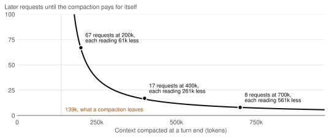

# sparkjoy

A Claude Code plugin that asks the session's own model whether the work ahead
still needs the context, and compacts if the model says no[^name]. It asks when
each turn ends, so that it compacts once a piece of work is finished, and again
just before an idle session's prompt cache expires.

When a piece of work is done, the next turns rarely need the detail a summary
drops. Just before the cache expires, compacting spares the next request a cache
write of the whole context. Claude Code compacts when the window fills, and
`/autocompact` compacts once the context reaches the size you set, whether or
not the turn has ended. A summary written in the middle of a turn is the most
likely to drop what the turn's next requests need.

|                | When it compacts                                                          |
| -------------- | ------------------------------------------------------------------------- |
| `/compact`     | when you type it                                                          |
| Claude Code    | at about 965k, even mid-turn                                              |
| Claude Code    | when idle, just before the one-hour cache expires, from 200k              |
| `/autocompact` | at the size you set, even mid-turn                                        |
| sparkjoy       | at a turn end, from 250k, if the model says to                            |
| sparkjoy       | when idle, just before the cache expires, from 175k, if the model says to |

<picture>
  <source media="(prefers-color-scheme: dark)" srcset="assets/session-dark.svg">
  
</picture>

Every request reads the whole context, so the area under each line counts the
tokens the session read. At each dot the plugin asked the session's model
whether to compact, and at the larger dots the session compacted. In the replay,
this session cost 30% less with the plugin than without it.

## Install

At the prompt of a Claude Code session:

```
/plugin install sparkjoy --marketplace max-sixty/sparkjoy
```

It acts only in sessions with a 1M-token context window, the size its defaults
are fitted to, and only in interactive ones, not in `-p` runs or SDK hosts. A
session picks it up when it starts. To see its verdicts before it compacts anything, run
`/sparkjoy classify` ([Settings](#settings)). CI tests it on Claude Code's
latest and stable releases.

Auto-update is off by default for the sparkjoy marketplace. To keep sparkjoy up
to date, open `/plugin`, go to the Marketplaces tab, select sparkjoy, and turn on
auto-update.

## What it does

- **When a turn ends**, it asks the session's own model whether to compact now,
  and compacts if the model says to ([How it decides](#how-it-decides)).
- **Before the prompt cache expires** in an idle session, it asks again. That
  is after 55 minutes on the one-hour cache, and after 4 minutes on the
  five-minute cache, which API keys use by default. The cache can lapse before
  then. In my sessions, nearly a quarter of requests after 45 to 60 minutes
  idle found that the API had dropped it.
- **Each verdict shows in the transcript** as a dim line with its reason, and
  a question that missed the prompt cache adds a line saying so. In the session
  above, it kept the context while a move was half done:

  ```
  sparkjoy: Kept at 362k tokens: The README move is half done: unpushed files, a helper still running, and a page rebuild that hasn't been run yet
  ```

  Once the move was on main, it compacted the session:

  ```
  sparkjoy: Compacting at 404k tokens: Move is finished and pushed; file paths, commands and conventions fit in a summary, and files can be re-read
  ```

- **`/sparkjoy report`** opens a page on your sessions of the last 14 days,
  with every verdict and what the compactions saved. It fits the [cost
  model](#cost-model) to those sessions, and sparkjoy uses the fit from then on.
  It reads your transcripts on your machine and sends nothing. It needs
  [uv](https://docs.astral.sh/uv/), which fetches Python and numpy the first
  time it runs.

<details>
<summary>Sample report</summary>

<picture>
  <source media="(prefers-color-scheme: dark)" srcset="assets/report-dark.png">
  
</picture>

</details>

- **`/sparkjoy bug`** drafts a bug report from the session's transcript, with
  what you say went wrong, sparkjoy's settings, and its last lines beside the
  requests around them, and files it here once you agree. A line that reports a
  bug, such as a check that failed or a question at a turn's end that missed
  the prompt cache, is followed by one suggesting it.

## Settings

`/sparkjoy` says which mode sparkjoy is in, the floors it asks from, where
each floor comes from, and whether its question carries instructions of yours.

- **`/sparkjoy classify`** sets sparkjoy to ask at turn ends and in idle
  sessions and show each verdict, but compact nothing. A verdict to compact
  reads `sparkjoy: Would compact at 404k tokens: …`, and `/sparkjoy report`
  counts these apart from compactions.
- **`/sparkjoy off`** turns sparkjoy off, so it asks nothing and compacts
  nothing, and `/sparkjoy on` sets it back to compacting when the model says
  to. These three commands set the **`mode`** setting.
- **`floor`** is the context, in tokens, from which sparkjoy asks at a turn
  end, and **`idle_floor`** the context from which it asks in an idle session.
  A floor you set wins over the one `/sparkjoy report` fitted, which wins over
  the defaults of 250k and 175k. sparkjoy ignores a floor of 1M or more, and a
  turn-end floor at or below the context a compaction leaves (142k, or the
  report's fit), since no compaction there could pay for itself. `/sparkjoy`
  says when it ignores one.
- **`instructions`** adds your own guidance to sparkjoy's question, such as
  "Keep the context while a pull request awaits review". It goes in a
  paragraph of its own near the end of the question ([The
  prompt](#the-prompt)).

`/config` lists each of these under sparkjoy. An agent can set them in
`~/.claude/settings.json`, under the id of the plugin as installed above.
Claude Code reloads sparkjoy whenever they change, in sessions already open
too.

```json
{
  "pluginConfigs": {
    "sparkjoy@sparkjoy": {
      "options": {
        "mode": "classify",
        "floor": 300000,
        "idle_floor": 200000,
        "instructions": "Keep the context while a pull request awaits review."
      }
    }
  }
}
```

## What it saves

The plugin cut the cost of my 87 Claude Code sessions from 7 to 15 November
2026 by 23%, from $5,214 to $4,013 at Opus 5.5 list prices, in a replay of
their 36,251 requests[^replay]. sparkjoy then asked only once the context
reached 400k at a turn end; it now asks from 250k:

<picture>
  <source media="(prefers-color-scheme: dark)" srcset="assets/cost-dark.svg">
  
</picture>

<picture>
  <source media="(prefers-color-scheme: dark)" srcset="assets/context-dark.svg">
  
</picture>

### Compared with `/autocompact`

`/autocompact` compacts every session at the size you set. sparkjoy compacts
only where the session's model judges that the work ahead no longer needs the
context, and only between turns.

That judgment pays where work differs in how much it needs its context: a design
still taking shape needs more of it than a finished fix. In the [cost
model](#a-classifier)'s cases, a judgment right 9 times in 10 saves 2% to 10%
against compacting all work at whichever single size costs least. Where work
doesn't differ, waiting for a turn end costs a little, since a long turn can
carry the context past that size before it ends. In a replay of my sessions,
`/autocompact` at its best size saves about a point more than compacting at
every turn end[^autocompact]. No session yet measures how widely work differs,
or how often the judgment is right.

`/autocompact` also compacts in the middle of a turn, 169 times in that replay,
where a summary is the most likely to drop what the turn is working on.

I run sparkjoy without `/autocompact`. If you set both, keep `/autocompact`
above sparkjoy's turn-end floor ([Limits](#limits)).

## How it decides

sparkjoy asks the session's own model whether now is a good time to compact, at
each turn end from 250k and again just before an idle session's prompt cache
lapses. To ask, it forks the conversation for one request. The fork reads the
whole conversation, which is already in the prompt cache, so a question costs
about as much as one more request. In my sessions, the questions cost $22 in
all, against $4,013 for the sessions. The model answers in about a hundred
tokens, a verdict and a one-line reason. The fork goes from Claude Code to the
session's own model, so the conversation goes only where the session already
sends it.

The question asks whether the next turns will need detail a summary drops, such
as failed attempts or a design still taking shape, and gives what a compaction
and keeping the context each cost at the context's size.

### The prompt

<details>
<summary>At the end of a turn, for a 500k context</summary>

```
The goal of this request is to decide whether to compact this session now. It comes from the sparkjoy plugin, not from the user, and a program reads your answer. Use no tools.

Your turn just ended.

Nearly every long transcript is mostly finished work, so that alone is no reason to compact. What decides it is whether the next turns will need detail a summary drops: exact output, what was tried and failed, what the user objected to and why, the state of a design or fix still taking shape. Work that iterates with the user on something just shown, or takes up a half-done fix or design, needs that detail; after a compaction it re-reads and re-runs what it can and loses the rest. Work that only reports a result, or starts something new, needs no more than a summary.

What a compaction costs:
- It takes about a minute, and the request that writes its summary outputs about 6k tokens, thinking included.
- Afterwards the context holds about 142k tokens, counting the files the next requests read again. Those requests make a cache write of all of it but the 30k of system prompt and tools, which stay cached.
- A cache write costs as much as 40 cached reads, and an output token as much as 100.
- At 500k a compaction pays for itself after about 13 more requests that need nothing it dropped.

What keeping costs, more the larger the context:
- Every later request reads all 500k tokens, against about 142k after a compaction.
- Keeping only puts the compaction off to a later turn end.
- A turn runs a median of 9 requests and a mean of 38, so keeping 500k through one more turn costs as much as about 0.7 compactions for a median turn and 3 for a mean one.

What lost detail costs:
- It's very noisy and hard to judge, but as some indication, past sessions had about 6 more wasted requests than usual after a compaction: failed tool calls, repeated lookups and corrections.
- That count misses detail lost without such a failure, such as a design's rejected options or what the user likes.

Weigh what keeping costs against what losing the detail would cost the next turns. The larger the context, the more detail a compaction can drop and still pay.

Answer with one JSON object and nothing else, filling its fields in order:
{"next": "what most likely comes next, in a few words", "needs_detail": true or false, "compact": true or false, "reason": "one short line saying why"}
```

</details>

<details>
<summary>In a session idle for 55 minutes, for a 500k context</summary>

```
The goal of this request is to decide whether to compact this session now, before its prompt cache lapses. It comes from the sparkjoy plugin, not from the user, and a program reads your answer. Use no tools.

Your turn ended 55 minutes ago, and nothing has happened since.

Nearly every long transcript is mostly finished work, so that alone is no reason to compact. What decides it is whether the next turns will need detail a summary drops: exact output, what was tried and failed, what the user objected to and why, the state of a design or fix still taking shape. Work that iterates with the user on something just shown, or takes up a half-done fix or design, needs that detail; after a compaction it re-reads and re-runs what it can and loses the rest. Work that only reports a result, or starts something new, needs no more than a summary.

What a compaction costs:
- It takes about a minute, and the request that writes its summary outputs about 6k tokens, thinking included.
- Afterwards the context holds about 142k tokens, counting the files the next requests read again. Those requests make a cache write of all of it but the 30k of system prompt and tools, which stay cached.
- A cache write costs as much as 40 cached reads, and an output token as much as 100.

What keeping costs now:
- The prompt cache holding the conversation lapses within a few minutes.
- The first request after that makes a cache write of all but 30k of its 500k tokens, against about 112k after a compaction.

So compact unless the next turn continues work that needs the transcript's detail.

What lost detail costs:
- It's very noisy and hard to judge, but as some indication, past sessions had about 6 more wasted requests than usual after a compaction: failed tool calls, repeated lookups and corrections.
- That count misses detail lost without such a failure, such as a design's rejected options or what the user likes.

Weigh what keeping costs against what losing the detail would cost the next turns. The larger the context, the more detail a compaction can drop and still pay.

Answer with one JSON object and nothing else, filling its fields in order:
{"next": "what most likely comes next, in a few words", "needs_detail": true or false, "compact": true or false, "reason": "one short line saying why"}
```

</details>

Your [`instructions`](#settings) go in both versions as a paragraph of their
own, between "Weigh what keeping costs…" and "Answer with one JSON object…":
the line "The user added these instructions for this decision:", then your
text. Unset, the question is as shown.

<!-- The Evals block waits until the mid-task verdicts' swing between batches is explained. Remove this line and the closing one to restore it.
### Evals

<details>
<summary>The question's verdicts at 16 turn ends from my sessions</summary>

Each turn end's label is chosen from what the session did next, and each run
asks the question above, on 19 and 20 November 2026[^evals]:

| turn ends                                                                                  | context   | label   | runs that matched it |
| ------------------------------------------------------------------------------------------ | --------- | ------- | -------------------- |
| five that finished a piece of work                                                         | 479k–742k | compact | 10 of 10             |
| one idle for 55 minutes after everything landed                                            | 290k      | compact | 2 of 2               |
| four in the middle of a task                                                               | 519k–681k | keep    | 80 of 160            |
| two that stop to ask before going on, where the next turn needed detail the ask leaves out | 490k–599k | keep    | 16 of 16             |
| two that stop to ask, where the ask holds all the next turn needed                         | 403k–479k | compact | 8 of 16              |
| two natural breaks, but small                                                              | 210k–296k | keep    | 0 of 4               |

At the two small natural breaks the [cost model](#cost-model) also says to
compact. At the mid-task turn ends, the same question and transcripts kept the
context in 6 of 16 runs on the evening of 19 November, in none of 16 on the
morning of 20 November, and in 23 of 32, 24 of 32 and 27 of 64 in three batches
that afternoon, so two versions of the question compare only when run in the
same batch. Some labels are uncertain, since each records what the session did
next rather than what it needed ([Where this leaves
them](evals/README.md#where-this-leaves-them)).

The hook reads only `compact` and `reason`, yet the question asks for `next`
and `needs_detail` first, because without them the model almost never keeps the
context. At the mid-task turn ends, in the batches that ran both, versions of the
question with the two fields kept it in 16 of 64 runs, and versions that ask
only for `compact` and `reason` in 3 of 96 (p = 0.03, an exact test within
batches). In one of those batches neither kept. Among the versions without them,
one asks first for a `reason` that says what most likely comes next and whether
it needs detail a summary drops, and another tells the model to consider those
two things before it answers. The two fields cost about 20 output tokens a
question.

</details>

[^evals]:
    The [evals](evals/README.md) put the question to the model at turn
    ends from my sessions.
-->

## Other plugins

Two other plugins also compact before the window fills, and never in the middle
of a turn:

- [Compactly](https://github.com/swapnildahiphale/compactly) asks Sonnet, at
  each prompt you send from 150k, whether the work has reached a natural break,
  and if so compacts before sending the prompt. After a turn that commits,
  pushes or opens a pull request, it also compacts if no prompt comes within 55
  minutes.
- [claude-smart-compact](https://github.com/mdseyam-as/claude-smart-compact)
  compacts at every turn end from 180k unless you send a message first. Haiku
  says whether the task is done, and its answer sets how long the plugin waits,
  60 seconds or up to 8 minutes. From 350k it compacts as soon as the turn ends.

Both decide from under 8,000 characters of the transcript, and neither tells its
model what keeping or compacting costs. sparkjoy asks the session's own model,
which reads the whole transcript, and tells it what each costs at the context's
size.

## Limits

- It asks only once the context reaches 250k at a turn end, or 175k in an idle
  session. In a replay of my sessions that compacts wherever the floors allow,
  this is the pair that costs least counting tokens alone. If a request with
  250k of context gets half as much done as one with the full 1M, the [cost
  model](#cost-model)'s base case, asking at a turn end from 400k instead would
  save 0.8 percentage points more. The floors stay at the lower pair because a
  floor only sets where sparkjoy starts asking, and above it the question
  decides. My sessions hold about 142k after a compaction, much of it my own
  instructions and skills, and sessions that hold less would do better with
  lower floors. `/sparkjoy report` fits the floors to your own sessions, and you
  can set them yourself ([Settings](#settings)).
- The report fits every figure the question states except the count of wasted
  requests after a compaction, which takes months of sessions to measure.
- It leaves Claude Code's own compaction on, so Claude Code still compacts when
  a turn fills the window. In a session you have open on the one-hour cache,
  Claude Code also compacts an idle context of 200k or more without asking, a
  minute or more before sparkjoy would ask.
  [`CLAUDE_CODE_IDLE_COMPACT_MIN_TOKENS`](https://code.claude.com/docs/en/env-vars)
  sets that 200k, to no less than 100k. So sparkjoy's idle question comes
  mainly on the five-minute cache, in background sessions, below that size, or
  with
  [`idleCompaction`](https://code.claude.com/docs/en/settings-reference#idlecompaction)
  set to `false`.
- If you set `/autocompact`, keep it above sparkjoy's turn-end floor. At or
  below the floor, Claude Code compacts mid-turn before any turn end reaches it,
  so sparkjoy never asks at a turn end.

[^name]:
    The name is Marie Kondo's test for what to keep when tidying: does it spark
    joy?

[^autocompact]:
    At the cost model's base case, where a request with 250k of context gets
    half as much done as one with the full 1M, and with each policy at the size
    that cost least and compacting idle sessions from 175k, `/autocompact` at
    370k saves 15% and compacting at every turn end from 390k saves 14%.
    Counting tokens alone, at 270k and from 240k, they save 40% and 31%. Turn
    ends break even once a compaction in the middle of a turn wastes 7 more
    requests than one at a turn end, or 35 counting tokens alone.

[^replay]:
    The replay keeps every logged request fixed and moves only the
    compactions: "with sparkjoy" keeps the plugin's, and "without sparkjoy"
    removes them and lets Claude Code compact at its own threshold, near 965k.
    Both price each request at Opus 5.5 list prices with the session's own cache
    lifetime, and "with sparkjoy" comes within 2% of the cost the transcripts log
    ($4,013 against $3,943). On a subscription, the same tokens count against
    usage limits rather than a bill.

# Cost model

sparkjoy's default floors come from a model of what keeping a context and
compacting it cost, fitted to my sessions.

<!-- Generated from docs/cost-model.md by docs/embed.py; edit that file. -->
<details>
<summary>The cost model</summary>

A compaction policy decides when a session compacts: at what size of context,
and at which moment in the work. Every request reads the whole context, so a
session that compacts late pays to read a large context on every request. One
that compacts early pays for more compactions, and its requests have less of
the session's history to work with. This document models what a policy costs
per unit of work done, to find when a session should compact.

Two numbers in the model set what the context is worth to the work, and each
varies:

- **β varies with the work.** A request gets more done with a larger context,
  by a power β of its size. Work that builds on its history, such as a design
  that takes shape over many turns, has a larger β than work that needs only a
  summary of what came before.
- **D varies with the moment.** A compaction drops detail, and the requests
  after it waste effort on what it dropped: failed tool calls, repeated lookups
  and corrections. D counts those wasted requests. It is largest in the middle
  of a turn, smaller at a turn end in the middle of a task, and close to 0 at a
  turn end that finishes a piece of work.

The moment matters for cost too. Just before an idle session's prompt cache
lapses, compacting spares the next request a cache write of the whole context.

If β and D were each one number for all work, one threshold would suit all of
it, and a policy could compact after whichever request reached it, as
`/autocompact` does once the context reaches the size you set. Because they vary, a policy that tells the cases apart can
compact each where it costs least. sparkjoy compacts only at a turn end, where
it asks the session's model whether the next turns need detail a summary would
drop, or just before an idle session's cache lapses.

Each section below takes one case of the model, from the simplest, whose formula
shows which parameters matter, to a replay that follows real sessions:

- **[Cost alone](docs/cost-model.md#cost-alone).** β = 0 and D = 0, and the context grows by the
  same number of tokens with each request. The lowest-cost threshold, the
  context at which compacting costs least, has a closed form.
- **[Cost and context](docs/cost-model.md#cost-and-context).** One β for all work, and D = 0. The
  lowest-cost threshold is the one where the cost per unit of work done is
  lowest.
- **[Idle sessions](docs/cost-model.md#idle-sessions).** The prompt cache is about to lapse, so
  compacting pays at a smaller context.
- **[Mid-turn or at a turn end](docs/cost-model.md#mid-turn-or-at-a-turn-end).** D is larger in
  the middle of a turn than at a turn end. Compacting only at turn ends avoids
  it, but lets a long turn carry the context past the lowest-cost threshold
  before the turn ends.
- **[A classifier](docs/cost-model.md#a-classifier).** β varies with the work and D with the turn
  end. A question that tells them apart, as sparkjoy's does, lets each compact
  where it costs least, and is worth what it saves against the lowest-cost
  single threshold.
- **[A replay of my sessions](docs/cost-model.md#a-replay-of-my-sessions).** It keeps every logged
  request and moves only the compactions, so it includes what the other cases
  leave out: uneven growth, long turns, cache lapses and sessions that end.

For my sessions on Opus 5.5[^prices]:

- What sparkjoy's question saves depends on how widely β and D vary, and on how
  often the question is right. If half the work gets twice as much done with
  twice the context (β = 1) and the rest gets as much done at any size (β = 0),
  a question right 9 times in 10 saves 9% against the lowest-cost single
  threshold. If half of turn ends fall in the middle of a task, a question right
  9 times in 10 saves 1.9% where a compaction there wastes 12 requests, and 9.0%
  where it wastes 96. No session of mine yet measures how widely β or D varies,
  or how often the question is right ([A classifier](docs/cost-model.md#a-classifier)).
- Compacting only at turn ends, as sparkjoy does, waits out long turns. Turns
  run a median of 9 requests but a mean of 38, so one long turn can carry the
  context far past where compacting pays before it ends. In the replay, at each
  policy's lowest-cost threshold, compacting at every turn end saves 9.1
  percentage points less than compacting after any request, counting cost
  alone, and 0.9 less at the base case, β = 0.5, where a request at 250k gets half as
  much done as one at 1M. Turn ends break even once a compaction in the middle
  of a turn wastes 35 more requests than one at a turn end, counting cost alone,
  or 7 more at the base case. No session of mine measures that ([Mid-turn or at
  a turn end](docs/cost-model.md#mid-turn-or-at-a-turn-end)).
- Just before an idle session's cache lapses, compacting pays from about 160k
  ([Idle sessions](docs/cost-model.md#idle-sessions)).
- A compaction costs about \$1 at any context size, most of it for the cache
  write of the context it leaves ([What a request and a compaction
  cost](docs/cost-model.md#what-a-request-and-a-compaction-cost)).
- Compacting after any request, the lowest-cost threshold is 262k counting cost
  alone ([Cost alone](docs/cost-model.md#cost-alone)), and 376k at the base case ([Cost and
  context](docs/cost-model.md#cost-and-context)).
- sparkjoy asks its question only once the context reaches a floor, 250k at a
  turn end or 175k in an idle session. The default floors are the pair that
  costs least, counting cost alone, in a replay that compacts wherever they
  allow ([Floors](docs/cost-model.md#floors)).

## Costs

<details>
<summary>The model's symbols</summary>

**Variables**

| symbol | what it is                                                                                  |
| ------ | ------------------------------------------------------------------------------------------- |
| x      | Context of a request, in tokens. Over each cycle between compactions, it grows from K to X. |
| X      | Context at which the session compacts, in tokens.                                           |

**Functions of the variables**

| symbol | what it is                                                                                                                                                                                                              |
| ------ | ----------------------------------------------------------------------------------------------------------------------------------------------------------------------------------------------------------------------- |
| c(x)   | Cost of a request with context x, in cached reads: $`c(x) = h\,x + c_0`$.                                                                                                                                               |
| F(X)   | Cost of a compaction at context X, in cached reads: $`F(X) = F_0 + X`$, since the compaction request reads the whole context.                                                                                           |
| η(x)   | Effectiveness of a request with context x, how much it gets done, relative to a request with the full 1M window: $`\eta(x) = (x / 1\text{M})^\beta`$.                                                                   |
| J(X)   | Cost per unit of effectiveness when the session compacts at X, in cached reads, a cost-effectiveness ratio. It is the cost of a cycle's requests and its compaction, divided by the sum of its requests' effectiveness. |

**Parameters**

| symbol | what it is                                                                                                                                                                                                         |
| ------ | ------------------------------------------------------------------------------------------------------------------------------------------------------------------------------------------------------------------ |
| K      | Context after a compaction, in tokens. It is the first request's context (the system prompt and tools, instructions, the summary, and recent messages and files), plus the files the next few requests read again. |
| g      | Growth of the context per request, in tokens, from tool results, files read and the model's own output.                                                                                                            |
| P      | Size of the system prompt and tools, in tokens. Claude Code keeps this part of K in a cache shared across sessions, so it stays cached through a compaction.                                                       |
| ℓ      | Share of requests that find the cache lapsed, and so make a cache write of the whole context. The cache lapses when it expires or is invalidated.                                                                  |
| N      | Output of the compaction request, in tokens: the summary's text plus its thinking.                                                                                                                                 |
| w      | Price of one token's cache write, in cached reads.                                                                                                                                                                 |
| o      | Price of one output token, in cached reads.                                                                                                                                                                        |
| β      | Growth of a request's effectiveness with its context: each doubling of the context makes a request $`2^\beta`$ times as effective.                                                                                 |
| D      | Requests a compaction wastes on the detail it dropped, such as failed tool calls, repeated lookups and corrections. Each costs as much as a request at K, so the compaction costs $`F(X) + D\,c(K)`$ in all.       |
| h      | Cost per request of one token in the context, in cached reads. It is one read, plus the chance that the cache has lapsed times the extra cost of the token's cache write: $`h = 1 + \ell\,(w - 1)`$.               |
| c₀     | Fixed cost of a request, the part that doesn't grow with its context, in cached reads. It is the request's output, its uncached input, and the cache write of its g new tokens.                                    |
| F₀     | Fixed cost of a compaction, in cached reads. It is the compaction request's output, plus the extra cost of the cache write of the K − P tokens outside the shared cache: $`F_0 = oN + (w - 1)(K - P)`$.            |

**Result**

| symbol | what it is                                                                                                                                            |
| ------ | ----------------------------------------------------------------------------------------------------------------------------------------------------- |
| X\*(β) | Lowest-cost threshold, the value of X that makes J lowest at a given β, in tokens. X\*(0) counts cost alone. Where the β is clear, it is written X\*. |

</details>

In each cycle between compactions, the context starts at K, right after a
compaction, and grows by g tokens with each request until the session compacts
at X. A request with context x costs

$`\displaystyle c(x) = h\,x + c_0, \qquad h = 1 + \ell\,(w - 1)`$

Each token in the context costs one cached read. In the share ℓ of requests
that find the cache lapsed, the token is a cache write instead, at w cached
reads, w − 1 more than the read. So h is what one token in the context costs a
request on average.
c₀ is the part that doesn't grow with the context: the request's output, its
uncached input, and the cache write of its g new tokens.

A compaction at X reads the whole context and outputs N tokens of summary and
thinking, at o cached reads each. The requests after it make a cache write of
the K tokens left after it, all but the P tokens of system prompt and tools, which
Claude Code keeps in a cache shared across sessions:

$`\displaystyle F(X) = F_0 + X, \qquad F_0 = o\,N + (w - 1)(K - P)`$

A compaction can also drop detail the requests after it need, and they waste D
requests on what it dropped, each costing as much as a request at K, c(K).
Unless a section says otherwise, it takes D = 0, a summary that keeps everything
the work needs.

[Parameter values](docs/cost-model.md#parameter-values) gives my sessions' value for each
parameter and where it comes from.

<picture>
  <source media="(prefers-color-scheme: dark)" srcset="assets/model-cycles-dark.svg">
  
</picture>

### What a request and a compaction cost

<picture>
  <source media="(prefers-color-scheme: dark)" srcset="assets/model-inputs-dark.svg">
  
</picture>

A compaction's cost hardly changes with the context it compacts, from \$1.01 at
142k to \$1.18 at 965k[^parts], since most of it, \$0.87, is the cache write of
the context it leaves. My skills, instruction files and memory make up \$0.51
of that write. The system prompt and tools, P, stay in a cache Claude Code
shares across sessions, so a compaction doesn't write them again.

The larger the context, the sooner a compaction pays for itself. After a
compaction at 700k, each later request reads 558k fewer tokens, and the
compaction pays for itself within 9 requests; at 400k within 17, and at 200k
within 74:

<picture>
  <source media="(prefers-color-scheme: dark)" srcset="assets/model-payback-dark.svg">
  
</picture>

<details>
<summary>Cost by kind of token</summary>

<picture>
  <source media="(prefers-color-scheme: dark)" srcset="assets/model-bill-dark.svg">
  
</picture>

Output is a small share because each request reads its whole context
again[^bill]. On average, a request's 746 output tokens cost as much as 75k
cached reads, and its context holds 335k tokens.

| kind of token             | share of the cost       | share of the cost from compactions                                                  |
| ------------------------- | ----------------------- | ----------------------------------------------------------------------------------- |
| output, thinking included | 14%                     | 0.4%, the summary                                                                   |
| cache writes              | 25%                     | 2.4%, the cache write of the compacted context on the request after each compaction |
| cache reads               | 61%                     | 0.35%, the compaction request's read of the context                                 |
| uncached input            | 0.01%, too thin to draw |                                                                                     |
| all                       | 100%                    | 3.2%                                                                                |

</details>

## Cost alone

A request's average cost over a cycle, its share of the compaction included, is
lowest where it equals the marginal cost, the cost of one more request before
compacting, as in Harris's economic order quantity. That threshold, X\*(0), has
a closed form:

$`\displaystyle X^*(0) = K + \sqrt{\frac{2g\,(F_0 + K)}{h}}`$

<picture>
  <source media="(prefers-color-scheme: dark)" srcset="assets/model-average-dark.svg">
  
</picture>

For my sessions, X\*(0) is 262k, with a 90% interval of 253–272k:

$`\displaystyle X^*(0) = 142\text{k} + \sqrt{\frac{2 \cdot 1706 \cdot (4.93\text{M} +
142\text{k})}{1.22}} = 142\text{k} + 119\text{k} = 262\text{k}`$

Compacting there, a request costs \$0.091 on average, its share of the
compaction included, against \$0.164 when the session never compacts.

## Cost and context

A request's effectiveness η(x) is how much it gets done with context x. If a
larger context helps the work, compacting costs more than tokens, since the
requests after a compaction work with less context. The lowest-cost threshold
then minimizes J, a cycle's cost per unit of its effectiveness:

$`\displaystyle J(X) = \frac{g\,F(X) + \int_K^X c(x)\,dx}{\int_K^X \eta(x)\,dx}`$

J is lowest at X\*(β), where one more request's cost, c(X) plus the g tokens it
adds to the compaction's read, per unit of what that request gets done, equals
the cycle's average:

$`\displaystyle \frac{c(X^*) + g}{\eta(X^*)} = J(X^*)`$

The model takes η to be a power of the context, relative to a request with the
full 1M window, so each doubling of the context multiplies it by $`2^\beta`$:

$`\displaystyle \eta(x) = \left(\frac{x}{1\text{M}}\right)^\beta`$

At β = 0, where a request gets as much done at any context, J is the average
cost under [Cost alone](docs/cost-model.md#cost-alone), and the condition above gives its closed
form, X\*(0). That is an extreme simplification: it says a request at 150k gets
as much done as one at 1M. No session measures β, so this document's figures
take a base case of β = 0.5, where a request at 250k gets half as much done as
one at 1M, and [Sensitivity](docs/cost-model.md#sensitivity) shows how the lowest-cost threshold
moves with β.

<picture>
  <source media="(prefers-color-scheme: dark)" srcset="assets/model-effectiveness-dark.svg">
  
</picture>

η depends only on the context's size, so a request right after a compaction, at
K, counts as getting as much done as one at K before any compaction.

### Cost at each threshold

<picture>
  <source media="(prefers-color-scheme: dark)" srcset="assets/model-cost-dark.svg">
  
</picture>

At β = 0.5, the lowest-cost threshold X\*(0.5) is 376k, with a 90% interval of
362–392k. Compacting there costs 14.5% less per unit of work than never
compacting, and compacting anywhere from 310k to 469k comes within a point of
that. Counting cost alone, X\*(0) is 262k.

A request's mean cost over a cycle doesn't depend on β, but what it gets done
does:

| compact at                                                  | requests a cycle | mean cost per request | cost per unit of work at β = 0.5, against never compacting |
| ----------------------------------------------------------- | ---------------- | --------------------- | ---------------------------------------------------------- |
| 175k                                                        | 19               | \$0.119               | 132.0%                                                     |
| 262k, X\*(0), the lowest-cost threshold counting cost alone | 70               | \$0.091               | 89.6%                                                      |
| 376k, X\*(0.5), the lowest-cost threshold at the base case  | 137              | \$0.098               | 85.5%                                                      |
| 600k                                                        | 268              | \$0.121               | 89.5%                                                      |
| never, leaving it to Claude Code at 965k                    | 482              | \$0.164               | 100%                                                       |

### Sensitivity

<picture>
  <source media="(prefers-color-scheme: dark)" srcset="assets/model-sensitivity-dark.svg">
  
</picture>

Across their 90% intervals, K and g move the lowest-cost threshold most, by 18k
and 15k. Each other parameter moves it by at most 7k. β moves it much further:
at 0.25 the lowest-cost threshold is 297k, and at 1 no compaction short of
Claude Code's own pays.

That interval covers only my sessions, and K differs more between users, since
most of it beyond the shared system prompt is the user's own instructions and
skills. A published session with few of them
([anthropics/claude-code#87602](https://github.com/anthropics/claude-code/issues/87602))
would have a K of roughly 60–70k on a 1M window, which puts the lowest-cost
threshold near 250k. So `/sparkjoy report` fits K and the floors to each user's
sessions.

The lowest-cost threshold reaches 400k if each compaction loses \$0.25 of
detail, the cost of some 4 wasted requests, or, with no detail lost, at β =
0.55.

## Idle sessions

Once the cache lapses, an idle session's next request makes a cache write of the
whole context, compacted or not. If the session keeps its context, that request costs P + w(x − P).
Compacting first, while the cache still holds the context, costs x + oN for the
compaction request and then P + w(K − P). Counting only the next request, which
understates the saving, compacting first is cheaper when

$`\displaystyle x > \frac{o\,N + w\,K}{w - 1}`$

For my sessions, compacting first pays from about 160k, or from 172k on the
five-minute cache, where a cache write costs 25 cached reads.

## Mid-turn or at a turn end

Claude Code compacts after whichever request fills the window, and
`/autocompact` after whichever request reaches its threshold, so most of their
compactions fall in the middle of a turn. sparkjoy compacts only at a turn end.
Turns run a median of 9 requests but a mean of 38, so one long turn can carry
the context far past the lowest-cost threshold before it ends, and every request
until then reads the larger context. `/autocompact` set above sparkjoy's floor
would compact those long turns as a backstop, but in their middle, where a
compaction is the most likely to drop what the turn's next requests need.

The [replay](docs/cost-model.md#a-replay-of-my-sessions) compares three policies, each at its
lowest-cost thresholds and each also compacting idle sessions from 175k. The
table gives what each saves against never compacting, and how many of its
compactions fall in the middle of a turn. Compacting idle sessions takes some of
the saving a lower turn-end threshold would make, so at the base case the
lowest-cost turn-end threshold here is 390k, against 280k without them:

| β                      | after any request                               | only at turn ends        | at turn ends, with a backstop after any request |
| ---------------------- | ----------------------------------------------- | ------------------------ | ----------------------------------------------- |
| 0, counting cost alone | from 270k: 39.8%, with 362 compactions mid-turn | from 240k: 30.7%, with 1 | from 250k, backstop 300k: 39.7%, with 227       |
| 0.5, the base case     | from 370k: 14.9%, with 169                      | from 390k: 14.0%, with 1 | from 400k, backstop 450k: 15.3%, with 79        |

The one mid-turn compaction under turn ends alone is Claude Code's own, in a
turn that filled the window. At the same number of mid-turn compactions, turn
ends with a backstop save more than `/autocompact` alone. Compacting at turn
ends from 250k, sparkjoy's floor, with a backstop at 500k compacts mid-turn 41
times, and saves 35.0% counting cost alone and 14.5% at the base case.
`/autocompact` alone compacts mid-turn as often at 700k, and saves 23.0% and
11.6%.

None of these savings counts the detail a compaction in the middle of a turn
drops. Let each such compaction waste ΔD more requests than one at a turn end,
each priced as a request at K, \$0.062, and move each policy's thresholds to
where they then cost least. Compacting only at turn ends then breaks even with
compacting after any request once ΔD reaches 35, counting cost alone, or 7 at
the base case. Turn ends with a backstop break even once ΔD reaches 1, counting
cost alone, and at the base case they cost less even at ΔD = 0.

No session of mine measures ΔD. After a compaction, nearly always at a turn end
or in an idle session, my sessions had about 6 more wasted requests than usual,
and sparkjoy's question gives the model that figure for what lost detail costs.
Only 17 of their 1,399 compactions from 22 September to 21 November came in the
middle of a turn, too few to measure what one costs.

## A classifier

The sections above take β and D to be the same for all work, so one threshold
suits all of it. In real work both vary. Some work leans on its history and some
doesn't, a difference in β. A compaction at a turn end in the middle of a task
drops detail the next turns need, and one at a turn end that finishes a piece of
work drops little, a difference in D.

A classifier that tells these apart lets each compact where it costs least.
sparkjoy's question is one: at each turn end above its floor, it reads the
context and says whether to keep it or compact it. The expected value of a
classifier's information is the cost it saves against the lowest-cost single
threshold, as a share of the whole cost, output included. For a classifier that
is always right, this is the expected value of perfect information.

The model takes as inputs how widely work differs and how often the classifier
is right. No session of mine measures them yet, so the sections below give what
a classifier saves across a range of each ([What the model needs
measured](docs/cost-model.md#what-the-model-needs-measured)).

### Work that differs in β

β belongs to the work between two compactions: it sets how much the requests in
between get done. So the classifier sorts the work into two groups, by whether
it judges that the context helps the work, and each group compacts at its own
lowest-cost threshold. With $`s_k`$ the share of the work of kind k, $`q_k`$ the
share of it the classifier says to compact, and $`J_k`$ the cost per unit of
work of kind k at its own β, from [Cost and context](docs/cost-model.md#cost-and-context), the
classifier's cost per unit of work is

$`\displaystyle J_\text{classifier} = \min_{X_1} \sum_k q_k\,s_k\,J_k(X_1) + \min_{X_0} \sum_k (1 - q_k)\,s_k\,J_k(X_0)`$

against $`J_\text{single} = \min_X \sum_k s_k\,J_k(X)`$, and it saves
$`1 - J_\text{classifier} / J_\text{single}`$. Below, the classifier is right
the same share of the time in each group. The chart measures its accuracy by its
information: the mutual information between its verdict and whether the context
helps the work, as a share of a perfect classifier's. A classifier right 9 times
in 10 has about half a perfect classifier's information, and one right 99 times
in 100 has about 90%.

<picture>
  <source media="(prefers-color-scheme: dark)" srcset="assets/model-voi-dark.svg">
  
</picture>

Each line is a mix of work with mean β 0.5, the base case, with one share at
the β shown and the rest at β = 0. The band along 0 is the cost of running the classifier,
about 0.4%.

| mix                                                | lowest-cost single threshold | a perfect classifier saves | right 9 times in 10, a classifier saves | a classifier pays once right |
| -------------------------------------------------- | ---------------------------- | -------------------------- | --------------------------------------- | ---------------------------- |
| all at β = 0.5                                     | 376k                         | 0                          | 0                                       |                              |
| 50% at β = 1                                       | 648k                         | 13.5%                      | 9%                                      | 58% of the time              |
| 25% at β = 2                                       | never compacting             | 23%                        | 10%                                     | 67%                          |
| 10% at β = 5, work that stalls without its history | never compacting             | 27%                        | 2%                                      | 85%                          |

<details>
<summary>Where a classifier compacts</summary>

<picture>
  <source media="(prefers-color-scheme: dark)" srcset="assets/model-voi-point-dark.svg">
  
</picture>

The work a classifier says to keep compacts at 965k at all but the lowest
accuracies. At β = 5, a unit of work compacted at 262k costs 206 times as much
as when the session never compacts, so compacting any of that mix pays only once
a classifier has 22% of a perfect classifier's information.

</details>

| work mixed with β = 0, in any share | the most a perfect classifier saves                                              |
| ----------------------------------- | -------------------------------------------------------------------------------- |
| at β = 1                            | 15%                                                                              |
| at β = 2                            | 31%                                                                              |
| at β = 5                            | 40%                                                                              |
| at any β                            | 45%, what β = 0 work saves at its lowest-cost threshold against never compacting |

At a given mean β, a perfect classifier saves most when a small share of the
work has β around 5 to 10. With 2% of the work at β = 30 it saves 17%. A unit
of that work's effectiveness costs 77 times one at β = 0 even when the session
never compacts, and no classifier lowers that part of the cost.

### Turn ends that differ in lost detail

D belongs to the moment of a compaction, so here the classifier picks the moment
rather than the group. A share m of turn ends fall in the middle of a task, where
a compaction wastes D requests, each priced as a request at K, \$0.062. The rest
finish a piece of work, where a compaction wastes none. Without a classifier, a
compaction falls at a turn end of either kind and wastes mD on average. A
classifier right at a share $`a`$ of the turn ends of each kind compacts only at
turn ends it calls finished, so each of its compactions wastes

$`\displaystyle \bar D(a) = D\,\frac{m\,(1-a)}{m\,(1-a) + (1-m)\,a}`$

and the session compacts at the threshold where J, with that cost added to each
compaction, is lowest. Waiting for a turn end the classifier calls finished
moves each compaction later. A lower floor makes up for the average wait, and J
changes little near its lowest point, so the spread around it costs little, and
the model leaves the wait out.

At the base case, with half of turn ends in the middle of a task:

| D, at a turn end in the middle of a task | lowest-cost single threshold | a perfect classifier saves | right 9 times in 10, a classifier saves | a classifier pays once right |
| ---------------------------------------- | ---------------------------- | -------------------------- | --------------------------------------- | ---------------------------- |
| 12 wasted requests, \$0.74               | 411k                         | 2.5%                       | 1.9%                                    | 59% of the time              |
| 24, \$1.48                               | 442k                         | 4.5%                       | 3.5%                                    | 55%                          |
| 48, \$2.95                               | 494k                         | 7.7%                       | 5.8%                                    | 53%                          |
| 96, \$5.91                               | 579k                         | 12.4%                      | 9.0%                                    | 52%                          |

At D = 12, a compaction wastes 6 requests on average, as many as my sessions'
compactions did ([Mid-turn or at a turn end](docs/cost-model.md#mid-turn-or-at-a-turn-end)).
A perfect classifier saves all that the lost detail adds to the cost, since its
compactions lose none. A classifier pays from little better than chance, since
each turn end it gets right avoids D outright.

sparkjoy's question goes further than this classifier. It states what keeping
the context costs, so the session's model can compact at a turn end in the
middle of a task once keeping costs more than the detail a compaction would
drop.

### What the model needs measured

| what the model takes as input                         | in the measured sessions                                                                                                                                                                                  |
| ----------------------------------------------------- | --------------------------------------------------------------------------------------------------------------------------------------------------------------------------------------------------------- |
| how widely β varies across work                       | Not measured. Continuing the same work once from a compaction and once from the whole context, and comparing each pair, would measure it.                                                                 |
| the share of turn ends in the middle of a task, and D | My sessions' compactions cost about 6 wasted requests on average, but nothing separates turn ends in the middle of a task from those that finish a piece of work. The same pairs would measure D at each. |
| how often the classifier is right                     | Not measured. Grading sparkjoy's verdicts by what happened next, such as whether the turns after a compaction re-read files it dropped, would measure it.                                                 |

## A replay of my sessions

The replay runs my sessions again under each compaction policy. It keeps every
logged request and moves only the compactions.

<picture>
  <source media="(prefers-color-scheme: dark)" srcset="assets/model-threshold-dark.svg">
  
</picture>

When the replay may compact after any request, its lowest-cost threshold at the
base case is 350k, against 376k under [Cost and context](docs/cost-model.md#cost-and-context), so
uneven growth, cache lapses and sessions ending move it 26k lower. Its
lowest-cost turn-end threshold is lower still, 280k, since turns run a median of
9 requests but a mean of 38, and one long turn can carry the context far past
the lowest-cost threshold before the next turn end. For β from 0.1 to 0.6 the
turn-end threshold is 240k–290k, and at β = 0 it is 200k. Each assumes a
compaction loses no detail the work needs.

Compacting at turn ends from 280k saves 12.5% against never compacting, and so
does compacting from 250k, sparkjoy's default floor. From 400k it saves 11.2%.
These savings are below the 14.5% that compacting at 376k saves under [Cost and
context](docs/cost-model.md#cost-and-context), because real sessions without compaction end before
their context reaches 965k. Each saving assumes a classifier that always says to
compact. sparkjoy's question instead decides at which turn ends past the floor
to compact.

### Floors

| policy                                                                          | saved |
| ------------------------------------------------------------------------------- | ----- |
| turn ends from 400k                                                             | 11.2% |
| turn ends from 400k and idle sessions from 200k                                 | 13.8% |
| turn ends from 280k, the lowest-cost threshold alone                            | 12.5% |
| turn ends from 250k and idle sessions from 175k, sparkjoy's default floors      | 13.1% |
| turn ends from 400k and idle sessions from 175k, the lowest-cost pair of floors | 13.9% |

Compacting idle sessions gets much of the saving of a lower turn-end threshold,
since 18% of turn ends are followed by an hour's gap. At the base case, the
default floors come 0.8 points short of the lowest-cost pair, and with idle
sessions from 175k, every turn-end floor from 250k to 400k comes within a point
of it. sparkjoy fits its floors by cost alone. A floor is where sparkjoy starts
asking, and its question decides at which turn ends above the floor to compact,
so the floor sits at the lowest-cost threshold that cost alone gives, the lowest
any β gives. For my sessions that is the default pair.

On the five-minute cache, priced at its own rates, the cache lapses after 52%
of turn ends, and 95% of pauses past 4 minutes run past 5. There, compacting at
turn ends from 250k saves 19.4%, and also asking after 4 minutes idle from 175k
saves 20.4%.

## Parameter values

<details>
<summary>My sessions' value for each parameter, and its source</summary>

| parameter                                       | value                      | source                                                                                                                                                                  |
| ----------------------------------------------- | -------------------------- | ----------------------------------------------------------------------------------------------------------------------------------------------------------------------- |
| K, context after a compaction                   | 142k                       | measured[^sessions], 90% interval 137–147k: the first request after a compaction holds 122k, and the next few requests read 20k of files again                          |
| g, growth of the context per request            | 1,706                      | measured, 1,615–1,805: the mean over the sessions' requests except the first few after a compaction, since K counts the files those read again                          |
| P, system prompt and tools                      | 30.4k                      | measured, 30.4–31.0k                                                                                                                                                    |
| ℓ, share of requests that find the cache lapsed | 0.56%                      | measured, 0.51–0.63%: the one-hour cache expires after an hour idle                                                                                                     |
| N, output of the compaction request             | 5.6k                       | measured, 5.2–5.9k: the summary's text is a median 3.5k tokens, and requests with about 3.5k tokens of visible output produce 1.61 times that in all, thinking included |
| w, price of a token's cache write               | 40 cached reads            | list price, for the one-hour cache; a write to the five-minute cache costs 25                                                                                           |
| o, price of an output token                     | 100 cached reads           | list price                                                                                                                                                              |
| β, growth of effectiveness with the context     | 0.5                        | assumed, since no session measures it: a request at 250k gets half as much done as one at 1M                                                                            |
| h, cost per request of a token in the context   | 1.22                       | derived                                                                                                                                                                 |
| c₀, fixed cost of a request                     | 134k cached reads, \$0.027 | derived                                                                                                                                                                 |
| F₀, fixed cost of a compaction                  | 4.93M cached reads, \$0.99 | derived                                                                                                                                                                 |

</details>

## Prices by model

<details>
<summary>Each model's prices, its fixed cost of a compaction, and its lowest-cost threshold</summary>

| model                 | a cached read, per 1M tokens | a cache write, in cached reads | an output token, in cached reads | a compaction's fixed cost | lowest-cost threshold, X\*(0.5) |
| --------------------- | ---------------------------- | ------------------------------ | -------------------------------- | ------------------------- | ------------------------------- |
| Opus 5.5              | \$0.20                       | 40                             | 100                              | \$0.99                    | 376k                            |
| Sonnet 5.5            | \$0.10                       | 40                             | 100                              | \$0.49                    | 376k                            |
| Fable 5.2             | \$0.20                       | 80                             | 200                              | \$1.99                    | 496k                            |
| Haiku 5.5, above 100k | \$0.05                       | 20                             | 50                               | \$0.12                    | 297k                            |

Prices for the one-hour cache. Every other section's figures are for Opus 5.5.

</details>

## Fitting it to your sessions

`/sparkjoy report` fits the model to your sessions of the last 14 days, and its
Thresholds section gives the pair of floors that minimizes their cost. From then
on, sparkjoy asks once the context reaches those floors, unless you set floors
of your own, and its question states the parameters the report measured in
place of mine. The fit needs some compactions in those sessions, to measure K
and N.

## Questions about the model

<details>
<summary>What would put the lowest-cost threshold near 700k?</summary>

A request at 700k costs about \$0.20, against about \$0.06 at 150k, so a
compaction there pays for its \$1.13 within 9 requests, the length of a
median turn. The lowest-cost threshold reaches 700k only if the requests after a
compaction get much less done, and even then compacting at 700k barely beats
never compacting:

| what puts the lowest-cost threshold at 700k                             | effectiveness right after a compaction, against 1M | effectiveness per dollar against never compacting |
| ----------------------------------------------------------------------- | -------------------------------------------------- | ------------------------------------------------- |
| β = 0.76, with no detail lost (lowest-cost threshold 721k)              | 23%                                                | +0.8%                                             |
| β = 0.5, and each compaction loses \$5.68 of detail, 98 requests' worth | 38%                                                | +2.7%                                             |

</details>

<details>
<summary>What does the model assume a compaction loses?</summary>

The model makes a request's effectiveness depend only on its context's size. A
request right after a compaction, whose 142k tokens hold a summary of the work
so far, counts as getting as much done as a request at 142k before the session's
first compaction.

At β above 0, a summary can do better than that. If it keeps everything the work
needs, the requests after the compaction get as much done as with the whole
transcript. The model counts them as getting less, so compacting pays more than
the model says. A summary that drops detail the next turns need costs more, in a
mistake, a correction from the user or a step run again. The model adds that
cost as D wasted requests per compaction, and the lowest-cost threshold above is
for D = 0.

| D per compaction                          | lowest-cost threshold |
| ----------------------------------------- | --------------------- |
| 0, a summary that keeps everything needed | 376k                  |
| 4 wasted requests, \$0.25                 | 400k                  |
| 16, \$1                                   | 461k                  |
| 65, \$4                                   | 629k                  |

</details>

<details>
<summary>Why a power law?</summary>

It has one parameter with a plain meaning: each doubling of the context makes a
request $`2^\beta`$ times as effective, wherever it starts. The cost uses only
the curve from about 150k to 965k, under three doublings. Over that range a
saturating form, levelling off once the context holds what the work needs, could
serve as well. The two differ on one question: does doubling an agent's context
from 400k to 800k improve its next steps about as much as doubling it from 100k
to 200k? Under the power law, both doublings improve them by the same factor.
Under a saturating form, the later doubling improves them less. A logarithm, η =
ln(x / 45k), gives a request at 150k as much against one at 1M as β = 0.5 does,
and puts the lowest-cost threshold at 398k, saving 16.8% against never
compacting, where the power law puts it at 376k, saving 14.5%.

</details>

<details>
<summary>Does the power law give context diminishing returns?</summary>

Yes, with β below 1: a token at 400k adds less than one at 100k, half as much at
β = 0.5 and 29% as much at β = 0.1. Every token is worth the same only at β = 1.

</details>

<details>
<summary>Has anyone modelled this before?</summary>

The closest cost model, [Cheng's](https://doi.org/10.5281/zenodo.21236704)
from July 2026, treats when to restart a prompt-cached session as an economic
order quantity and as ski rental, and prices the rebuild at the cache-write
rate. It and the closest cost rule,
[Nadir's](https://getnadir.com/blog/mask-dont-summarize-agent-context-cache-cost/),
leave out quality. The closest studies, from August to October 2026, sweep the
threshold on benchmarks ([Satish et al.](https://arxiv.org/abs/2609.32961),
[Nguyen et al.](https://arxiv.org/abs/2609.26779)) or measure what a compaction
drops ([Salle et al.](https://arxiv.org/abs/2610.31778),
[Liu](https://arxiv.org/abs/2608.16370)). Salle et al. also find accuracy
similar across thresholds from 160k to 380k. None lets a request's
effectiveness depend on its context or limits compaction to turn ends.

</details>

[^prices]:
    Dollars are at Opus 5.5's prices for the one-hour cache. The formulas
    count costs in cached reads, the price of reading one token from the prompt
    cache, \$0.20 per million tokens on Opus 5.5. [Prices by
    model](docs/cost-model.md#prices-by-model) gives other models' prices.

[^sessions]:
    The measured parameters come from my sessions of 7 to 15 November,
    with 90% intervals from resampling sessions.

[^parts]:
    Every part except the read of the context is measured from 36,249
    requests of my sessions. The cache write after a compaction is split by
    the characters each source put into the first request after each of the
    135 compactions and into the requests after it, at characters per token
    fitted to their logged usage (`model/context.py`).

[^bill]:
    Each of the sessions' 36,000 requests is priced from its logged usage
    at Opus 5.5. A compaction's own request isn't logged, so its cost comes
    from the model.

</details>
<!-- End of the generated copy. -->
