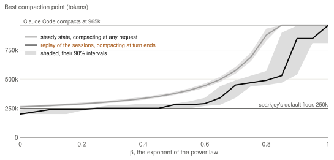

# sparkjoy

A Claude Code plugin that compacts the conversation when a piece of work is
finished, rather than when the context window fills. At the end of each turn
it puts Marie Kondo's question to the session's own model: does this
transcript spark joy? That is, does the work ahead still need it, or can it go?

<picture>
  <source media="(prefers-color-scheme: dark)" srcset="assets/session-dark.svg">
  
</picture>

One session with the plugin, and the same session replayed without it. Every
request reads the whole context again, so the area under each line counts the
tokens the session read. At each dot the plugin asked the session's model whether to
compact, and at the six filled ones it did, when a piece of work had ended:

> Long transcript of finished exploration, reverted attempts and diffs;
> remaining work is CI follow-up and the final closeout, which a summary
> covers. *(728k)*

> The hierarchy PR is open and handed over. The follow-up work needs only the
> summary, not the transcript's diffs and logs. *(680k)*

At the hollow dots the session kept going. Where the line climbs with no dot, either
a long turn was still running or the context was under 400k, the plugin's floor
when this session ran, since lowered to 250k ([Limits](#limits)). In the
replay, this session cost 25% less with the plugin than without it, and the 87
sessions under [What it saves](#what-it-saves) cost 23% less.

## Install

At the prompt of a Claude Code session:

```
/plugin install sparkjoy --marketplace max-sixty/sparkjoy
```

## What it does

- **When a turn ends**, it asks the session's own model whether to compact now
  ([How it decides](#how-it-decides)), and on yes it compacts.
- **When the session then sits idle for 55 minutes** on the one-hour prompt
  cache, it asks again, adding that the cache is about to lapse and the next
  message would make a cache write of the whole context.
- **Each verdict shows in the transcript** as a dim line with its reason:

  ```
  sparkjoy: Compacting at 401k tokens: Long transcript of finished experiments, diffs and query output; …
  ```

- **`/sparkjoy:report`** opens a page on your sessions of the last 14 days:
  every verdict, what the compactions saved, and the floors and figures the
  [cost model](#cost-model) fits to them, which sparkjoy uses from then on. It
  needs [uv](https://docs.astral.sh/uv/).

<details>
<summary>Sample report</summary>

<picture>
  <source media="(prefers-color-scheme: dark)" srcset="assets/report-dark.png">
  
</picture>

</details>

## What it saves

The author's 87 Claude Code sessions from 7 to 15 November 2026, 36,251
requests, replayed with and without the plugin[^replay]:

<picture>
  <source media="(prefers-color-scheme: dark)" srcset="assets/cost-dark.svg">
  
</picture>

<picture>
  <source media="(prefers-color-scheme: dark)" srcset="assets/context-dark.svg">
  
</picture>

|                                 | without sparkjoy | with sparkjoy |
| ------------------------------- | ---------------- | ------------- |
| cost, at Opus 5.5 list prices   | $5,214           | $4,013 (−23%) |
| mean context per request        | 462k             | 337k          |
| requests at 600k tokens or more | 28%              | 6%            |

Of the 59 sessions that reached 400k, half saved between 12% and 31%, and one
cost 19% more.

Each question is one request to the session's model, which reads the
conversation from the cache and outputs about a hundred tokens. The 198
questions, at turn ends of 400k or more, cost $22 in all, and 122 of them led
to a compaction.

A compaction costs about $0.99 on Opus 5.5, mostly the cache write of the
142k tokens it leaves. Every later request then reads less:

| compacting at | each later request reads | pays for itself after | context grows back in |
| ------------- | ------------------------ | --------------------- | --------------------- |
| 200k          | 58k less                 | 74 requests           | 34 requests           |
| 400k          | 258k less                | 17 requests           | 151 requests          |
| 700k          | 558k less                | 9 requests            | 327 requests          |

## How it decides

sparkjoy asks only when a turn ends, and again if the session then sits idle,
because a piece of work most likely ends where a turn does.

The session's own model makes the call, reading the whole transcript from the
prompt cache, because the parts of it the next turns need differ from one piece
of work to the next. The question tells the model that mostly finished work is
no reason by itself to compact, since nearly every long transcript holds mostly
finished work. It asks instead whether the next turns will need detail a
summary drops, such as exact output, failed attempts or a design still taking
shape.

The question also gives both costs, sized for the context: what a compaction
costs and how many requests it takes to pay for itself, and what keeping the
context through another turn costs, which grows with the context. The model
weighs the two and answers with its verdict and a one-line reason. In the
[evals](evals/README.md), it compacts at every turn end where the work had
finished, as the [cost model](#cost-model) recommends past about 250k. At the
four turn ends in the middle of a task, from 519k to 681k, it compacts in 5 of
8 runs.

### The prompt

<details>
<summary>At the end of a turn, for a 500k context</summary>

```
This message comes from the sparkjoy plugin, not from the user, and a program reads your reply. Use no tools.

Your turn just ended with this reply to the user:

<reply>
…the reply…

</reply>

Decide whether to compact the conversation now, while the user reads that reply.

Nearly every long transcript is mostly finished work, so that alone is no reason to compact. What decides it is whether the next turns will need detail a summary drops: exact output, what was tried and failed, what the user objected to and why, the state of a design or fix still taking shape. Work that iterates with the user on something just shown, or takes up a half-done fix or design, needs that detail; after a compaction it re-reads and re-runs what it can and loses the rest. Work that only reports a result, or starts something new, needs no more than a summary.

A compaction takes about a minute, and the request that writes its summary outputs about 6k tokens, thinking included. Afterwards the context holds about 142k tokens, counting the files the next requests read again, and those requests write it to the cache again, all but the 30k of system prompt and tools, which stay cached. A cache write costs as much as 40 cached reads, and an output token as much as 100. At 500k a compaction pays for itself after about 13 more requests that need nothing it dropped.

Keeping costs too, and more the larger the context: every later request reads all 500k tokens, against about 142k after a compaction, and keeping only puts the compaction off to a later turn end. A turn runs a median of 9 requests and a mean of 38, so keeping 500k through one more turn costs as much as about 0.7 compactions for a median turn and 3 for a mean one.

After a compaction, past sessions had about 6 more wasted requests than usual: failed tool calls, repeated lookups and corrections. That count misses detail lost without such a failure, such as a design's rejected options or what the user likes.

Weigh what keeping costs against what losing the detail would cost the next turns. The larger the context, the more detail a compaction can drop and still pay.

Reply with one JSON object and nothing else, filling its fields in order:
{"next": "what most likely comes next, in a few words", "needs_detail": true or false, "compact": true or false, "reason": "one short line saying why"}
```

</details>

<details>
<summary>In a session idle for 55 minutes, for a 500k context</summary>

```
This message comes from the sparkjoy plugin, not from the user, and a program reads your reply. Use no tools.

Your turn ended 55 minutes ago with this reply to the user, and nothing has happened since:

<reply>
…the reply…

</reply>

Decide whether to compact the conversation now. The prompt cache holding it lapses in a few minutes, and the first request after that writes all but 30k of its 500k tokens to the cache again, against about 112k after a compaction. So compact unless the next turn continues work that needs the transcript's detail.

Nearly every long transcript is mostly finished work, so that alone is no reason to compact. What decides it is whether the next turns will need detail a summary drops: exact output, what was tried and failed, what the user objected to and why, the state of a design or fix still taking shape. Work that iterates with the user on something just shown, or takes up a half-done fix or design, needs that detail; after a compaction it re-reads and re-runs what it can and loses the rest. Work that only reports a result, or starts something new, needs no more than a summary.

A compaction takes about a minute, and the request that writes its summary outputs about 6k tokens, thinking included. Afterwards the context holds about 142k tokens, counting the files the next requests read again, and those requests write it to the cache again, all but the 30k of system prompt and tools, which stay cached. A cache write costs as much as 40 cached reads, and an output token as much as 100.

After a compaction, past sessions had about 6 more wasted requests than usual: failed tool calls, repeated lookups and corrections. That count misses detail lost without such a failure, such as a design's rejected options or what the user likes.

Weigh what keeping costs against what losing the detail would cost the next turns. The larger the context, the more detail a compaction can drop and still pay.

Reply with one JSON object and nothing else, filling its fields in order:
{"next": "what most likely comes next, in a few words", "needs_detail": true or false, "compact": true or false, "reason": "one short line saying why"}
```

</details>

## Limits

- Until you run `/sparkjoy:report`, it asks only once the context reaches 250k
  at a turn end, or 175k in an idle session. That pair of floors costs least in
  a replay of the author's sessions ([Cost model](#cost-model)) when every
  question leads to a compaction. Their sessions hold about 142k after a
  compaction, much of it their own instructions and skills, and sessions that
  hold less pay from lower floors.
- The report fits all of the question's figures but one, the count of wasted
  requests after a compaction, which needs months of sessions to measure.
- It leaves Claude Code's own compaction on. Claude Code still compacts a turn
  that fills the window before it ends. In a session you have open, it also
  compacts an idle context of 200k or more without asking, a minute or more
  before sparkjoy would ask. So sparkjoy's idle question comes mainly in
  background sessions, below 200k, or with
  [`idleCompaction`](https://code.claude.com/docs/en/settings-reference#idlecompaction)
  set to `false`.
- It acts only in sessions with a 1M-token context window, the size its floors
  and figures come from.

[^replay]: The replay keeps every logged request fixed and moves only the
    compactions: "with sparkjoy" keeps the plugin's, and "without sparkjoy"
    removes them and lets Claude Code compact near 965k, as it does on its own.
    Both price each request at Opus 5.5 list prices with the session's own cache
    lifetime, and "with sparkjoy" comes within 2% of the cost the transcripts log
    ($4,013 against $3,943).

# Cost model

sparkjoy's default floors come from a model of what keeping a context and compacting it
cost, fitted to the author's sessions. It is also on [a page of its own](docs/cost-model.md).

<!-- Generated from docs/cost-model.md by docs/embed.py; edit that file. -->
<details>
<summary>The cost model</summary>

This is an analytical model of when compacting costs least. It simplifies a
session to a context that grows by the same number of tokens with each request
and drops back to the same size at each compaction, which gives the best
compaction point in closed form. [The model](docs/cost-model.md#the-model) states it in symbols.
[Fitted to the author's sessions](docs/cost-model.md#fitted-to-the-authors-sessions) puts in
values measured from the author's sessions on Opus 5.5 with the one-hour cache,
and tests the simplifications with a replay of the same sessions.

It answers two questions:

- **One compaction threshold.** If every compaction comes at the same context
  size, whatever the work, which size costs least? For the author's sessions it
  is about 260k<sup>1</sup> if three things hold: a request gets as much done at any
  context size, a compaction loses nothing the next turns need, and a session
  can compact after any request.
  The replay, which compacts only at turn ends, gives sparkjoy's default
  floors: 250k at turn ends and 175k in an idle session.
- **[Value of information](docs/cost-model.md#value-of-information).** A check at each turn end
  compacts before or after that threshold, depending on how much the work ahead
  needs the context's detail. sparkjoy's question is such a check. The model
  finds what a check could save over the best single threshold, and how often it
  must be right to pay for itself.

Costs are in CRTs, cached-read tokens. One CRT is the price of reading one token
from the prompt cache, which [Prices by model](docs/cost-model.md#prices-by-model) gives for each
model.

## The model

### Request and compaction costs

Over each cycle between compactions, a request's context x grows from K, the
context right after a compaction, by g tokens a request, until the session
compacts at X. A request with context x costs

$`\displaystyle c(x) = h\,x + c_0, \qquad h = 1 + \ell\,(w - 1)`$

Each token in the context costs one cached read, plus the extra cost of its
cache write, at w CRTs, in the share ℓ of requests that find the cache lapsed.
c₀ is the part that doesn't grow with the context: the request's output, its
uncached input, and the cache write of its g new tokens.

A compaction at X reads the whole context and outputs N tokens of summary and
thinking, at o CRTs each. The requests after it make a cache write of the K
tokens it leaves, all but the P tokens of system prompt and tools, which
Claude Code keeps in a cache shared across sessions:

$`\displaystyle F(X) = F_0 + X, \qquad F_0 = o\,N + (w - 1)(K - P)`$

<details>
<summary>The model's symbols</summary>

**Variables**

| symbol | what it is |
|----|----|
| x | Context of a request, in tokens. Over each cycle between compactions, it grows from K to X. |
| X | Context at which the session compacts, in tokens. The model chooses it. |

**Functions of the variables**

| symbol | what it is |
|----|----|
| c(x) | Cost of a request with context x, in CRTs: $`c(x) = h\,x + c_0`$. |
| F(X) | Cost of a compaction at context X, in CRTs: $`F(X) = F_0 + X`$, since the compaction request reads the whole context. |
| η(x) | Effectiveness of a request with context x, relative to a request with the full 1M window: $`\eta(x) = (x / 1\text{M})^\beta`$. A request's effectiveness is how much it gets done. |
| J(X) | Cost per unit of effectiveness when the session compacts at X, in CRTs, a cost-effectiveness ratio. It is the cost of a cycle's requests and its compaction, divided by the sum of its requests' effectiveness. |

**Parameters**

| symbol | what it is |
|----|----|
| K | Context after a compaction, in tokens. It is the first request's context (the system prompt and tools, instructions, the summary, and recent messages and files), plus the files the next few requests read again. |
| g | Growth of the context per request, in tokens, from tool results, files read and the model's own output. |
| P | Size of the system prompt and tools, in tokens. Claude Code keeps this part of K in a cache shared across sessions, so it stays cached through a compaction. |
| ℓ | Share of requests that find the cache lapsed, and so make a cache write of the whole context. The cache lapses when it expires or is invalidated. |
| N | Output of the compaction request, in tokens: the summary's text plus its thinking. |
| w | Price of one token's cache write, in CRTs. |
| o | Price of one output token, in CRTs. |
| β | Growth of a request's effectiveness with its context: each doubling of the context makes a request $`2^\beta`$ times as effective. |
| h | Cost per request of one token in the context, in CRTs. It is one read, plus the chance that the cache has lapsed times the extra cost of the token's cache write: $`h = 1 + \ell\,(w - 1)`$. |
| c₀ | Fixed cost of a request, the part that doesn't grow with its context, in CRTs. It is the request's output, its uncached input, and the cache write of its g new tokens. |
| F₀ | Fixed cost of a compaction, in CRTs. It is the compaction request's output, plus the extra cost of the cache write of the K − P tokens outside the shared cache: $`F_0 = oN + (w - 1)(K - P)`$. |

**Result**

| symbol | what it is |
|----|----|
| X\* | Value of X that makes J lowest, in tokens. |

</details>

### Best compaction point

A request's cost averaged over a cycle, its share of the compaction included,
is lowest where the marginal cost crosses it. The marginal cost is what one more
request before compacting costs. Waiting for that request lowers the average
while it costs less than the average, as in Harris's economic order quantity. If
a request gets as much done at any context, the best point has a closed form:

$`\displaystyle X^* = K + \sqrt{\frac{2g\,(F_0 + K)}{h}}`$

### Context size and effectiveness

<picture>
  <source media="(prefers-color-scheme: dark)" srcset="assets/model-effectiveness-dark.svg">
  
</picture>

A request's effectiveness η(x), how much it gets done, against its context x, as
a share of a request's with the full 1M window. Each doubling of the context
multiplies it by $`2^\beta`$, so at β = 0 a request gets as much done at any
context.

η depends only on the context's size, so a request right after a compaction, at
K, counts as getting as much done as one at K before any compaction. At larger
β, a compaction then costs effectiveness, since the requests after it work with
less. The best point then minimizes J, a cycle's cost per unit of its
effectiveness, which at β = 0 is the average cost under [Best compaction
point](docs/cost-model.md#best-compaction-point):

$`\displaystyle J(X) = \frac{g\,F(X) + \int_K^X c(x)\,dx}{\int_K^X \eta(x)\,dx}`$

### Compacting before the cache lapses

Once the cache lapses, an idle session's next request makes a cache write of the
whole context, compacted or not. Keeping costs that request P + w(x − P).
Compacting first, while the cache still holds the context, costs x + oN for the
compaction request and then P + w(K − P). If only the next request is counted,
which understates the saving, compacting first is cheaper when

$`\displaystyle x > \frac{o\,N + w\,K}{w - 1}`$

### Value of information

If a check could tell kinds of work apart, each kind could compact at its own
best point, and sparkjoy's question, asked at each turn end, is such a check. The
expected value of the check's information is the cost it saves against the best single
threshold, as a share of the whole cost, output included; a perfect check's is
the expected value of perfect information.

Work can differ in two ways that a check could tell apart:

- **In β.** A check sorts the work into a group to keep and a group to compact,
  each compacting at its own best point, and is right the same share of the time
  in each. It is scored by the mutual information between its verdict and
  whether the context helps the work, as a share of a perfect check's: a check
  right 9 times in 10 carries about half a perfect check's information, and one
  right 99 times in 100 about 90%.
- **In lost detail.** A turn end is mid-task, where a compaction loses detail, or
  finished, where it loses none. A check is right at some share of turn ends.
  Once the context passes a floor, it compacts at each turn end it calls
  finished, and once the context passes a higher ceiling, at every turn end. The
  floor and ceiling are set where they cost least.

## Fitted to the author's sessions

Measured parameters come from the author's sessions of 7 to 15 November, with 90%
intervals from resampling sessions.

### Parameter values

| parameter | value | source |
|----|----|----|
| K, context after a compaction | 142k | measured, 90% interval 137–147k: the first request after a compaction holds 122k, and the next few requests read 20k of files again |
| g, growth of the context per request | 1,706 | measured, 1,615–1,805: the mean over the sessions' requests except the first few after a compaction, since K counts the files those read again |
| P, system prompt and tools | 30.4k | measured, 30.4–31.0k |
| ℓ, share of requests that find the cache lapsed | 0.56% | measured, 0.51–0.63%: the one-hour cache expires after an hour idle |
| N, output of the compaction request | 5.6k | measured, 5.2–5.9k: the summary's text is a median 3.5k tokens, and requests that show about that much output produce 1.61 times as much in all, thinking included |
| w, price of a token's cache write | 40 | list price, for the one-hour cache; a write to the five-minute cache costs 25 |
| o, price of an output token | 100 | list price |
| β, growth of effectiveness with the context | 0 | assumed |
| h, cost per request of a token in the context | 1.22 | derived |
| c₀, fixed cost of a request | 134k | derived |
| F₀, fixed cost of a compaction | 4.93M | derived |
| X\*, best compaction point | 261k | derived |

### Trade-off

<picture>
  <source media="(prefers-color-scheme: dark)" srcset="assets/model-cycles-dark.svg">
  
</picture>

The model at four compaction points over 600 requests. Compacting early makes
compactions frequent, and compacting late makes requests large.

| compact at | requests a cycle | mean cost per request | against never compacting |
|----|----|----|----|
| 175k | 19 | 600k CRTs | 73% |
| 260k | 69 | 455k CRTs | 55% |
| 400k | 151 | 500k CRTs | 61% |
| never, leaving it to Claude Code at 965k | 482 | 820k CRTs | 100% |

### What a request and a compaction cost

<picture>
  <source media="(prefers-color-scheme: dark)" srcset="assets/model-inputs-dark.svg">
  
</picture>

A request's cost c(x) (top) and a compaction's F(x) (bottom) by part, against
the context x. A request's cost grows with its context, mostly its cache read,
from about 300k CRTs at 150k to 1M at 700k. A compaction costs about 5M at any
context, 4.4M of it the cache write of the context it leaves.

Every part except the read of the context is measured from 36,249
requests.

<details>
<summary>What share of the sessions' bill each kind of token took</summary>

<picture>
  <source media="(prefers-color-scheme: dark)" srcset="assets/model-bill-dark.svg">
  
</picture>

The sessions' 36,000 requests, each priced from its logged usage at Opus 5.5,
with each compaction's own request, which isn't logged, taken from the model.
Output is a small share because each request reads its whole context again: on
average, a request's 746 output tokens cost as much as 75k cached reads, against
a context of 335k tokens.

| kind of token | share of the bill | compactions' part, as a share of the bill |
|----|----|----|
| output, thinking included | 14% | 0.4%, the summary |
| cache writes | 25% | 2.4%, the compacted context, on the request after each compaction |
| cache reads | 61% | 0.35%, the context the compaction reads |
| uncached input | 0.01%, too thin to draw | |
| all | 100% | 3.2% |

</details>

### Average cost

<picture>
  <source media="(prefers-color-scheme: dark)" srcset="assets/model-average-dark.svg">
  
</picture>

A request's cost averaged over a cycle, its share of the compaction included,
against the compaction point, with a request getting as much done at any
context size. Against Claude Code's default of compacting at 965k, compacting
at the cheapest point, about 260k, saves 45% per request, and compacting at
400k saves 39%.

The average is lowest where the marginal cost, the straight line in the chart,
crosses it. With the values above, the closed form under [Best compaction
point](docs/cost-model.md#best-compaction-point) gives

$`\displaystyle X^* = 142\text{k} + \sqrt{\frac{2 \cdot 1706 \cdot (4.93\text{M} + 142\text{k})}{1.22}} = 142\text{k} + 119\text{k} = 262\text{k}`$

### Best point for each β

<picture>
  <source media="(prefers-color-scheme: dark)" srcset="assets/model-cost-dark.svg">
  
</picture>

J against the compaction point, as a share of J when never compacting. The
larger β, the later the minimum comes and the less it saves.

| β | effectiveness at 150k, against 1M | best point | saved there, against never compacting |
|----|----|----|----|
| 0 | 100% | about 260k | 45% |
| 0.3 | 55% | 310k | 28% |
| 0.6 | 30% | 440k | 8% |
| 1 | 15% | 965k, where Claude Code compacts | none |

### Sensitivity

<picture>
  <source media="(prefers-color-scheme: dark)" srcset="assets/model-sensitivity-dark.svg">
  
</picture>

How far the best point at β = 0, about 260k, moves when a parameter measured in
the sessions is halved or doubled, and across its 90% interval. K, the context
after a compaction, moves it most, from 150k to 459k when halved or doubled, but
only from 254k to 269k across its interval, and each other parameter moves it
less than 10k across its own.

That interval covers only the author's sessions, and K differs more between
users. About two-thirds of what K holds beyond the shared system prompt is the
user's own instructions and skills, which Claude Code attaches again after a
compaction. One published session with few of them held 37k right after a
compaction, on a 200k window
([anthropics/claude-code#87602](https://github.com/anthropics/claude-code/issues/87602)).
With the larger skill listing a 1M window carries and the files read again, that
is a K of roughly 60–70k, which puts the best point near 140k. So
`/sparkjoy:report` fits K and the floors to each user's sessions.

The assumptions about the work move it more. It reaches 400k only at β = 0.55,
where a request at 200k gets 68% as much done as one at 400k, or if each
compaction loses about 19M CRTs of detail, some 64 wasted requests.

<details>
<summary>Does the model's simplification matter?</summary>

<picture>
  <source media="(prefers-color-scheme: dark)" srcset="assets/model-threshold-dark.svg">
  
</picture>

The best point against β, in the model, which compacts after any request, and
in a replay of the sessions from 7 to 15 November, which compacts only at turn
ends, with 90% bands. Turn ends move the best point earlier.

The replay keeps every logged request and moves only the compactions. When the
replay may compact after any request, its best point is 260k, against the model's 261k,
so uneven growth, cache lapses and sessions ending move it little. Turns run a
median of 9 requests but a mean of 38, so one turn can carry the context far
past the best point before the next chance to compact.

| β | best point | best turn-end threshold | saved there | saved from 250k, sparkjoy's default floor | saved from 400k |
|----|----|----|----|----|----|
| 0   | 261k | 200k | 30.0% | 29.8% | 25.0% |
| 0.3 | 307k | 250k | 20.1% | 20.1% | 17.2% |
| 0.6 | 444k | 290k | 8.5%  | 8.3%  | 7.9%  |

These savings are below the model's 45% because, without compaction, real
sessions end before their context reaches 965k. Each assumes a check that always
says to compact; sparkjoy's question decides which turn ends past the floor to
use.

</details>

### Idle sessions

| policy | saved |
|----|----|
| turn ends from 400k | 25.0% |
| turn ends from 400k and idle sessions from 200k | 28.4% |
| turn ends from 200k, the best without idle compaction | 30.0% |
| turn ends from 250k and idle sessions from 175k | 30.7% |

The replay at β = 0, each policy compacting wherever it allows. Idle compaction
does much of what a lower turn-end threshold would, since 18% of turn ends are
followed by an hour's gap.

sparkjoy asks once a session has sat 55 minutes since its last reply without a
new message. The replay times that wait from each reply to the next message, and
counts each session's last reply as followed by one. The last row, sparkjoy's
default floors, is the best pair on a grid of 50k steps at turn ends and 25k steps idle. Every pair of 200k–250k at turn ends and
150k–175k idle comes within 0.3 points of it.

With the values above, compacting before the cache lapses is cheaper for the
next request alone from about 160k, by the inequality under [Compacting before
the cache lapses](docs/cost-model.md#compacting-before-the-cache-lapses).

### What a check saves

#### Work that differs in β

<picture>
  <source media="(prefers-color-scheme: dark)" srcset="assets/model-voi-dark.svg">
  
</picture>

What a check saves, against how much its verdict tells about whether the
context helps the work. Each line is a mix of work with mean β 0.6, with one
share at a single β and the rest at β = 0. The higher that share's β, the more
a perfect check saves, and the closer to perfect a check must be to get half of
that saving. The band along 0 is what the checks cost, about 0.3%.

| mix | best single threshold | a perfect check saves | half that saving needs | right 9 times in 10, a check saves | a check pays once right |
|----|----|----|----|----|----|
| all at β = 0.6 | 440k | 0 | | 0 | |
| 60% at β = 1 | 790k | 11% | 39% of the information | 7% | 57% of the time |
| 30% at β = 2 | never compacting | 20% | 63% | 7% | 71% |
| 12% at β = 5, work that stalls without its history | never compacting | 24% | 90% | 1% | 87% |

Compacting work that needs its context is the costly error, and each unit of β
makes it about 3.5 times dearer. Compacted at 261k, a unit of work costs 1.5,
4.8 and 208 times what it does never compacting at β = 1, 2 and 5. So the higher
β, the purer the group a check says to compact must be before compacting it
pays, and at β = 5 a check saves nothing up to 29% of the information.

A perfect check saves at most 15% on any mix of β = 0 and 1, 31% of 0 and 2, and
40% of 0 and 5. On no mix can it save more than 45%, what β = 0 work saves at its
best point against never compacting, since never compacting is always one choice
of single threshold. At a given mean β, it saves most when a small share of the
work has β around 5 to 10. A rarer, steeper share saves less, 17% with 2% of the work at
β = 30, because a unit of its effectiveness costs 77 times one at β = 0 even
when never compacting, and no check lowers that part of the cost.

#### Turn ends that differ in lost detail

A replay of the sessions marks 30% of turn ends mid-task and the rest finished,
and gives its check a floor and a ceiling as under [Value of
information](docs/cost-model.md#value-of-information).

| with 1.8M CRTs lost per compaction, as measured, about 6 wasted requests | share of the cost under the best threshold without a check |
|----|----|
| what a perfect check saves | 0.8% |
| what a check saves that calls turn ends as sparkjoy's question did on the evals | 0.1% |
| what the checks cost | 0.3% |
| what the lost detail costs in all, the most any check can save | 2% |

On the evals, sparkjoy's question compacted at every finished turn end, and
kept the context in 3 of 8 runs at the four mid-task turn ends, two runs each.
The evals' verdicts have not yet been compared with the live plugin's. The lost detail costs little in all because
real sessions end, and so compact less often than the steady state does.

The replay's check doesn't see the context's size, so it needs the ceiling.
sparkjoy's question states what keeping the context costs, so the model can
compact at a mid-task turn end once keeping costs more than the detail a
compaction would lose. On the evals, its verdicts still respond noisily to
context size.

#### Where a check pays

| telling work apart pays when | in the measured sessions |
|----|----|
| work's β varies widely, and the check is right most of the time | Neither how much β varies across the work nor how accurate sparkjoy's question is has been measured yet. Grading each of its verdicts by what happened next, such as whether the turns after a compaction re-read files it dropped, would measure the second. |
| each compaction loses several times the 1.8M CRTs of detail measured so far | Not seen, though the measure misses some losses, such as a design's rejected options or what the user likes ([What does the model assume a compaction loses?](docs/cost-model.md#questions-about-the-model)). |

### Prices by model

| model | price of 1M CRTs | a token's cache write, in CRTs | an output token, in CRTs | a compaction's fixed cost | best point |
|----|----|----|----|----|----|
| Opus 5.5 | \$0.20 | 40 | 100 | 4.9M CRTs, \$0.99 | about 260k |
| Sonnet 5.5 | \$0.10 | 40 | 100 | 4.9M CRTs, \$0.49 | about 260k |
| Fable 5.2 | \$0.20 | 80 | 200 | 10M CRTs, \$1.99 | about 300k |
| Haiku 5.5, above 100k | \$0.05 | 20 | 50 | 2.4M CRTs, \$0.12 | about 230k |

Prices for the one-hour cache. Where a model's cache write and output cost more
CRTs, a compaction costs more too, and the best point moves later. Every other
section's figures are for Opus 5.5.

## Fitting it to your sessions

`/sparkjoy:report` fits the model to your sessions of the last 14 days. Its
Thresholds section gives the pair of floors that costs least for them. From then
on sparkjoy asks from that pair, and its question states the parameters the
report measured in place of the defaults. A
fit needs some compactions in the window, to measure K and N.

## Questions about the model

<details>
<summary>What would put the best point near 700k?</summary>

A request at 700k costs about 1M CRTs, against about 300k at 150k, so a
compaction there recovers its 5.6M CRTs within 9 requests, a median turn.
Waiting that long pays only if the requests after a compaction get much less
done, and even then compacting at 700k barely beats never compacting:

| what puts the best point at 700k | effectiveness right after a compaction | effectiveness per CRT against never compacting |
|----|----|----|
| β = 0.75 (best point 690k) | 23% of 1M's | +1.1% |
| β = 0, and each compaction loses 106M CRTs of detail, 365 requests' worth | 100% | +5.3% |

</details>

<details>
<summary>What does the model assume a compaction loses?</summary>

The model makes a request's effectiveness depend only on its context's size. A
request right after a compaction, whose 142k tokens hold a summary of the work
so far, counts as getting as much done as a request at 142k before the session's
first compaction.

At β above 0, a summary can do better than that. If it keeps what the work
needs, the requests after it get as much done as with the whole transcript, more
than the model counts, and compacting pays more than the model says. A summary
that drops detail the next turns need costs more instead, in a mistake, a
correction from the user or a step run again. The model adds that cost as D
CRTs per compaction, and the best point of 260k takes D as 0.

After manual `/compact`s and Claude Code's own compactions, the author's
sessions had about 6 more wasted requests than usual, failed tool calls,
repeated lookups and corrections, a D of about 1.8M CRTs with a 90% interval
from −0.7M to +5.6M. That count misses losses that waste no request, such as a
design's rejected options or what the user likes.

| D per compaction | best point, β = 0 | best point, β = 0.6 | a perfect check saves, β = 0 |
|----|----|----|----|
| 0, a summary that keeps everything needed | 260k | 440k | 0 |
| 1.8M CRTs, as measured | 280k | 480k | 0.8% |
| 5.6M, the top of its interval | 315k | 550k | 3.1% |
| 18.6M, about 64 wasted requests | 400k | 720k | 12% |

</details>

<details>
<summary>Why a power law?</summary>

It has one parameter with a plain meaning: each doubling of the context makes a
request $`2^\beta`$ times as effective, wherever it starts. The cost uses only the
curve from about 150k to 965k, under three doublings, so what it does at small
contexts doesn't enter the cost. Over that range a saturating form, levelling
off once the context holds what the work needs, could serve as well. The two
differ on one question: does doubling an agent's context from 400k to 800k
improve its next steps about as much as doubling it from 100k to 200k? The
power law predicts it does.

</details>

<details>
<summary>Does the power law give more context diminishing returns?</summary>

Per token, yes, with β below 1: a token at 400k adds less than one at 100k, half
as much at β = 0.5 and 29% as much at β = 0.1. Per doubling, no, since each
doubling makes a request $`2^\beta`$ times as effective at any size. Every token is
worth the same only at β = 1.

</details>

<details>
<summary>Has anyone modelled this before?</summary>

The closest published studies, from August to October 2026, sweep the
threshold on benchmarks ([Satish et al.](https://arxiv.org/abs/2609.32961),
[CliffCompaction](https://arxiv.org/abs/2609.26779)) or measure what a
compaction drops ([Salle et al.](https://arxiv.org/abs/2610.31778),
[Liu](https://arxiv.org/abs/2608.16370)). The closest cost rule,
[Nadir's](https://getnadir.com/blog/mask-dont-summarize-agent-context-cache-cost/),
leaves out quality. None lets a request's effectiveness depend on its context,
prices the cache write, or limits compaction to turn ends.

</details>

## Notes

1. X\*, the best compaction point: 262k from the closed form under [Best compaction point](docs/cost-model.md#best-compaction-point), and 253–271k, its 90% interval from resampling sessions.

</details>
<!-- End of the generated copy. -->
