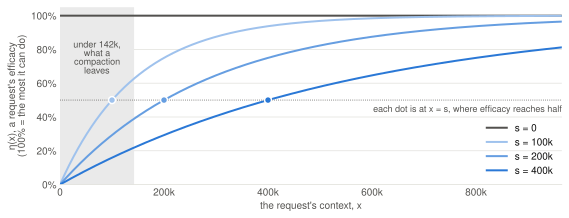
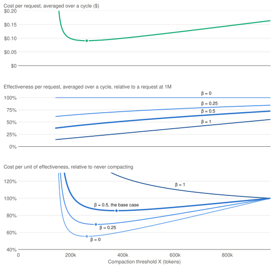
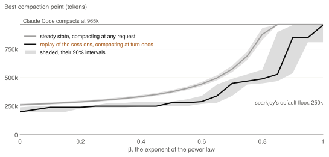

# When to compact

In a Claude Code session, every model request reads the whole conversation
from the prompt cache, so a long context makes every request dearer. A
compaction replaces the conversation with a summary. It costs the summary's
output and a cache write of the shorter context, and makes every later request
cheaper. This page models that trade, fits the model to the author's sessions,
and gives the context size at which to compact.

For the author's sessions on Opus 5.5 with a one-hour cache, the model says to
compact when the context reaches about **260k tokens**. In plain numbers: a
compaction costs about as much as reading 4.9M cached tokens, $0.99, besides
one read of the context; it leaves about 142k; each later request reads the
difference less; and the context grows back about 1.7k tokens a request.

| compacting at | each later request reads | pays for itself after | context grows back in |
| ------------- | ------------------------ | --------------------- | --------------------- |
| 200k          | 58k less                 | 74 requests           | 34 requests           |
| 260k          | 118k less                | 37 requests           | 69 requests           |
| 400k          | 258k less                | 17 requests           | 151 requests          |
| 700k          | 558k less                | 9 requests            | 327 requests          |

Compacting costs least where a compaction pays for itself in about half the
time the context takes to grow back. At 200k it hasn't paid by the time the
context is back; at 400k it paid for itself long before.

A turn is everything Claude does between the user's message and its reply: a
run of model requests, typically one per tool call. A compaction inside a turn
would interrupt work in progress, so sparkjoy, like a person typing
`/compact`, compacts only at the end of a turn. Turns are uneven, a median 9
requests and a mean 38, so a policy limited to turn ends does best compacting
earlier, from about **200k**: 30.0% less than never compacting, where every
turn end past 400k, sparkjoy's first floor, saves 25.0%. Compacting idle
sessions as well, from about 175k, raises the best turn-end threshold to 250k
and the saving to 30.7%. sparkjoy asks from these two.

These figures take a request to get as much done at any context size. The
model lets more context help a request, up to a limit: s is the context at
which a request gets half as much done as it could, and at s = 0 size doesn't
matter. The sessions put s near 0 and at most about 100k, where the best point
is 324k and the best threshold at turn ends 250k:

| s    | best point, compacting after any request | best threshold at turn ends | saved there | saved at 250k | saved at 400k |
| ---- | ---------------------------------------- | --------------------------- | ----------- | ------------- | ------------- |
| 0    | 261k (253–271k)                          | 200k (200–240k)             | 30.0%       | 29.8%         | 25.0%         |
| 50k  | 279k (272–288k)                          | 240k (200–250k)             | 28.3%       | 28.2%         | 24.0%         |
| 100k | 324k (316–333k)                          | 250k (240–290k)             | 23.0%       | 23.0%         | 20.4%         |
| 150k | 368k (360–378k)                          | 280k (250–290k)             | 18.1%       | 18.1%         | 16.6%         |
| 200k | 410k (401–421k)                          | 290k (270–340k)             | 14.3%       | 14.1%         | 13.5%         |
| 300k | 488k (476–502k)                          | 340k (300–440k)             | 9.2%        | 8.6%          | 9.0%          |

The second column is the steady-state model's optimum, derived below. The
third comes from replaying the sessions with compaction only at turn ends.
"Saved" is the cost per unit of progress against never compacting, where Claude
Code still compacts near the end of the window. Ranges are 90% intervals from
resampling the 85 sessions; for the replay, the resampling holds the fitted
compaction parameters fixed.

## The model

### Units

Costs are counted in cached reads, the price of reading one token from the
prompt cache. Every other kind of token is a multiple of it
([pricing](https://platform.claude.com/docs/en/about-claude/pricing),
November 2026):

| cached reads per token of | symbol | Opus 5.5, Sonnet 5.5 | Fable 5.2 |
| ------------------------- | ------ | -------------------- | --------- |
| cache read                |        | 1                    | 1         |
| uncached input            | u      | 20                   | 40        |
| output                    | o      | 100                  | 200       |
| cache write, 5 minutes    | w      | 25                   | 50        |
| cache write, 1 hour       | w      | 40                   | 80        |

A cached read costs $0.20 per million tokens on Opus 5.5 and Fable 5.2, and
$0.10 on Sonnet 5.5. None of the three charges more for long prompts. Claude
Code caches for an hour on a subscription and for five minutes with an API key.

### What a request costs

A request with context x is a cache read of the context, a cache write of the
g tokens added since the request before it, and ō output tokens. A share ℓ of
requests find the cache lapsed or invalidated, and make a cache write of the
whole context instead, except the system prompt and tools (P tokens), which Claude
Code keeps in a cache shared across sessions:

```math
c(x) = x + (w-1)\big[(1-\ell)\,g + \ell\,(x-P)\big] + o\,\bar{o} + u\,\bar{\imath} \;=\; h\,x + c_0
```

with h = 1 + ℓ(w−1), the cached reads it costs to hold a token for a request,
and c₀ = oō + uī + (w−1)[(1−ℓ)g − ℓP], the cached reads of a request's cost
that don't grow with the context. ī is the uncached input, a couple of tokens.

### What a compaction costs

```math
F(x) = x + o\,N + (w-1)\,(K - P)
```

- The compaction request is a cache read of the context x and N tokens of
  output: the summary's text plus its thinking.
- The context then restarts from K tokens: the first request after the
  compaction (122k: the system prompt and tools, instructions, the summary,
  and recent messages and files), plus the files the next few requests read
  again because the summary left them out (20k).
- Of those, P, the system prompt and tools (30k), sit in a cache shared across
  sessions, so a compaction never makes a cache write of them. The rest is a
  cache write again, K − P tokens in all. The model needs only K and P, not
  how the rest splits.

F₀ = oN + (w−1)(K − P), in cached reads, is the part of F that doesn't depend
on x.

### Efficacy and its half point s

The size of the context can change how much a request gets done. A larger
context helps when more of the work's history is at hand, and the help runs
out once the context holds what the next steps need. The model gives a request
with context x an efficacy of

```math
\eta(x) = 1 - 2^{-x/s}
```

how much it gets done, where 100% is the most a request can get done, the
level it approaches as its context grows. A session's progress is the sum of its
requests' efficacies. s, in tokens, is the context at which a request reaches
half of full efficacy. Like a half-life, each further s of context halves the
gap that remains, so a request reaches 75% at 2s and 88% at 3s. At s = 100k, a
request at 400k has 94% and one at 900k nearly 100%; at s = 200k, 75% and 96%.
At s = 0 every request has the same efficacy, whatever its context.

<picture>
  <source media="(prefers-color-scheme: dark)" srcset="../assets/model-progress-dark.svg">
  
</picture>

### The best compaction point

Suppose a session compacts each time its context reaches X. Its context grows
from K to X at g tokens per request, then starts again. By the renewal-reward
theorem ([Ross](https://shop.elsevier.com/books/introduction-to-probability-models/ross/978-0-443-18761-2),
ch. 7), its long-run cost per unit of progress is one cycle's cost over one
cycle's progress:

```math
J(X) = \frac{g\,F(X) + \int_{K}^{X} c(x)\,dx}{\int_{K}^{X} \eta(x)\,dx}
```

Setting dJ/dX to zero gives the condition for the best point X\*:

```math
\frac{c(X^*) + g}{\eta(X^*)} = J(X^*)
```

Compact when the next request's cost per unit of progress reaches the average over
the cycle, compaction included. (The g is the next request's growth, which the
summary would also read.) It is the rule for replacing a machine whose running
cost rises with age: replace it when its marginal cost reaches its average
cost ([Kletke 1969](https://ageconsearch.umn.edu/record/29853/files/01010045.pdf)).

At s = 0 the condition solves in closed form:

```math
X^* = K + \sqrt{\frac{2\,g\,(F_0 + K)}{h}}
```

This is Harris's
[economic order quantity](https://doi.org/10.1287/opre.38.6.947) (1913): the
context is stock that costs h cached reads per token per request to hold, and a
compaction is an order with fixed cost F₀ + K. Two properties follow.

- At X\*, a compaction pays for itself in about half the requests the context
  takes to grow back to X\*, as the table at the top shows. The yardstick for
  payback is the regrowth time, not the length of a turn.
- Cost is flat near X\*. Compacting at twice the optimal growth X\* − K, near
  380k here, raises the part of the cost that depends on X by 25%, which is 8%
  of a request's whole cost.

For s > 0, `model/fit.py` solves the condition numerically. There c₀ matters:
output and new tokens cost the same per request at any context, but a request's
efficacy doesn't, so they weigh on the choice only when s > 0.

<picture>
  <source media="(prefers-color-scheme: dark)" srcset="../assets/model-sawtooth-dark.svg">
  
</picture>

<picture>
  <source media="(prefers-color-scheme: dark)" srcset="../assets/model-cost-dark.svg">
  
</picture>

The cost against the compaction point, for s from 0 to 400k. It climbs
steeply toward K, where compactions come every few requests, and flattens
around X\*. With s above 0, a compaction costs progress as well as tokens,
since the requests after it work with less context until it refills, so X\*
moves later and the saving shrinks. No compaction short of Claude Code's own
pays above s ≈ 1.2M. These savings are larger than the replay's below because
the steady state's never-compacting arm climbs to 965k in every cycle, where
real sessions end before many cycles.

## Fitted parameters

From the author's 85 interactive sessions of more than one request, 7 to 15
November 2026, 36,249 main-thread requests, priced at Opus 5.5 with the
one-hour cache the sessions used:

| parameter | value | 90% interval | how |
| --------- | ----- | ------------ | --- |
| K, tokens of context after a compaction: the first request after it (122k: the system prompt and tools, instructions, the summary, and recent messages and files), plus the files the next few requests read again (20k) | 142k | 137–147k | the first request's median over 135 compactions, plus how much more the first 20 requests of a turn grow after a compaction than after another turn end |
| P, tokens of the system prompt and tools, in the cache shared across sessions | 30k | 30–31k | the first request's cache reads |
| N, output tokens of the compaction request: the summary's text plus its thinking | 5,608 | 5,247–5,885 | the summary's text, a median 3,474 tokens at 4 characters each over 143 summaries, times 1.61, the median ratio of output tokens to visible output (text, and tool input as JSON) of the 243 requests whose visible output is half to 1.5 times the summary's, on their session's model |
| g, tokens the context grows per request | 1,706 | 1,615–1,805 | mean, leaving out the 20 requests after each compaction |
| ō, output tokens per request | 746 | 699–792 | mean |
| ℓ, share of requests that make a cache write of the context | 0.56% | 0.51–0.63% | 18% of turn ends are followed by a gap of over an hour |
| h, c₀, F₀, in cached reads | 1.22, 134k, 4.93M | | derived; F₀ is $0.99 |

At s = 0, X\* is 262k by the closed form above (261k on the script's 1k grid).
Without the lapses in h it would be 274k, and with N twice as large, 268k.
K's 20k of files read again likely leans high, since the turns after a
compaction more often start new work, which reads more files anyway.

Two measurements bear on what the model assumes:

- **Re-reading.** Over the 20 requests after a compaction, whatever turns they
  fall in, 0.24 more requests read a file that had been read before the
  compaction than, after an ordinary turn end, read a file read earlier in the
  context (90%: 0.04 to 0.50). Claude Code attaches the files a session used
  last, which may be why the excess is small.
- **Growth.** g falls from 2.3k tokens per request at 100–200k to 1.5k at
  400–500k, where the model takes it as constant. The replay below uses each
  request's own growth.

## Results

### s moves the point later

<picture>
  <source media="(prefers-color-scheme: dark)" srcset="../assets/model-threshold-dark.svg">
  
</picture>

Across s from 0 to 100k, the range "Calibrating s" below allows, the best point
moves from 261k to 324k and the best turn-end threshold from 200k to 250k. For
the point to reach 400k, s has to be 190k, where a request at 200k has 52% efficacy
and one at 400k 77%.

### Turn ends lower the threshold

A turn runs a median of 9 requests but a mean of 38, because a few run to
hundreds, so one turn can carry the context far past X\* before the next
chance to compact. The best threshold at turn ends therefore sits below X\*.

The replay measures how far. It keeps every logged request, with its growth,
output and timing, and moves only the compactions: those sparkjoy or Claude
Code's auto-compaction made are removed, those the user typed stay, and each
arm compacts by its own rule. Each compaction an arm makes leaves K at once,
the 20k of files read again included, and each one it removes takes those 20k
out of the growth of the requests after it. Compacting after any request, the
replay's best point is 260k, beside the steady state's 261k: uneven growth, real lapses and sessions ending
together move the optimum little, though they may offset one another.
Compacting only at turn ends moves it to 200k.

At s = 0, any threshold from 170k to 280k comes within one percentage point of
the best. A threshold of 400k costs 7% more per unit of progress than the best,
and 600k costs 24% more.

Compacting too early can't run away at turn ends. Under K, every turn end
compacts, and that still costs about a fifth less than never compacting at s = 0,
because a turn grows the context by 68k on average. In the steady state, where
a compaction could follow any request, compacting at 150k would cost 3.2 times
as much per unit of progress as compacting at X\*: a compaction every four
requests or so.

### Lost detail

The model prices a compaction in tokens. Its other cost is work the summary no
longer supports: a mistake, a correction from the user, a step re-run. If that
costs D cached reads on average, D adds to F₀, and X\* − K grows with
√(F₀ + K + D). At s = 0, X\* reaches 400k when D is 18.6M cached reads, $3.72
at Opus 5.5 prices: 3.5 times the compaction's own cost at 400k, or the price
of a cache write of 477k tokens, about 24 times the 20k of files read again
after a compaction. LangWatch's
author [found](https://langwatch.ai/blog/context-tax-when-to-compact) that in
their sessions, 42% of their messages in the five steps after a compaction
carried a correction, matched by phrase, against 18% otherwise. In these
sessions, "Calibrating s" below finds D near zero where it could be measured.

D varies from one turn end to the next, which a threshold can't see.
sparkjoy's question asks the session's model whether the next turns will need
detail a summary drops; in the model's terms, it estimates D for the moment at
hand.

### Idle sessions

When a session sits idle until its cache lapses, the next request makes a cache
write of the whole context, compacted or not. Keeping costs that request
P + w(x − P). Compacting first, while the cache still holds the context, costs
the compaction request, x + oN, and then P + w(K − P). Compacting is cheaper
when

```math
x > \frac{o\,N + w\,K}{w - 1} \approx 160\text{k}
```

counting the next request alone; the cheaper requests after it only add to the
saving. sparkjoy asks once a session has sat 55 minutes since its last reply
without a new message. The replay runs that timer from each reply to the next
message, and takes a session's last reply to be followed by such a wait.
Replayed at s = 0, with every policy compacting wherever it allows:

| policy                                                   | saved |
| -------------------------------------------------------- | ----- |
| turn ends from 400k, sparkjoy's first floor              | 25.0% |
| and idle sessions from 200k, its first idle floor        | 28.4% |
| turn ends from 200k, the best without idle compaction    | 30.0% |
| turn ends from 250k and idle sessions from 175k: the best pair, and sparkjoy's floors | 30.7% |

The pairs come from a grid of turn-end thresholds in steps of 50k and idle
thresholds in steps of 25k; every pair of 200k–250k at turn ends and 150k–175k
idle comes within 0.3 points of the best. 18% of turn ends here are followed by
an hour's gap, so idle compaction does much of what a lower turn-end threshold
would: sparkjoy's first two floors together saved 2.3 points less than the
best pair.

### Other prices and cache lifetimes

The same sessions, priced again, at s = 0:

| prices               | cache     | ℓ     | h    | X\*  | best at turn ends | saved | idle break-even |
| -------------------- | --------- | ----- | ---- | ---- | ----------------- | ----- | --------------- |
| Opus 5.5, Sonnet 5.5 | 1 hour    | 0.56% | 1.22 | 261k | 200k              | 30.0% | 160k            |
| Opus 5.5, Sonnet 5.5 | 5 minutes | 2.33% | 1.56 | 228k | 160k              | 37.0% | 172k            |
| Fable 5.2            | 1 hour    | 0.56% | 1.44 | 297k | 250k              | 26.8% | 158k            |
| Fable 5.2            | 5 minutes | 2.33% | 2.14 | 246k | 180k              | 36.4% | 168k            |

A Fable 5.2 cache write costs twice as many cached reads, which raises F₀ and
with it X\*. A five-minute cache lapses after 2.3% of requests, 57% of them at
turn ends, which makes a large context dearer to hold and lowers X\*.

## Calibrating s

Progress isn't logged, but some of what is lost of it is: a tool call that
fails, a lookup repeated while its result is still in the context, a turn the
user corrects or interrupts. `model/calibrate.py` counts these as trouble and
compares it across context sizes within each session, with a fixed effect for
each session and markers for the 20 requests and two turns after a compaction.
If a share w of requests is wasted, efficacy is proportional to
1 − w, so each value of s predicts how much more trouble requests at small
contexts see. That assumes a request that goes right gets as much done
at any context; a gain there would show in none of these
signals. A corrected or interrupted turn counts as wholly wasted. Corrections
are matched by a phrase list in what the user typed; scored blind against 160
hand-labelled turns, it finds half of them, and a third of its matches aren't
corrections, so its slopes are divided by J = sensitivity + specificity − 1 =
0.42, whose own uncertainty the intervals carry.

The 60 days to 16 November have 993 sessions, 311,386 requests and 3,465
turns the user answered by typing (90% intervals from resampling sessions):

| trouble              | mean  | points per e-fold of context | points after a compaction |
| -------------------- | ----- | ---------------------------- | ------------------------- |
| failed tool call     | 2.8%  | −0.56 (−0.72 to −0.38)       | +1.0 (+0.8 to +1.3)       |
| repeated lookup      | 0.26% | +0.10 (+0.04 to +0.15)       | −0.16 (−0.22 to −0.11)    |
| correction (matches) | 20%   | −1.5 (−7.9 to +5.5)          | −2.2 (−9.8 to +5.7)       |
| interruption         | 0.7%  | +0.04 (−0.61 to +0.64)       | −0.59 (−1.00 to −0.14)    |

At s = 100k, requests below 200k would see 24 points more trouble than those
at 400k–600k, and at s = 50k 9 points more; the measured difference is −13
(−37 to +5).
The best fit is **s near 0, at most 100k**: X\* is 261k, or 324k at the top of
the interval, and the best turn-end threshold 200k, or 250k. It is weak
evidence. Within a session the context grows as a piece of work goes on, and
compactions come where work ends, so trouble by context is partly trouble by
the work's phase, which the session's fixed effect doesn't remove. Randomizing
the threshold across sessions would separate the two.

**Long contexts hurting.** η can't fall as the context grows. A power law,
η ∝ x^(α−1), can, for α below 1. Fitted to the same trouble, by
α − 1 = −(dw/d ln x) / (1 − w̄), it gives α = 1.06 (0.82–1.27): no sign of
harm. A compaction resets the context but not the session's age, so the two
separate; controlling for the age moves α by 0.01. Counting corrections as
wasting none of their turn gives 1.005, and twice their turn 1.16 (0.42–1.95).
A flat η, the power law and the saturating form fit the trouble about equally
well: the data bound the size of the effect but can't tell the shapes apart.

**Lost detail.** The trouble after a compaction comes to −2.8 wasted requests
(−19 to +13), D = −$0.16 (−$1.07 to +$0.73). It is lower after sparkjoy's
compactions, which come where a piece of work ends: −34 requests (−85 to +5).
After the user's and Claude Code's it is +6 requests (−3 to +20), $0.35
(−$0.14 to +$1.12). X\* reaches 400k only at D = $3.72, 64 wasted requests; at
$1.12, X\* is 315k and the best turn-end threshold 250k. With s at 100k as
well, the best turn-end threshold is 290k, and 400k saves one point less. An
estimated 16% of first turns after a compaction drew a correction, against 23%
of others, where LangWatch found 42% against 18%.

**Where compactions happen.** The sessions do compact much later than the
model says, the user's own `/compact` included:

| compacted by         | 60 days | median context (10th–90th) | this page's window | median |
| -------------------- | ------- | -------------------------- | ------------------ | ------ |
| the user, `/compact` | 664     | 413k (242–625k)            | 14                 | 525k   |
| sparkjoy, from 400k  | 326     | 453k (402–623k)            | 121                | 471k   |
| Claude Code, idle    | 35      | 244k (210–349k)            | 8                  | 243k   |
| Claude Code, at 965k | 4       | 968k                       | 0                  |        |

The outcomes measured give no reason to wait that long. They miss progress
lost without a failure, a lookup or a correction; corrections given on a Leaf
page; harm later than two turns after a compaction; the user's time; and D
where a threshold would compact, since nearly every compaction measured came
where sparkjoy or the user chose. The 35 idle compactions fall at arbitrary
moments but are too few to measure alone. Comparing thresholds in use, a floor
of 250k in some sessions against 400k in others, would measure D where it
matters.

## What it implies for sparkjoy

With s at most 100k, and D small where it could be measured, the model
supports asking at turn ends from 250k rather than 400k, where sparkjoy first
asked. 250k doesn't depend on the fit of s: it comes within 0.2 points of the
best threshold for any s up to 200k, where 400k gives up 5 points if s is near
0. In idle sessions it supports asking from 150k–175k rather than 200k.
sparkjoy asks from 250k and 175k, and its question's payback and turn-cost
figures come from F(x) and h above, with the fitted parameters rounded.
The question's payback sum misleads when it is set beside the length of a
turn. A compaction is repaid over every request until
the context grows back, (x − K)/g of them, and at a turn end it pays even
before its payback falls to half of that, because the next chance to compact
may be hundreds of requests away. What a threshold can't see, whether the next
turns need detail a summary drops, stays with the question.

## What the model leaves out

- **Which moment it is.** The threshold treats every turn end alike; the lost
  detail D above is what differs between them.
- **sparkjoy's check.** The replay compacts wherever its threshold allows, so
  it stands for a check that always says yes. Each real check costs about one
  request at the current context, and one that keeps saves nothing. The
  README's replay of the plugin as it ran, with its checks and the turn ends
  where it kept, saves 23%.
- **Time.** A compaction takes a median 62 s, which sparkjoy spends while the
  user reads the reply.
- **Subagents,** whose contexts are separate.
- **Subscription limits,** whose weighting of token kinds isn't published. If
  it follows API prices, the answer is the same.
- **Long contexts hurting.** η never falls as the context grows, though
  long-context benchmarks do: Anthropic's system cards report MRCR v2 (8
  needles) for [Opus 4.6](https://anthropic.com/claude-opus-4-6-system-card)
  falling from 91.9 at 256k to 78.3 at 1M, and GraphWalks BFS for
  [Opus 4.8](https://anthropic.com/claude-opus-4-8-system-card) from 85.9 to
  68.1. If efficacy tracked them, compacting earlier would pay. Retrieval
  measures much less than getting work done, and "Calibrating s" finds no sign
  of harm in these sessions.
- **Progress beyond s.** The replay keeps every logged request, so each arm
  makes the same progress by construction, and only s lets context size change it.

## Questions

### Why does no fit put the best point near 700k?

In any model where 700k is best, compacting there barely beats never
compacting. A request's cost rises in step with its context, from 310k cached
reads at 142k to 990k at 700k ($0.06 to $0.20 on Opus 5.5), and a compaction
there costs 5.6M ($1.13), so at 700k one pays for itself within 9 requests, a
median turn. Waiting longer pays only if the
requests after a compaction get much less done. For that to hold at 700k,
efficacy must still be climbing steeply there, so it must be low at 142k, and
each compaction then costs nearly as much progress as it saves in tokens:

| what puts the best point at 700k                                    | efficacy at 142k | progress per dollar against never compacting |
| ------------------------------------------------------------------- | ---------------- | -------------------------------------------- |
| s = 630k                                                            | 15%              | +1.9%                                        |
| β = 0.75 (best point 690k)                                          | 23% of 1M's      | +1.1%                                        |
| s = 0, and each compaction loses $21 of detail, 365 requests' worth | 100%             | +5.3%                                        |

The sessions show no such world. Requests at 142k would get about a quarter of
what those at 700k do, yet requests below 200k see no more trouble than those
at 400k–600k ("Calibrating s"). A late compaction can still be right where the
next turns need detail a summary drops, and that is a call for each turn end,
which sparkjoy's question makes.

### Why a saturating form rather than a power law?

A power law, η ∝ x^β, gives every doubling of the context the same gain, a
factor of 2^β, wherever it starts. So it can't hold at small contexts: at
β = 0.1, a request with 1k tokens would get half as much done as one at 1M. The
saturating form gets almost nothing done with almost no context and levels off
once the context holds what the work needs. The cost depends only on the curve
from 142k to 965k, under three doublings, where the two fit the sessions about
equally well. A question for anyone who runs agents tells them apart: does
doubling an agent's context from 400k to 800k improve its next steps by about as
much as doubling from 100k to 200k, or by much less? Much less is the saturating
form.

### Does more context have diminishing returns under both forms?

Per token, yes. With β below 1 or s above 0, a token at 400k adds less than one
at 100k: half as much under a power law with β = 0.5, 29% with β = 0.1, and
13–77% for s from 100k to 800k. Per doubling, only the saturating form
diminishes, since a power law gains the same from each doubling at any size.
Every token is worth the same only at β = 1, or with s far past the window.

## Prior work

- **Long contexts degrade.**
  [Lost in the Middle](https://aclanthology.org/2024.tacl-1.9/),
  [RULER](https://arxiv.org/abs/2404.06654),
  [NoLiMa](https://arxiv.org/abs/2502.05167),
  Chroma's [Context Rot](https://www.trychroma.com/research/context-rot), and
  [Du et al.](https://arxiv.org/abs/2510.05381), who find accuracy falls with
  length even when retrieval is perfect. Anthropic's
  [context engineering essay](https://www.anthropic.com/engineering/effective-context-engineering-for-ai-agents)
  treats context as "a finite resource with diminishing marginal returns".
  For agents writing software, though,
  [LoCoBench-Agent](https://arxiv.org/abs/2511.13998) finds "remarkable
  long-context robustness" from 10K to 1M tokens.
- **Compaction against cost.**
  [LangWatch](https://langwatch.ai/research/finding-the-optimal-context-window)
  fit the cost per productive step against the threshold on one engineer's
  sessions, with a rediscovery penalty for each compaction, and found 220k, or
  314k with twice the penalty; it recommends 250k to 450k by task.
  [Satish et al.](https://arxiv.org/abs/2609.32961) vary when, what and how
  much to compress over nearly 35,000 runs on SWE-bench Verified and
  Terminal-Bench, and find that fewer tokens need not mean a cheaper or faster
  run. [CliffCompaction](https://arxiv.org/abs/2609.26779) cuts cost by up to
  50% on Terminal-Bench by compacting only by truncation, never summarizing a
  summary. Neither fits a model of when to compact.
  [Nadir](https://getnadir.com/blog/mask-dont-summarize-agent-context-cache-cost/)
  compacts when the cache reads of stale tokens over the turns left exceed one
  cache write of what stays, in a simulation that leaves quality out.
  [Relace](https://relace.ai/blog/compact) argues for compacting on a cache
  miss, as for idle sessions above, and
  [exe.dev](https://blog.exe.dev/expensively-quadratic) shows cache reads come
  to dominate a long conversation's cost.
- **What a compaction drops.** [Salle et al.](https://arxiv.org/abs/2610.31778)
  find that the threshold doesn't measurably change task success for two
  models with 1M windows, but the first summary drops about a third of a task's
  anti-cheating rules, and in real sessions instructions on how to work are
  dropped about six times as often as specifications of what to build.
  [Liu](https://arxiv.org/abs/2608.16370) finds compression leaving completion
  unchanged while retrieval calls triple, from 21 to 64 for GPT-5.5: the
  re-reading that K's 20k counts here.
- **Other agents** compact at a fixed share of the window:
  [Codex CLI](https://github.com/openai/codex/blob/83a23c09366d82cd0cb469c64c3e55d04d71c87a/codex-rs/protocol/src/openai_models.rs#L579-L590)
  at 90%,
  [Gemini CLI](https://github.com/google-gemini/gemini-cli/blob/1603e9bab6c0527dfddb3215677a29ebf482e40f/packages/core/src/context/chatCompressionService.ts#L45)
  at 50%, [Amp](https://ampcode.com/news/neo) at 90%, and
  [Claude Code](https://code.claude.com/docs/en/model-config#default-auto-compact-thresholds)
  at about 967k of 1M, or
  [from 200k](https://code.claude.com/docs/en/settings-reference#idlecompaction)
  in a session idle for an hour. The Claude API's
  [server-side compaction](https://platform.claude.com/docs/en/build-with-claude/compaction-threshold)
  defaults to 150k.

## Fitting it to your sessions

```
uv run --script model/fit.py                                                       # the last 14 days
uv run --script model/fit.py --since 2026-11-07T12:00Z --until 2026-11-16T00:00Z   # this page's sessions
uv run --script model/fit.py --model claude-fable-5-2 --ttl 5m                     # other prices and cache
uv run --script model/fit.py --charts assets                                       # redraw the charts
uv run --script model/calibrate.py --since 2026-09-17T00:00Z --until 2026-11-16T00:00Z \
  --costs-since 2026-11-07T12:00Z --costs-until 2026-11-16T00:00Z                  # s and D, as above
```

The script reads the main thread of each interactive session in
`~/.claude/projects`, measures the parameters above, resamples sessions for the
intervals, and prints the figures on this page. It opens only transcripts
modified since `--since`, at low priority. A fit needs some compactions in the
window, to measure K and N.
