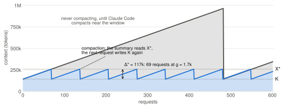

# When to compact

In a Claude Code session, every model request reads the whole conversation
from the prompt cache, so a long context makes every request dearer. A
compaction replaces the conversation with a summary. It costs a summary and a
rewrite of the shorter context to the cache, and makes every later request
cheaper. This page models that trade, fits the model to the author's sessions,
and gives the context size at which to compact.

For the author's sessions on Opus 5.5 with a one-hour cache, the model says to
compact when the context reaches about **260k tokens**. In plain numbers: a
compaction costs about as much as reading 4.8M cached tokens, $0.95; it leaves
about 142k; each later request reads the difference less; and the context
grows back about 1.7k tokens a request.

| compacting at | each later request reads | pays for itself after | context grows back in |
| ------------- | ------------------------ | --------------------- | --------------------- |
| 200k          | 58k less                 | 71 requests           | 34 requests           |
| 260k          | 118k less                | 35 requests           | 69 requests           |
| 400k          | 258k less                | 16 requests           | 151 requests          |
| 700k          | 558k less                | 8 requests            | 327 requests          |

Compacting costs least where a compaction pays for itself in about half the
time the context takes to grow back. At 200k it hasn't paid by the time the
context is back; at 400k it paid for itself long before.

A turn is everything Claude does between the user's message and its reply: a
run of model requests, typically one per tool call. A compaction inside a turn
would interrupt work in progress, so sparkjoy, like a person typing
`/compact`, compacts only at the end of a turn. Turns are uneven, a median 9
requests and a mean 38, so a policy limited to turn ends does best compacting
earlier, from about **200k**: 30.2% less than never compacting, where every
turn end past 400k, sparkjoy's current floor, saves 25.1%. Compacting idle
sessions as well, from about 175k, raises the best turn-end threshold to 250k
and the saving to 30.9%. The answer depends on how context size changes what
each request gets done, which the model carries as a coefficient α. Across the
range 0.8 to 1.2 it moves little:

| α   | best point, compacting after any request | best threshold at turn ends | saved there | saved at 400k |
| --- | ---------------------------------------- | --------------------------- | ----------- | ------------- |
| 0.8 | 243k (235–252k)                          | 200k (190–210k)             | 36.1%       | 29.5%         |
| 0.9 | 250k (243–259k)                          | 200k (190–220k)             | 33.3%       | 27.4%         |
| 1.0 | 259k (251–269k)                          | 200k (200–240k)             | 30.2%       | 25.1%         |
| 1.1 | 271k (262–281k)                          | 240k (200–250k)             | 27.0%       | 22.6%         |
| 1.2 | 285k (276–296k)                          | 240k (210–250k)             | 23.7%       | 20.0%         |

The second column is the steady-state model's optimum, derived below. The
third comes from replaying the sessions with compaction only at turn ends.
"Saved" is the cost per unit of progress against never compacting, where Claude
Code still compacts near the end of the window. Ranges are 90% intervals from
resampling the 85 sessions; for the replay, the resampling holds the fitted
compaction parameters fixed.

## The model

### Units

Costs are counted in cached reads, the price of reading one token from the
prompt cache. Every other kind of token is a multiple of it
([pricing](https://platform.claude.com/docs/en/about-claude/pricing),
November 2026):

| one token of           | symbol | Opus 5.5, Sonnet 5.5 | Fable 5.2 |
| ---------------------- | ------ | -------------------- | --------- |
| cache read             |        | 1                    | 1         |
| uncached input         | u      | 20                   | 40        |
| output                 | o      | 100                  | 200       |
| cache write, 5 minutes | w      | 25                   | 50        |
| cache write, 1 hour    | w      | 40                   | 80        |

A cached read costs $0.20 per million tokens on Opus 5.5 and Fable 5.2, and
$0.10 on Sonnet 5.5. None of the three charges more for long prompts. Claude
Code caches for an hour on a subscription and for five minutes with an API key.

### What a request costs

A request with context x reads the context from the cache, writes the g tokens
added since the request before it, and produces ō output tokens. A share ℓ of
requests find the cache lapsed or invalidated, and write the whole context
again instead, except the system prompt and tools (P tokens), which Claude
Code keeps in a cache shared across sessions:

```math
c(x) = x + (w-1)\big[(1-\ell)\,g + \ell\,(x-P)\big] + o\,\bar{o} + u\,\bar{\imath} \;=\; h\,x + c_0
```

with h = 1 + ℓ(w−1), the cost of holding a token for a request, and
c₀ = oō + uī + (w−1)[(1−ℓ)g − ℓP], the part of a request's cost that doesn't
grow with the context. ī is the uncached input, a couple of tokens.

### What a compaction costs

```math
F(x) = x + o\,S + (w-1)\,(K - P)
```

- The summary request reads the context x from the cache and writes a summary
  of S output tokens.
- The context then restarts from K tokens, in three parts:
  - P, the system prompt and tools (30k), which sit in a cache shared across
    sessions, so a compaction never rewrites them;
  - the rest of the first request after the compaction (92k): instructions,
    the summary, and the recent messages and files Claude Code attaches again;
  - E, the files and output the requests after it read again because the
    summary left them out (20k).

  The last two are written to the cache again, K − P tokens in all. The model
  needs only K and P, not how the rest splits.

F₀ = oS + (w−1)(K − P) is the part of F that doesn't depend on x.

### Progress and the context efficiency coefficient

The size of the context can change how much a request gets done. A larger
context can help, because more of the work's history is at hand, or hurt,
because models attend less reliably over long inputs. The model has a request
with context x do

```math
\eta(x) = (x/W)^{\alpha - 1}
```

units of progress, where W is the 1M-token window and α is the context efficiency
coefficient. At α = 1 every request makes the same progress, whatever its context.
Below 1 smaller contexts do more, and above 1 larger ones do. At α = 0.9 a
request with 200k of context does 15% more than one with 800k; at α = 1.2 it
does 24% less. Only ratios of η enter the results, so the choice of W drops
out.

### The best compaction point

Suppose a session compacts each time its context reaches X. Its context grows
from K to X at g tokens per request, then starts again. By the renewal-reward
theorem ([Ross](https://shop.elsevier.com/books/introduction-to-probability-models/ross/978-0-443-18761-2),
ch. 7), its long-run cost per unit of progress is one cycle's cost over one
cycle's progress:

```math
J(X) = \frac{g\,F(X) + \int_{K}^{X} c(x)\,dx}{\int_{K}^{X} \eta(x)\,dx}
```

Setting dJ/dX to zero gives the condition for the best point X\*:

```math
\frac{c(X^*) + g}{\eta(X^*)} = J(X^*)
```

Compact when the next request's cost per unit of progress reaches the average over
the cycle, compaction included. (The g is the next request's growth, which the
summary would also read.) It is the rule for replacing a machine whose running
cost rises with age: replace it when its marginal cost reaches its average
cost ([Kletke 1969](https://ageconsearch.umn.edu/record/29853/files/01010045.pdf)).

At α = 1 the condition solves in closed form:

```math
X^* = K + \sqrt{\frac{2\,g\,(F_0 + K)}{h}}
```

This is Harris's
[economic order quantity](https://doi.org/10.1287/opre.38.6.947) (1913): the
context is stock that costs h cached reads per token per request to hold, and a
compaction is an order with fixed cost F₀ + K. Two properties follow.

- At X\*, a compaction pays for itself in about half the requests the context
  takes to grow back to X\*, as the table at the top shows. The yardstick for
  payback is the regrowth time, not the length of a turn.
- Cost is flat near X\*. Compacting at twice the optimal growth X\* − K, near
  380k here, raises the part of the cost that depends on X by 25%, which is 8%
  of a request's whole cost.

For α ≠ 1, `model/fit.py` solves the condition numerically. There c₀ matters:
output and new tokens cost the same per request at any context, but a request's
progress doesn't, so they weigh on the choice only when α ≠ 1.

<picture>
  <source media="(prefers-color-scheme: dark)" srcset="../assets/model-sawtooth-dark.svg">
  
</picture>

<picture>
  <source media="(prefers-color-scheme: dark)" srcset="../assets/model-cost-dark.svg">
  
</picture>

The cost against the compaction point, for α from 0.8 to 2. It climbs
steeply toward K, where compactions come every few requests, and flattens
around X\*. Above α ≈ 1.8 no compaction short of Claude Code's own pays, so
the α = 2 curve has no minimum. These savings are larger than the replay's below because the
steady state's never-compacting arm climbs to 965k in every cycle, where real
sessions end before many cycles.

## Fitted parameters

From the author's 85 interactive sessions of more than one request, 7 to 15
November 2026, 36,249 main-thread requests, priced at Opus 5.5 with the
one-hour cache the sessions used:

| parameter                               | value                    | 90% interval | how                                                                                |
| --------------------------------------- | ------------------------ | ------------ | ---------------------------------------------------------------------------------- |
| first request after a compaction        | 122k                     | 120–125k     | median over 135 compactions                                                        |
| P, system prompt and tools, in the cache shared across sessions | 30k | 30–31k | that request's cache reads                                                  |
| E, tokens read again after a compaction | 20k                      | 15–26k       | growth over the first 20 requests of a turn after a compaction, minus the same after another turn |
| g, growth per request                   | 1,706                    | 1,615–1,805  | mean, leaving out the 20 requests after each compaction                            |
| ō, output per request                   | 746                      | 699–792      | mean                                                                               |
| ℓ, requests that rewrite the context    | 0.56%                    | 0.51–0.63%   | 18% of turn ends are followed by a gap of over an hour                             |
| S, summary output                       | 4,000                    | 3,300–8,000  | the summary's text is a median 3,300 (chars/4); its thinking isn't logged, and the pass's median 58 s at this account's output speed allows up to about 8,000 |
| K, context a compaction leaves; h, c₀, F₀ | 142k; 1.22, 134k, 4.77M |            | derived: K is the first request plus E; F₀ is $0.95                                |

At α = 1, X\* is 260k by the closed form above (259k on the script's 1k grid).
Without E it would be 229k; without the lapses in h, 272k; with S at 8,000,
264k. E likely leans high, since the turns after a compaction more
often start new work, which reads more files anyway.

Two measurements bear on what the model assumes:

- **Re-reading.** Over the 20 requests after a compaction, whatever turns they
  fall in, 0.24 more requests read a file that had been read before the
  compaction than, after an ordinary turn end, read a file read earlier in the
  context (90%: 0.04 to 0.50). Claude Code attaches the files a session used
  last, which may be why the excess is small.
- **Growth.** g falls from 2.3k tokens per request at 100–200k to 1.5k at
  400–500k, where the model takes it as constant. The replay below uses each
  request's own growth.

## Results

### α moves the point little

<picture>
  <source media="(prefers-color-scheme: dark)" srcset="../assets/model-threshold-dark.svg">
  
</picture>

Across α from 0.8 to 1.2 the best point moves from 243k to 285k. Reading cost
grows in proportion to the context, and progress per request only as x^(α−1), so a
coefficient near 1 barely shifts the balance. For the point to reach 400k, α
has to be 1.55, where a request at 800k makes about twice the progress of one at
200k. In the steady state, compacting before Claude Code does never pays above
α = 1.82; the replay still finds a fraction of a percent to save at 850k–930k.

The range 0.8 to 1.2 was an assumption; "Calibrating α" below measures 1.06
(0.82–1.27) from what happens in the sessions. Long-context
retrieval benchmarks give a sense of scale: if progress tracked their scores, α
would sit just under 1. Anthropic's system cards report MRCR v2 (8 needles)
for [Opus 4.6](https://anthropic.com/claude-opus-4-6-system-card) falling from
91.9 at 256k to 78.3 at 1M, which is α ≈ 0.88, and GraphWalks BFS for
[Opus 4.8](https://anthropic.com/claude-opus-4-8-system-card) falling from
85.9 to 68.1, α ≈ 0.83. Retrieval measures much less than getting work done.

### Turn ends lower the threshold

A turn runs a median of 9 requests but a mean of 38, because a few run to
hundreds, so one turn can carry the context far past X\* before the next
chance to compact. The best threshold at turn ends therefore sits below X\*.

The replay measures how far. It keeps every logged request, with its growth,
output and timing, and moves only the compactions: those sparkjoy or Claude
Code's auto-compaction made are removed, those the user typed stay, and each
arm compacts by its own rule. It charges E at once at each compaction an arm
makes, and takes E out of the growth of the requests after each one it
removes. Compacting after any request, the replay's best point is 260k, beside
the steady state's 259k: uneven growth, real lapses and sessions ending
together move the optimum little, though they may offset one another.
Compacting only at turn ends moves it to 200k.

At α = 1, any threshold from 170k to 280k comes within one percentage point of
the best. A threshold of 400k costs 7% more per unit of progress than the best,
and 600k costs 24% more.

Compacting too early can't run away at turn ends. Under K, every turn end
compacts, and that still costs about a fifth less than never compacting at α = 1,
because a turn grows the context by 68k on average. In the steady state, where
a compaction could follow any request, compacting at 150k would cost 3.2 times
as much per unit of progress as compacting at X\*: a compaction every four
requests or so.

### Lost detail

The model prices a compaction in tokens. Its other cost is work the summary no
longer supports: a mistake, a correction from the user, a step re-run. If that
costs D cached reads on average, D adds to F₀, and X\* − K grows with
√(F₀ + K + D). At α = 1, X\* reaches 400k when D is 18.8M cached reads, $3.75
at Opus 5.5 prices: 3.6 times the compaction's own cost at 400k, or the price
of writing 481k tokens again, about 24 times the E measured. LangWatch's
author [found](https://langwatch.ai/blog/context-tax-when-to-compact) that in
their sessions, 42% of their messages in the five steps after a compaction
carried a correction, matched by phrase, against 18% otherwise. In these
sessions, "Calibrating α" below finds D near zero where it could be measured.

D varies from one turn end to the next, which a threshold can't see.
sparkjoy's question asks the session's model whether the next turns will need
detail a summary drops; in the model's terms, it estimates D for the moment at
hand.

### Idle sessions

When a session sits idle until its cache lapses, the next request writes the
whole context again, compacted or not. Keeping costs that request
P + w(x − P). Compacting first, while the cache still holds the context, costs
the summary, x + oS, and then P + w(K − P). Compacting is cheaper when

```math
x > \frac{o\,S + w\,K}{w - 1} \approx 156\text{k}
```

counting the next request alone; the cheaper requests after it only add to the
saving. sparkjoy asks once a session has sat 55 minutes since its last reply
without a new message. The replay runs that timer from each reply to the next
message, and takes a session's last reply to be followed by such a wait.
Replayed at α = 1, with every policy compacting wherever it allows:

| policy                                                   | saved |
| -------------------------------------------------------- | ----- |
| turn ends from 400k, sparkjoy's current floor            | 25.1% |
| and idle sessions from 200k, its idle floor              | 28.5% |
| turn ends from 200k, the best without idle compaction    | 30.2% |
| turn ends from 250k and idle sessions from 175k, the best pair | 30.9% |

The pairs come from a grid of turn-end thresholds in steps of 50k and idle
thresholds in steps of 25k; every pair of 200k–250k at turn ends and 150k–175k
idle comes within 0.3 points of the best. 18% of turn ends here are followed by
an hour's gap, so idle compaction does much of what a lower turn-end threshold
would: sparkjoy's two floors together save 2.4 points less than the best pair.

### Other prices and cache lifetimes

The same sessions, priced again, at α = 1:

| prices               | cache     | ℓ     | h    | X\*  | best at turn ends | saved | idle break-even |
| -------------------- | --------- | ----- | ---- | ---- | ----------------- | ----- | --------------- |
| Opus 5.5, Sonnet 5.5 | 1 hour    | 0.56% | 1.22 | 259k | 200k              | 30.2% | 156k            |
| Opus 5.5, Sonnet 5.5 | 5 minutes | 2.33% | 1.56 | 226k | 160k              | 37.3% | 165k            |
| Fable 5.2            | 1 hour    | 0.56% | 1.44 | 294k | 250k              | 26.9% | 154k            |
| Fable 5.2            | 5 minutes | 2.33% | 2.14 | 243k | 180k              | 36.7% | 162k            |

A Fable 5.2 cache write costs twice as many cached reads, which raises F₀ and
with it X\*. A five-minute cache lapses after 2.3% of requests, 57% of them at
turn ends, which makes a large context dearer to hold and lowers X\*.

## Calibrating α

Progress isn't logged, but some of what is lost of it is: a tool call that
fails, a lookup repeated while its result is still in the context, a turn the
user corrects or interrupts. `model/calibrate.py` counts these as trouble and
regresses it on the log of the context, with a fixed effect for each session
and markers for the 20 requests and two turns after a compaction. If a share w
of requests is wasted, progress per request is proportional to 1 − w, so
α − 1 = −(dw/d ln x) / (1 − w̄). That assumes a request that goes right makes
the same progress at any context; a gain there would show in none of these
signals. A corrected or interrupted turn counts as wholly wasted. Corrections
are matched by a phrase list in what the user typed; scored blind against 160
hand-labelled turns, it finds half of them, and a third of its matches aren't
corrections, so its slopes are divided by J = sensitivity + specificity − 1 =
0.42, whose own uncertainty the intervals carry.

This page's window has only 207 turns the user answered by typing: α = 0.98
(0.10–1.46). The 60 days to 16 November have 993 sessions, 311,386 requests
and 3,465 answered turns (90% intervals from resampling sessions):

| trouble              | mean  | points per e-fold of context | points after a compaction |
| -------------------- | ----- | ---------------------------- | ------------------------- |
| failed tool call     | 2.8%  | −0.56 (−0.72 to −0.38)       | +1.0 (+0.8 to +1.3)       |
| repeated lookup      | 0.26% | +0.10 (+0.04 to +0.15)       | −0.16 (−0.22 to −0.11)    |
| correction (matches) | 20%   | −1.5 (−7.9 to +5.5)          | −2.2 (−9.8 to +5.7)       |
| interruption         | 0.7%  | +0.04 (−0.61 to +0.64)       | −0.59 (−1.00 to −0.14)    |

Trouble doesn't rise with the context, so **α = 1.06 (0.82–1.27)**: X\* is
265k (244–298k), and the best turn-end threshold 220k, from 200k to 250k across
the interval. A compaction resets the context but not the session's age, so the
two separate; controlling for the age moves α by 0.01. Counting corrections as
wasting none of their turn gives 1.005, and twice their turn 1.16 (0.42–1.95).

**A saturating form**, η ∝ 1 − e^(−x/s), would make a compaction to 142k cost
progress until the context refills. At s = 150k (X\* 325k), requests below
200k would see 25 points more trouble than those at 400k–600k; they see −13
(−37 to +5). The best fit is s near 0, flat above K, and the interval reaches
146k (X\* 322k). The data bound the size of the effect but can't tell the
shapes apart.

**Lost detail.** The trouble after a compaction comes to −2.8 wasted requests
(−19 to +13), D = −$0.16 (−$1.07 to +$0.73). It is lower after sparkjoy's
compactions, which come where a piece of work ends: −34 requests (−85 to +5).
After the user's and Claude Code's it is +6 requests (−3 to +20), $0.35
(−$0.14 to +$1.12). X\* reaches 400k only at D = $3.75, 65 wasted requests; at
$1.12, X\* is 322k and the best turn-end threshold 250k. An estimated 16% of
first turns after a compaction drew a correction, against 23% of others, where
LangWatch found 42% against 18%.

**Where compactions happen.** The sessions do compact much later than the
model says, the user's own `/compact` included:

| compacted by         | 60 days | median context (10th–90th) | this page's window | median |
| -------------------- | ------- | -------------------------- | ------------------ | ------ |
| the user, `/compact` | 664     | 413k (242–625k)            | 14                 | 525k   |
| sparkjoy, from 400k  | 326     | 453k (402–623k)            | 121                | 471k   |
| Claude Code, idle    | 35      | 244k (210–349k)            | 8                  | 243k   |
| Claude Code, at 965k | 4       | 968k                       | 0                  |        |

The outcomes measured give no reason to wait that long. They miss progress
lost without a failure, a lookup or a correction; corrections given on a Leaf
page; harm later than two turns after a compaction; the user's time; and D
where a threshold would compact, since nearly every compaction measured came
where sparkjoy or the user chose. The 35 idle compactions fall at arbitrary
moments but are too few to measure alone. Comparing thresholds in use, a floor
of 250k in some sessions against 400k in others, would measure D where it
matters.

## What it implies for sparkjoy

With α near 1, and D small where it could be measured, the model supports
asking at turn ends from 200k–250k rather than 400k, and in idle sessions from
150k–175k rather than 200k. The question's payback sum misleads when it is set
beside the length of a turn. A compaction is repaid over every request until
the context grows back, (x − K)/g of them, and at a turn end it pays even
before its payback falls to half of that, because the next chance to compact
may be hundreds of requests away. What a threshold can't see, whether the next
turns need detail a summary drops, stays with the question.

## What the model leaves out

- **Which moment it is.** The threshold treats every turn end alike; the lost
  detail D above is what differs between them.
- **sparkjoy's check.** The replay compacts wherever its threshold allows, so
  it stands for a check that always says yes. Each real check costs about one
  request at the current context, and one that keeps saves nothing. The
  README's replay of the plugin as it ran, with its checks and the turn ends
  where it kept, saves 23%.
- **Time.** A compaction takes a median 62 s, which sparkjoy spends while the
  user reads the reply.
- **Subagents,** whose contexts are separate.
- **Subscription limits,** whose weighting of token kinds isn't published. If
  it follows API prices, the answer is the same.
- **Progress beyond α.** The replay keeps every logged request, so each arm
  makes the same progress by construction, and only α lets context size change it.

## Prior work

- **Long contexts degrade.**
  [Lost in the Middle](https://aclanthology.org/2024.tacl-1.9/),
  [RULER](https://arxiv.org/abs/2404.06654),
  [NoLiMa](https://arxiv.org/abs/2502.05167),
  Chroma's [Context Rot](https://www.trychroma.com/research/context-rot), and
  [Du et al.](https://arxiv.org/abs/2510.05381), who find accuracy falls with
  length even when retrieval is perfect. Anthropic's
  [context engineering essay](https://www.anthropic.com/engineering/effective-context-engineering-for-ai-agents)
  treats context as "a finite resource with diminishing marginal returns".
  For agents writing software, though,
  [LoCoBench-Agent](https://arxiv.org/abs/2511.13998) finds "remarkable
  long-context robustness" from 10K to 1M tokens.
- **Compaction against cost.**
  [LangWatch](https://langwatch.ai/research/finding-the-optimal-context-window)
  fit the cost per productive step against the threshold on one engineer's
  sessions, with a rediscovery penalty for each compaction, and found 220k, or
  314k with twice the penalty; it recommends 250k to 450k by task.
  [Relace](https://relace.ai/blog/compact) argues for compacting on a cache
  miss, as for idle sessions above, and
  [exe.dev](https://blog.exe.dev/expensively-quadratic) shows cache reads come
  to dominate a long conversation's cost.
- **Other agents** compact at a fixed share of the window:
  [Codex CLI](https://github.com/openai/codex/blob/83a23c09366d82cd0cb469c64c3e55d04d71c87a/codex-rs/protocol/src/openai_models.rs#L579-L590)
  at 90%,
  [Gemini CLI](https://github.com/google-gemini/gemini-cli/blob/1603e9bab6c0527dfddb3215677a29ebf482e40f/packages/core/src/context/chatCompressionService.ts#L45)
  at 50%, [Amp](https://ampcode.com/news/neo) at 90%, and
  [Claude Code](https://code.claude.com/docs/en/model-config#default-auto-compact-thresholds)
  at about 967k of 1M, or
  [from 200k](https://code.claude.com/docs/en/settings-reference#idlecompaction)
  in a session idle for an hour. The Claude API's
  [server-side compaction](https://platform.claude.com/docs/en/build-with-claude/compaction-threshold)
  defaults to 150k.

## Fitting it to your sessions

```
uv run --script model/fit.py                                                       # the last 14 days
uv run --script model/fit.py --since 2026-11-07T12:00Z --until 2026-11-16T00:00Z   # this page's sessions
uv run --script model/fit.py --model claude-fable-5-2 --ttl 5m                     # other prices and cache
uv run --script model/fit.py --charts assets                                       # redraw the charts
uv run --script model/calibrate.py --since 2026-09-17T00:00Z --until 2026-11-16T00:00Z \
  --costs-since 2026-11-07T12:00Z --costs-until 2026-11-16T00:00Z                  # α, s and D, as above
```

The script reads the main thread of each interactive session in
`~/.claude/projects`, measures the parameters above, resamples sessions for the
intervals, and prints the figures on this page. It opens only transcripts
modified since `--since`, at low priority. A fit needs some compactions in the
window, to measure K and E.
